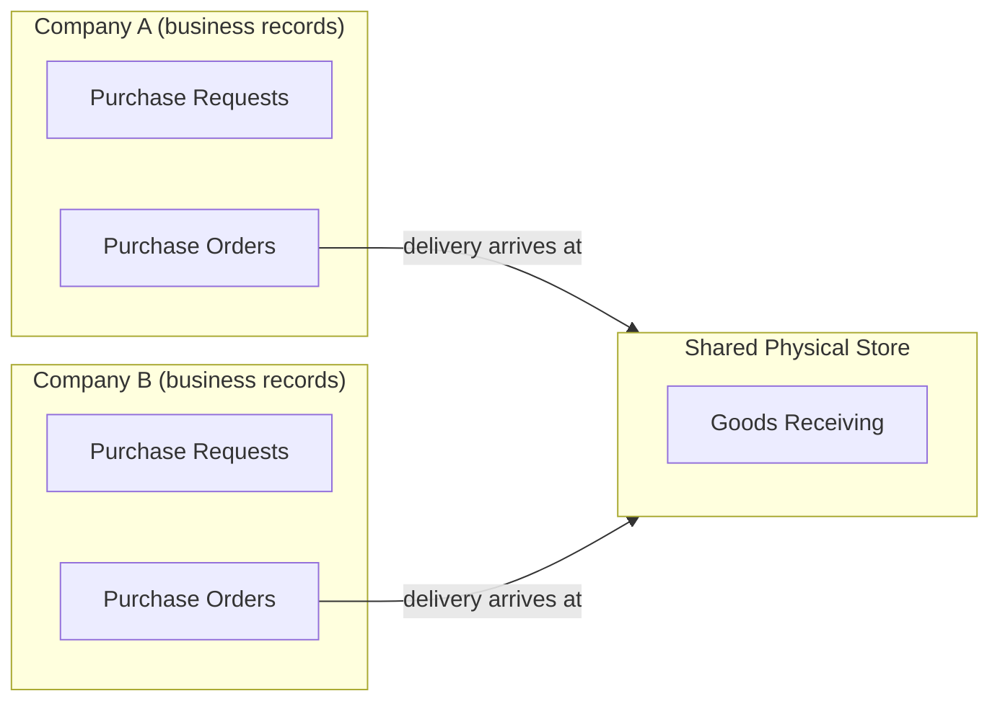
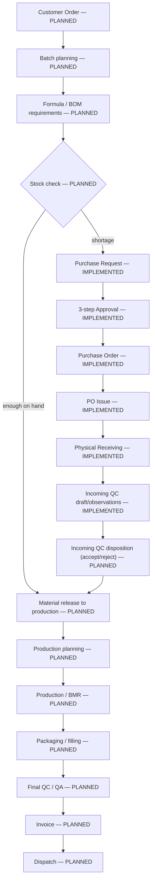
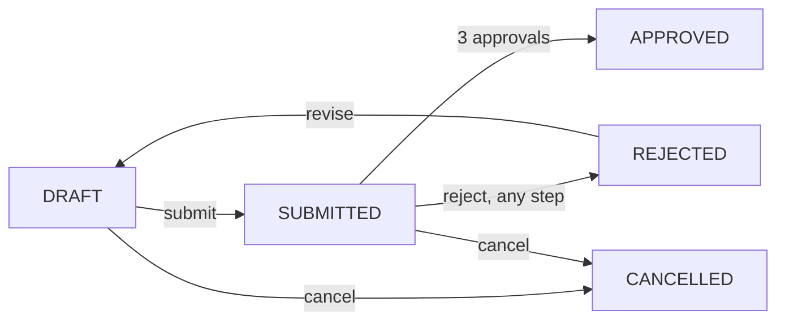
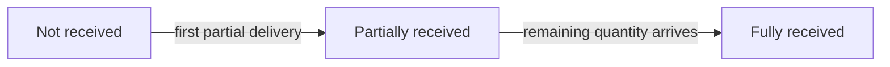
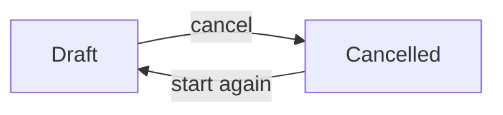

# CMHP ERP — Business Flow (Client Handoff)

Plain-business-English walkthrough of the ERP for two pharmaceutical companies
sharing one physical store. This document explains **what exists today**,
**what is proposed but not yet agreed**, and **what is only a future
direction with no design work started**.

> **Source limitation.** No final, client-approved "user stories /
> requirements" document exists anywhere in this repository as of this
> writing (only `backend/requirements.txt`, which is an unrelated list of
> Python software packages). Everything below is built from the actual
> backend code, its task-by-task build log (`docs/backend-tasks.md`), its
> design-decision log (`docs/backend-decisions.md`), and three internal
> policy proposals (`docs/purchase-workflow-proposal.md`,
> `docs/purchase-order-proposal.md`, `docs/receiving-proposal.md`). Where
> the client has not yet been asked or has not yet answered a question,
> this document says so explicitly instead of guessing.

## Status legend

| Tag | Meaning |
|---|---|
| **CONFIRMED REQUIREMENT** | The client has explicitly agreed to this rule. |
| **PROPOSED POLICY** | The engineering team chose a reasonable starting rule so work could proceed. It is built and working, but the client has not confirmed it is the rule they actually want. |
| **IMPLEMENTED** | Real, working backend code exists and is covered by automated tests. |
| **VERIFICATION PENDING** | Code exists but has not yet been exercised through the actual Postman/manual-click flow (automated tests have run; a human has not clicked through it in a UI). |
| **PLANNED** | A natural future stage of a pharma ERP, mentioned here only to show where today's work fits in the bigger picture. **No backend design, task, or schedule exists for it yet.** This is not a promise or a commitment — it is a placeholder for context only. |
| **CLIENT DECISION REQUIRED** | Work cannot safely proceed past this point in production without the client answering the question. |

---

## 1. Two companies, one shared physical store

**IMPLEMENTED.**

The client operates **two separate pharmaceutical companies**. Each company
has its own business records — its own purchase requests, its own purchase
orders, its own approvals. But physically, both companies **use one shared
warehouse ("store")** to receive and hold material.

**What this means in practice, today:**

- A **Purchase Request** and **Purchase Order** always belong to exactly one
  company — the company that needs the material. **PROPOSED POLICY**, not
  yet client-confirmed: a Purchase Order's company is always fixed to the
  company of the Purchase Request it came from, and cross-company purchasing
  (Company A buying on Company B's behalf) is **not supported** in the
  system today.
- The **shared store** is a physical location, not a company. Anyone
  working there needs to be separately given access to whichever company's
  purchase orders they're allowed to see — access to the store does **not**
  automatically reveal both companies' business (see §5, dual access).
- **CLIENT DECISION REQUIRED**: when material physically sits in the shared
  store, **who legally owns it**? The system deliberately does not answer
  this question anywhere. Recording a delivery at the shared store is a
  physical fact only — it never implies legal ownership, financial
  ownership, or which company's books the stock belongs on.

---

## 2. The full business flow, end to end

The stages below are ordered as a pharmaceutical company would actually
experience them. **Stages 2.2–2.3 below (shortage through receiving, plus
QC *drafting* only) are built and working. Every other stage — including
QC *disposition* itself — is PLANNED only** — shown here purely so the
client can see where today's work sits inside the larger picture.

### 2.1 Customer order → batch → formula requirements → stock check — **PLANNED**

No customer-order, batch, formula/bill-of-materials, or stock-balance
concept exists anywhere in the system today. There is no stock ledger at
all — the system cannot currently answer "how much of material X do we
have on hand," because nothing yet records material leaving the shared
store or being consumed. This entire stage is a future direction only.

### 2.2 Shortage → Purchase Request → Approval → Purchase Order → Physical Receiving — **IMPLEMENTED**

This is the heart of what has been built. Full detail in §3 below.

### 2.3 Incoming QC → material release → production planning — **QC draft-recording IMPLEMENTED; disposition, release and everything after PLANNED**

Physical receiving (§3.5) records that material has **arrived**, in a
purely physical sense — quantity and an optional supplier lot reference.
It does **not** check quality, does **not** decide whether the material may
be used, and does **not** release anything to production. **A "fully
received" delivery is not the same thing as "accepted" or "usable."**

**IMPLEMENTED (policy PROPOSED, not yet client-confirmed):** a QC user can
now open a **draft inspection** against a physically-received delivery
line and log free-text observations against it — a test/parameter name,
an optional method reference, a result, and remarks. This is manual data
entry only. The system does **not** provide, validate against, or imply
any pharmaceutical test specification, numerical limit, or sampling
method — every value a QC user types is exactly that: what they typed,
nothing checked against a standard. There is deliberately **no**
"accepted," "rejected," or "released" outcome anywhere in this draft —
only **Draft** and **Cancelled**. At most one active draft may exist per
received delivery line at a time; a cancelled one may be replaced by a
new one. See §3.6 below and `docs/incoming-qc-proposal.md`.

**PLANNED, not implemented:** the actual QC **decision** — accept,
reject, or place material on hold — who is authorized to make that
decision, whether a second (QA) reviewer must sign off before release,
and the release of material to production itself. None of this exists
yet. A completed inspection draft today is simply a record that
observations were taken; it authorizes nothing.

### 2.4 Production / BMR → packaging / filling → final QC/QA — **PLANNED**

No batch manufacturing record (BMR), no production-line tracking, and no
packaging/filling workflow exists. (The material catalog can label a
material as "packaging material" versus "raw material," but that is only a
classification tag on the material master — it is not a packaging
production process.)

### 2.5 Invoice → dispatch — **PLANNED**

No customer invoicing and no dispatch/shipping tracking exists. (Note: the
*purchasing* side already computes a pre-tax **purchase-order** subtotal —
see §3.4 — but that is money owed to a *supplier*, not a customer invoice.)

### 2.6 Reference books, TQM, reports, Tally integration — **PLANNED (supporting work)**

None of these exist today: no reference/document library, no Total Quality
Management module, no reporting/analytics layer beyond the raw list/search
endpoints described in the frontend handoff, and no accounting/Tally
integration of any kind.

---

## 3. What is actually built: the purchasing-to-receiving flow

*Purchase Request lifecycle — IMPLEMENTED*

### 3.1 Raising a need — Purchase Request — **IMPLEMENTED**

Any authorized person in a company can draft a Purchase Request: what
material, how much, needed by when. While in **DRAFT** it can be freely
edited. Nothing is committed yet — no supplier, no price.

### 3.2 Approval — **IMPLEMENTED (three-step count and single-permission rule CONFIRMED; who exactly may hold that permission is the client's own internal decision)**

Submitting moves the request to **SUBMITTED**, freezing its content. It
then needs **exactly three sequential approvals** — step 1, then step 2,
then step 3 — before it becomes **APPROVED**. This count and the rule that
one single permission decides every step (**CONFIRMED REQUIREMENT** — not
three different named roles like "Store Manager / Purchase Manager /
Director") were agreed with the client. Two firm rules apply at every step:

- **CONFIRMED REQUIREMENT**: the person who created the request can
  **never** approve or reject it — not even a company superuser.
- **PROPOSED POLICY, not yet client-confirmed**: the same approver cannot
  decide two steps of the same round — each step needs a *different*
  eligible person. This is a conservative starting rule chosen by the
  engineering team, not something the client has been asked to confirm.
  **Do not read this as an agreed business rule.**

A rejection at any step sends the request straight to **REJECTED**, with a
reason. See §4.2 for what happens next.

### 3.3 Turning an approved need into a Purchase Order — **IMPLEMENTED (policy PROPOSED, not yet client-confirmed)**

Once a request is **APPROVED**, someone can draft a **Purchase Order**
against it — choosing a supplier, entering prices per line, and a delivery
currency. The order always belongs to the same company as the original
request; it copies the approved quantities exactly (no adding, removing, or
resizing lines at this stage — only price is editable while still a draft).
Only one active order may exist per request at a time.

### 3.4 Issuing the Purchase Order — **IMPLEMENTED (policy PROPOSED, not yet client-confirmed)**

"Issuing" finalizes the order internally — it becomes **ISSUED** and can
never be edited or reopened again. **Issuing is not proof the supplier has
been contacted, has accepted the order, or has shipped anything** — the
system sends no email, PDF, or message to anyone. Today, a single person
holding one permission can issue their own draft — this is deliberately
**not** a second, multi-step sign-off the way the Purchase Request approval
is. Whether that is the right level of control is an open question (§5).
A handful of safety checks run automatically at the moment of issuing:
every line must have a price above zero, the delivery date must not already
be in the past, and the currency must be one of a short, explicitly
verified list (**INR, USD, EUR, GBP** today — not a complete list of world
currencies, just the ones the system's rounding logic has actually been
checked against).

### 3.5 Physical receiving at the shared store — **IMPLEMENTED (policy PROPOSED, not yet client-confirmed)**

When material physically arrives at the shared store, a receiving clerk
records a **Goods Receipt** against the issued Purchase Order: which line,
how much, and (optionally) the supplier's own lot/batch reference. A
delivery can be recorded in parts — e.g. 60 units today, the remaining 40
next week — and each part is tracked separately, including from different
supplier lots.

*Delivery progress per order line — IMPLEMENTED. This tracks physical
arrival only.*

**"Fully received" does not mean "accepted," "usable," "in stock," or
"financially closed."** No stock ledger exists, so nothing is ever counted
as available inventory here. No QC step exists yet to *decide* accept or
reject — see §3.6 for what does exist. This is purely "did the ordered
quantity physically show up."

A receiving clerk needs **two separate kinds of access at once** — active
membership in the shared store with receiving permission, **and** active
membership in the purchase order's own company with permission to view its
purchase orders. Store access alone is deliberately not enough to see a
company's purchase orders (§5).

### 3.6 Recording a QC inspection draft — **IMPLEMENTED (policy PROPOSED, not yet client-confirmed)**

Once a delivery line has been physically received, a QC user can open a
**draft inspection** against that specific line and log observations —
freeform test/parameter entries with an optional method reference, a
result, and remarks. A QC user needs active store access with QC
permission, **and** plain membership (no specific permission required) in
the delivery's own purchasing company — deliberately **not** the same
purchasing-price permission a receiving clerk needs, since a QC inspector
has no business reason to see supplier prices.

*Incoming QC inspection lifecycle — IMPLEMENTED. Draft or Cancelled only —
no accept/reject/release state exists.*

At most one active (non-cancelled) inspection may exist per delivery
line at a time. A draft can be edited freely — observations can be added,
replaced, or cleared — for as long as it stays a draft. **Nothing about
this step decides whether the material is usable.** It is a record that
observations were taken, nothing more.

---

## 4. Exception paths

### 4.1 Material shortage

This is the normal entry point into the flow — a shortage (once stock
checking exists, §2.1) is what triggers a Purchase Request in the first
place. Today, a Purchase Request can also simply be raised directly by a
person who knows material is needed, without an automated stock-check
trigger.

### 4.2 Rejected Purchase Request and resubmission — **IMPLEMENTED**

A rejected request is not a dead end. It can be **revised** (edited again)
and **resubmitted** — but resubmission always restarts approval from step
1, regardless of which step rejected it the first time. Every past round's
approval history (who rejected it, when, and why) is kept permanently, even
after a later round succeeds.

### 4.3 Partial supplier delivery — **IMPLEMENTED**

Covered in §3.5. A supplier can deliver in installments; each is recorded
separately and the system tracks exactly how much of each ordered line has
arrived so far, and how much remains. Over-delivery is currently **rejected
outright** — if the cumulative delivered quantity across every recorded
delivery for a line would exceed what was ordered, the excess post is
refused, even by a very small amount. **PROPOSED POLICY, not confirmed**:
whether real supplier deliveries need some tolerance (e.g. "allow 2% over")
has not been decided.

### 4.4 QC rejection — **PLANNED, not implemented (a draft inspection can be logged and cancelled — see §3.6 — but no accept/reject decision exists)**

No QC *decision* step exists yet, so there is no QC-rejection path to
describe. A QC user can log a draft inspection's observations and, if it
was opened in error, cancel that draft — but cancelling a draft is not a
disposition and has no effect on the material itself. This is flagged
here only because the client's process will eventually need a real
accept/reject decision — today, a delivery that turns out to be unusable
at QC time has no system-level disposition handling at all (it stays
recorded as "fully received" forever, with no way to flag or reverse
that — see §5).

### 4.5 Pending approval / no eligible approver available — **PARTIALLY UNRESOLVED**

If a Purchase Request's approval step is stuck — for example, because the
only remaining eligible approver is the original requester (who is
permanently barred from approving their own request), or because of the
provisional "different approver per step" rule (§3.2) — the request simply
**stays pending indefinitely**. There is no automatic escalation, reminder,
or reassignment. An administrator must resolve it manually, outside the
system, by granting the approval permission to another eligible person.

---

## 5. Do not assume — explicit correctness notes

These are called out because they are easy to misread from the feature
names alone:

- **Do not assume the shared store or a Purchase Order's company implies
  legal ownership of stock.** Neither is ever meant that way anywhere in
  this system (§1, §3.3, §3.5).
- **Do not equate "received quantity" with usable stock.** Physical arrival
  and QC acceptance are two different, currently-separate concepts — only
  the first one, plus a manual observation *draft*, is built (§3.5, §3.6, §4.4).
- **Do not equate a QC inspection draft with a QC decision.** Logging
  observations, or cancelling a draft, is not an accept/reject/release
  decision — no such decision exists in the system today (§3.6, §4.4).
- **Do not present the "different approver per round-step" rule as a
  client-confirmed policy.** It is a conservative engineering default,
  explicitly flagged in the code and documentation as provisional (§3.2).

---

## 6. Where confirmed stops and proposed begins — quick reference

| Decision | Status |
|---|---|
| Exactly three approval steps, one shared permission decides all three | **CONFIRMED REQUIREMENT** |
| Requester can never approve/reject their own request | **CONFIRMED REQUIREMENT** |
| Rejected request restarts approval at step 1 on resubmission | **CONFIRMED REQUIREMENT** |
| Same approver barred from deciding two steps in one round | **PROPOSED POLICY** |
| Purchase Order's company always equals its source request's company; no cross-company purchasing | **PROPOSED POLICY** |
| Legal ownership of shared-store stock | **CLIENT DECISION REQUIRED — unresolved** |
| One person's single permission can issue a Purchase Order (no second sign-off) | **PROPOSED POLICY** |
| No tolerance on over-delivery when receiving | **PROPOSED POLICY** |
| Receiving requires both store access and company access at once | **PROPOSED POLICY** |
| Correcting/reversing a posted delivery record | **CLIENT DECISION REQUIRED — no mechanism exists yet** |
| A QC inspection draft can be logged against a received delivery line | **IMPLEMENTED** |
| QC access requires only bare company membership, not purchasing-price permission | **PROPOSED POLICY** |
| At most one active QC inspection draft per delivery line at a time | **PROPOSED POLICY** |
| Who may decide QC acceptance/rejection, and whether QA sign-off is required | **CLIENT DECISION REQUIRED — no decision mechanism exists yet** |

See `docs/erp-handoff-open-decisions.md` for the full, consolidated list of
open questions (so the client is not asked the same question twice across
documents).
