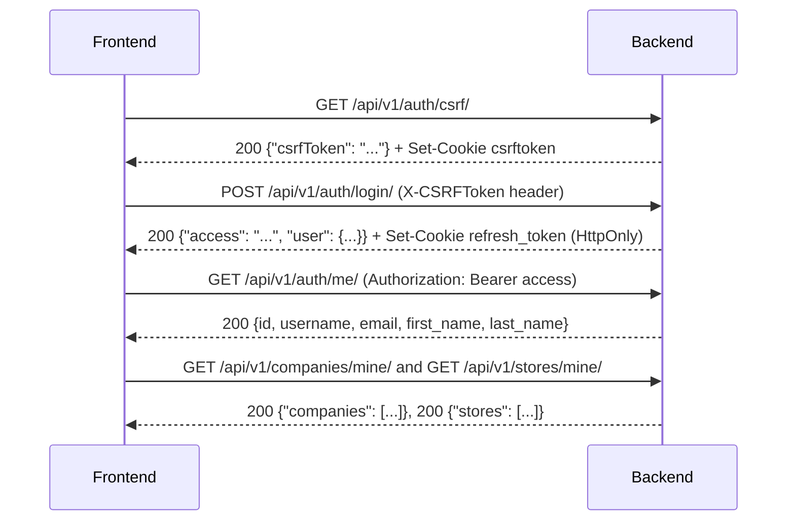

# CMHP ERP — Frontend API Handoff

Code-verified API contract for the frontend team. Every endpoint below was
read directly from `backend/apps/*/urls.py`, `views.py`, `serializers.py`,
`models.py`, and `services.py` as of 2026-09-23, updated through Task
11D (migrations confirmed
applied against the live project database, not just the test database —
see §0.5). Screen IDs reference `docs/erp-screen-catalog.md`.

All examples are synthetic. No real credentials, tokens, or customer data
appear anywhere in this document.

---

## 0. Foundations

### 0.1 Base URL and framework facts

- All endpoints are under `/api/v1/`.
- Django 5.2 + DRF, PostgreSQL only (no SQLite fallback, no in-memory test double in production).
- Default DRF authentication: `JWTAuthentication` (Bearer header), default permission: `IsAuthenticated`.
- No global `DEFAULT_PAGINATION_CLASS` — pagination is opted into **per view**. Some list-shaped endpoints are **not** paginated (§0.6).
- No custom DRF exception handler exists anywhere — every error response is either DRF's stock shape, or one of two custom `APIException` subclasses (`Conflict` 409, `Forbidden` 403 — §0.7).
- No hard `DELETE` exists anywhere in the entire backend. Every lifecycle uses paired `POST .../activate/` / `POST .../deactivate/` actions instead.
- Every management view sets `Cache-Control: no-cache` (`never_cache`) — responses must never be cached by the browser or an intermediate proxy.

### 0.2 CSRF → login → current user → company/store access (session bootstrap sequence)

This is the required bootstrap order for any frontend session:



1. **`GET /api/v1/auth/csrf/`** — public, no auth. Sets the `csrftoken`
   cookie and also returns `{"csrfToken": "<token>"}` in the JSON body (for
   clients that can't read cookies directly). Call this once before any
   POST to `/auth/login/`, `/auth/refresh/`, or `/auth/logout/`.
2. **`POST /api/v1/auth/login/`** — send `X-CSRFToken: <csrfToken>` header.
   Body: `{"username": "...", "password": "..."}`.
3. **`GET /api/v1/auth/me/`** — Bearer-authenticated, confirms the access
   token actually works and returns the display identity.
4. **`GET /api/v1/companies/mine/`** / **`GET /api/v1/stores/mine/`** —
   populate the company/store switcher (NAV-01). A user may have zero of
   either — that is a valid, real state, not an error.

### 0.3 Access-token handling and cookie-based refresh

- **Access token**: returned in the login/refresh JSON body only, **never**
  set as a cookie. Store it in memory (not localStorage, to limit XSS
  exposure) and attach it as `Authorization: Bearer <access>` on every
  authenticated request. Default lifetime: **5 minutes**
  (`JWT_ACCESS_TOKEN_MINUTES`, env-configurable).
- **Refresh token**: HttpOnly cookie only, path-scoped to `/api/v1/auth/`,
  `SameSite=Lax`. The frontend **never reads or sends this value manually**
  — the browser attaches it automatically to requests under that path.
  Default lifetime: **1 day** (`JWT_REFRESH_TOKEN_DAYS`).
- **Refresh is entirely client-driven** — nothing on the backend
  auto-refreshes. The frontend must call `POST /api/v1/auth/refresh/`
  itself, either proactively (e.g. a timer just under 5 minutes) or
  reactively (on a 401 from any protected endpoint). Send the CSRF header
  on this call too (it is a POST). Refresh rotates the refresh token
  (`ROTATE_REFRESH_TOKENS=True`, old one blacklisted) and returns a new
  `{"access": "..."}` — the cookie is re-set automatically by the response.
  The backend also re-checks the user is still active in the database on
  every refresh, not just the token's own signature/expiry.
- **On a failed refresh** (missing cookie, expired, blacklisted, or the
  user has since been deactivated): **401**. The frontend must treat this
  as a full logout — clear in-memory state and return to AUTH-01.

### 0.4 Logout and refresh failure

- **`POST /api/v1/auth/logout/`** — CSRF header required. Blacklists the
  refresh token found in the cookie (safe to call even with a
  missing/expired/already-blacklisted cookie — idempotent) and clears the
  cookie. Returns **204**, empty body.
- **Documented limitation**: logout does **not** revoke any access token
  already handed out — it remains valid in memory/wherever it was cached
  until its own short expiry. There is no server-side access-token
  revocation list. This is an accepted tradeoff of the 5-minute access
  token lifetime, not an oversight to "fix" on the frontend.
- A **401** from any endpoint other than login/refresh means: try one
  silent refresh; if that also fails, force logout to AUTH-01. Do **not**
  loop — one refresh attempt per failed request, never a retry storm.

### 0.5 Verified backend state as of this document

- **Full test suite — HISTORICAL (Task 09A), not a statement about the current code**: at Task 09A `python manage.py test tests -v 1` passed **958 of 958**, exit code 0. **Many modules were added after that (customers, products, quotations, sales orders and confirmation, formulas, seed tests, requirement preview) and no full-suite run exists for the current codebase.** Later tasks were verified with focused, per-module runs recorded in `docs/backend-tasks.md`; their counts are not summed here and no new total is claimed.
- **Migrations**: all 15 purchasing/receiving/permissions migrations (plus every earlier app's migrations) are applied to the live project PostgreSQL database (`cmhp_new_dev`), confirmed via `python manage.py showmigrations` — not just the isolated test database.
- The 958 figure is historical evidence for Task 09A only. Do not read it as verification of today's code; a fresh full run would be needed for that (deliberately not run by documentation tasks).

### 0.6 Pagination and list-response contract

Standard paginated envelope (`BoundedPageNumberPagination`, `apps/common/pagination.py`):

```json
{"count": 137, "next": "http://.../?page=2", "previous": null, "results": [ /* ... */ ]}
```

- Default `page_size` = **20**. Client-adjustable via `?page_size=N`, hard-capped at **100** (a request for more is silently clamped, not rejected).
- **The frontend must never assume a "list everything" call returns the whole set on one page.** The permission catalog (ADM-08) is a concrete example — it now regularly exceeds 20 rows; a screen genuinely needing "all of them" (e.g. a permission picker, ADM-10) should request `?page_size=100`, not rely on the default.
- Most list endpoints support `?search=` (case-insensitive substring on 2–4 relevant text fields) and `?is_active=` (**strict** boolean parse — only `true`/`1`/`false`/`0`; anything else is a 400, not a silent fallback).
- **Four endpoints deliberately return a bare JSON array, not the paginated envelope** — do not wrap these in list-response handling that expects `count`/`results`:
  - `GET /api/v1/users/<id>/memberships/`
  - `GET /api/v1/users/<id>/memberships/<mid>/roles/`
  - `GET /api/v1/stores/<id>/memberships/`
  - `GET /api/v1/stores/<id>/memberships/<mid>/roles/`

### 0.7 Standard error shapes

| Status | Shape | Meaning |
|---|---|---|
| 400 | `{"<field>": ["<message>"], ...}` or `{"detail": "<message>"}` / `{"detail": ["<message>"]}` | Validation failure or business-rule rejection (wrong status for a transition, self-approval attempt, over-receipt, etc.) |
| 401 | `{"detail": "<message>"}` | Missing/invalid/expired access token, or failed refresh |
| 403 | `{"detail": "<message>"}` | Authenticated, but the specific permission is missing (membership-present-but-permission-missing case) |
| 404 | `{"detail": "Not found."}` or a resource-specific message | Resource doesn't exist, **or** the caller has no membership/access to it at all — these two cases are deliberately indistinguishable everywhere in this API (§0.8) |
| 409 | `{"detail": "<message>"}` | Optimistic-concurrency conflict — stale `expected_version`, a moved-on approval round/step, or (goods receipts only) an idempotency-key content mismatch |
| 429 | Standard DRF throttle body | Login rate limit exceeded (`5/min` per IP by default) |

### 0.8 No company/store authorization inferred from frontend selection

**Critical design rule the frontend must respect**: selecting a company or
store in the UI (NAV-01) is purely a **display convenience** — it is never
sent to the backend as a security boundary, and the backend never trusts
it as one. Every single request is independently re-authorized server-side
against the *actual* company/store IDs in the URL path, using the caller's
real membership and permissions at request time. A stale or manipulated
`company_id` in a frontend URL cannot grant access to anything the backend
wouldn't already allow.

The consistent convention (**"fold into 404"**) across every app:
nonexistent resource, inactive resource, or **no active membership at
all** → **404**. Active membership present but the *specific* permission
is missing → **403**. This is deliberate — it prevents a caller from even
learning that a company/store/record exists if they can't see it. The one
documented exception is **goods receiving's company-axis check**, which
folds to 404 unconditionally on that axis (no 403 path at all there) — see
§5.4.

---

## 1. Users (superuser-only) — screens ADM-01–04

| Method | Path | Screen | Auth |
|---|---|---|---|
| GET | `/api/v1/users/` | ADM-01 | Superuser |
| POST | `/api/v1/users/` | ADM-02 | Superuser |
| GET | `/api/v1/users/<id>/` | ADM-03 | Superuser |
| PATCH | `/api/v1/users/<id>/` | ADM-03 | Superuser |
| POST | `/api/v1/users/<id>/activate/` | ADM-03 | Superuser |
| POST | `/api/v1/users/<id>/deactivate/` | ADM-03 | Superuser |
| GET / POST | `/api/v1/users/<id>/memberships/` | ADM-04 | Superuser |
| POST | `/api/v1/users/<id>/memberships/<mid>/deactivate/` | ADM-04 | Superuser |
| GET / POST | `/api/v1/users/<id>/memberships/<mid>/roles/` | ADM-04 | Superuser |
| POST | `/api/v1/users/<id>/memberships/<mid>/roles/<aid>/deactivate/` | ADM-04 | Superuser |

**Create request** (`POST /api/v1/users/`):
```json
{"username": "jdoe", "email": "jdoe@example.com", "first_name": "Jane", "last_name": "Doe", "initial_password": "a-strong-pass-1"}
```
Rejected (400) if the body contains `is_staff`, `is_superuser`, `is_active`, `groups`, `user_permissions`, or `password` — these must never be exposed on this form.

**Representative response** (`GET /api/v1/users/<id>/`):
```json
{"id": 12, "username": "jdoe", "email": "jdoe@example.com", "first_name": "Jane", "last_name": "Doe", "is_active": true, "is_staff": false, "is_superuser": false, "date_joined": "2026-01-10T09:00:00Z", "updated_at": "2026-01-10T09:00:00Z", "memberships_url": "/api/v1/users/12/memberships/"}
```

**Filters**: `?search=` (username/email/first/last name), `?is_active=`, `?ordering=` — allowlisted to `username`/`-username`/`date_joined`/`-date_joined`/`email`/`-email` only (400 on anything else).

**Deactivate**: rejects a superuser target (403) and self-deactivation (400). No `version`/`expected_version` field exists on `User` — no conflict handling needed here.

**Refresh after success**: re-fetch ADM-01's list row (or the ADM-03 detail) — no other screen depends on user identity data.

---

## 2. Companies — screens ADM-05–07, NAV-01–02

| Method | Path | Screen | Auth |
|---|---|---|---|
| GET | `/api/v1/companies/mine/` | NAV-01 | Any authenticated user |
| GET | `/api/v1/companies/<id>/my-permissions/` | NAV-02 | Any authenticated user (own membership only) |
| GET | `/api/v1/companies/` | ADM-05 | Superuser |
| POST | `/api/v1/companies/` | ADM-05 | Superuser |
| GET / PATCH | `/api/v1/companies/<id>/` | ADM-07 | Superuser |
| POST | `/api/v1/companies/<id>/activate/` `.../deactivate/` | ADM-07 | Superuser |

**`GET /api/v1/companies/mine/`** response:
```json
{"companies": [{"id": 3, "code": "CMHP-A", "legal_name": "CMHP Pharma A Pvt Ltd", "display_name": "Company A"}]}
```

**`GET /api/v1/companies/<id>/my-permissions/`** response:
```json
{"company_id": 3, "permissions": ["purchase_requests.view", "purchase_requests.create"]}
```
A nonexistent company, an inactive company, and no active membership all produce the identical **404** here — no distinction.

**Create** (`POST /api/v1/companies/`): `{"code": "CMHP-B", "legal_name": "...", "display_name": "..."}`. `code` is permanently immutable once created.

---

## 3. Permissions & role management — screens ADM-08–10, ADM-13

| Method | Path | Screen |
|---|---|---|
| GET | `/api/v1/permissions/` | ADM-08 |
| GET / POST | `/api/v1/companies/<id>/roles/` | ADM-09 |
| GET / PATCH | `/api/v1/companies/<id>/roles/<rid>/` | ADM-10 |
| PUT | `/api/v1/companies/<id>/roles/<rid>/permissions/` | ADM-10 |
| POST | `/api/v1/companies/<id>/roles/<rid>/activate/` `.../deactivate/` | ADM-10 |
| GET | `/api/v1/stores/<id>/my-permissions/` | NAV-02 |
| GET / POST | `/api/v1/stores/<id>/roles/...` (mirrors company roles) | ADM-13 |

**Permission catalog filters**: `?search=`, `?module=`, `?scope=` (`COMPANY`/`STORE`, else 400), `?is_active=`. **Request `?page_size=100` for any "show me everything" use (e.g. a permission picker) — do not rely on the default page size of 20.**

**Replace a role's permissions** (`PUT .../roles/<rid>/permissions/`):
```json
{"permission_codes": ["purchase_requests.view", "purchase_requests.create"]}
```
This is a **full atomic replace**, not additive — omitting a currently-assigned code removes it. Response echoes the role plus the new `permission_codes` list. Rejected (400) if the company or role is inactive.

---

## 4. Shared stores, storage locations & catalog — screens ADM-11–12, ADM-14, CAT-01–04

| Method | Path | Screen |
|---|---|---|
| GET | `/api/v1/stores/mine/` | NAV-01 |
| GET | `/api/v1/stores/<id>/overview/` | NAV-03 |
| GET/POST | `/api/v1/stores/` | ADM-11 (superuser) |
| GET/PATCH | `/api/v1/stores/<id>/` | ADM-12 (superuser) |
| GET/POST | `/api/v1/stores/<id>/memberships/` (+ nested roles) | ADM-14 (superuser, **unpaginated array**) |
| GET/POST | `/api/v1/stores/<id>/locations/` | CAT-04 (read: any active store member with `storage_locations.view`, or superuser; write: superuser) |
| GET/PATCH | `/api/v1/stores/<id>/locations/<lid>/` | CAT-04 |
| GET/POST | `/api/v1/units/` | CAT-01 (read: `shared_catalog.view` in any store, or superuser; write: superuser) |
| GET/POST | `/api/v1/material-categories/` | CAT-02 |
| GET/POST | `/api/v1/materials/` | CAT-03 |

**Materials filters**: `?search=`, `?is_active=`, `?kind=` (`RAW_MATERIAL`/`PACKAGING_MATERIAL`), `?category=<int>`, `?base_unit=<int>` (strict integer, 400 on non-integer).

**Representative Material response**:
```json
{"id": 44, "code": "PARA-500", "name": "Paracetamol 500mg (bulk)", "description": "", "kind": "RAW_MATERIAL", "category_id": 2, "category_code": "APIS", "base_unit_id": 1, "base_unit_code": "KG", "is_active": true, "created_at": "...", "updated_at": "..."}
```

None of these models carry `quantity`/`stock`/`company_id`/`owner` — sending any of those fields to a create/update endpoint here is explicitly rejected (400), confirming no stock-balance concept exists anywhere in the catalog.

---

## 5. Purchase Requests — screens PR-01–05

Base path: `/api/v1/companies/<company_id>/purchase-requests/`. All access requires active company membership with at least `purchase_requests.view`.

### 5.1 Endpoints

| Method | Path | Permission(s) | Idempotent retry? |
|---|---|---|---|
| GET | `.../purchase-requests/` | view | n/a |
| POST | `.../purchase-requests/` | view + create | No idempotency-key mechanism on this resource |
| GET | `.../purchase-requests/<id>/` | view | n/a |
| PATCH | `.../purchase-requests/<id>/` | view + edit | No-op body skips version bump entirely, not an error |
| POST | `.../submit/` | view + submit | **Yes** — same version, already SUBMITTED → 200 unchanged |
| POST | `.../cancel/` | view + (cancel **or** cancel_pending, resolved server-side after locking — see 5.3) | Yes, only if the reason also matches; different reason on a repeat → 409 |
| POST | `.../approve/` | view + approve | **No** — no retry branch; requires exact `expected_round`/`expected_step` match too |
| POST | `.../reject/` | view + approve | **No** — same as approve |
| POST | `.../revise/` | view + edit | Yes, only if already DRAFT **and** `current_round > 0` (i.e. genuinely came from a REJECTED→DRAFT transition, not a never-submitted draft) |

### 5.2 Status machine

`DRAFT →(submit)→ SUBMITTED →(3× approve)→ APPROVED` (terminal) · `SUBMITTED →(reject, any step)→ REJECTED →(revise)→ DRAFT` · `DRAFT/SUBMITTED →(cancel)→ CANCELLED` (terminal). `APPROVED`/`REJECTED`/`CANCELLED` header fields, and line snapshot fields, are frozen at the moment of transition and never change afterward.

### 5.3 Round/step/version handling — the pattern the frontend must implement exactly

Every mutating call carries `expected_version`, read from the value last
fetched by this screen. `approve`/`reject` additionally require
`expected_round` and `expected_step`, also read from the last fetch — the
frontend must **never** hardcode round=1/step=1.

```json
// POST .../approve/
{"expected_version": 4, "expected_round": 2, "expected_step": 1}
```

- Wrong `expected_version` → **409**, refetch the whole request and show the conflict (§8).
- Correct version but the round/step has since moved on (someone else already decided it) → **409** with a distinct message — same refetch-and-show handling.
- Deciding from the wrong status (e.g. approving an already-APPROVED request) → **400**.
- The request's own creator attempting to approve/reject it → **400**, `{"detail": "The requester cannot decide (approve or reject) their own purchase request..."}` — the UI should hide the Approve/Reject buttons entirely for the creator, but the backend enforces this regardless of what the UI shows.
- The same approver attempting to decide a second step of the same round (provisional rule) → **400**, `{"detail": "Provisional policy (not yet confirmed by the client): the same approver cannot decide more than one step within the same approval round..."}` — display this message verbatim; do not reword it into something that sounds like a confirmed rule.
- Cancel is special: the view does a cheap pre-check for either `purchase_requests.cancel` or `purchase_requests.cancel_pending`, but the **authoritative** permission check happens *after* the row is locked, based on whether the request is currently DRAFT (`cancel`) or SUBMITTED (`cancel_pending`) — a **403 `Forbidden`** here is the one place in this whole API where a permission requirement genuinely depends on the record's current state.

### 5.4 Representative full response

```json
{
  "id": 501, "company_id": 3, "company_code": "CMHP-A", "reference": "PR-20260122-a1b2c3d4e5",
  "status": "SUBMITTED", "required_by": "2026-02-01", "notes": "Urgent — low stock",
  "created_by_id": 12, "submitted_by_id": 12, "submitted_at": "2026-01-22T10:00:00Z",
  "cancelled_by_id": null, "cancelled_at": null, "cancellation_reason": "",
  "created_at": "2026-01-20T09:00:00Z", "updated_at": "2026-01-22T10:00:00Z",
  "version": 4, "current_round": 1, "current_step": 2,
  "lines": [
    {"id": 900, "line_number": 1, "material_id": 44, "material_code": "PARA-500", "material_name": "Paracetamol 500mg (bulk)",
     "unit_id": 1, "unit_code": "KG", "unit_name": "Kilogram", "quantity": "50.000", "notes": "",
     "material_code_snapshot": "PARA-500", "material_name_snapshot": "Paracetamol 500mg (bulk)",
     "unit_code_snapshot": "KG", "unit_name_snapshot": "Kilogram"}
  ],
  "approval_rounds": [
    {"id": 30, "round_number": 1, "required_by_snapshot": "2026-02-01", "notes_snapshot": "Urgent — low stock",
     "submitted_by_id": 12, "submitted_at": "2026-01-22T10:00:00Z", "outcome": "PENDING", "closed_at": null,
     "lines": [ /* PurchaseRequestApprovalRoundLine, same shape as line snapshot fields above */ ],
     "decisions": [{"id": 80, "step": 1, "decision": "APPROVED", "actor_id": 20, "decided_at": "2026-01-22T11:00:00Z", "reason": ""}]}
  ]
}
```

**Refresh after success**: re-fetch this same detail response after any mutation — it is the single source of truth for lines, round history, and the current `version`/`current_round`/`current_step` needed for the *next* action.

---

## 6. Purchase Orders — screens PO-01–05

Base path: `/api/v1/companies/<company_id>/purchase-orders/`.

### 6.1 Endpoints

| Method | Path | Permission(s) |
|---|---|---|
| GET | `.../purchase-orders/` | view |
| POST | `.../purchase-orders/` | view + create, **plus** `purchase_requests.view` on the source request |
| GET | `.../purchase-orders/<id>/` | view |
| PATCH | `.../purchase-orders/<id>/` | view + edit |
| POST | `.../cancel/` | view + cancel |
| POST | `.../issue/` | view + issue |

### 6.2 Draft vs Issued behavior

- **DRAFT**: created from an APPROVED Purchase Request. `currency_code` is **required at creation, immutable afterward** (3-letter shape check only — not validated against a real ISO list). Lines are copied verbatim from the request's approved round and cannot be added/removed/resized — **only `unit_price` per line is editable**, and only while DRAFT. Cancelling a DRAFT frees the source request for a brand-new order (the unique constraint only counts non-cancelled orders) — there is no "reopen a cancelled order" action.
- **ISSUED** (`POST .../issue/`, body `{"expected_version": <int>}`): a full server-side revalidation runs inside one transaction before allowing it — source request still APPROVED and same company; every line still matches its approved round; ≥1 line; every material/unit/category/supplier still active; `expected_delivery_date` present and not in the past; `currency_code` in the supported-issue allowlist (`INR`, `USD`, `EUR`, `GBP` — this is *not* a complete ISO 4217 list, only the currencies whose 2-decimal rounding this system has actually verified); every line's `unit_price` strictly greater than zero. **Once ISSUED, the order is permanently terminal** — no edit, cancel, or reopen exists anywhere in this system for an issued order.
- Retry of `issue` at the same version while already ISSUED → 200, unchanged, no re-snapshot.

### 6.3 Representative response (issued order)

```json
{
  "id": 88, "company_id": 3, "company_code": "CMHP-A", "reference": "PO-20260123-f6a7b8c9d0",
  "status": "ISSUED", "source_purchase_request_id": 501, "source_purchase_request_reference": "PR-20260122-a1b2c3d4e5",
  "supplier_id": 9, "supplier_code": "ACME", "expected_delivery_date": "2026-02-10", "notes": "",
  "currency_code": "INR", "created_by_id": 12, "created_at": "2026-01-23T09:00:00Z", "updated_at": "2026-01-23T12:00:00Z",
  "issued_by_id": 12, "issued_at": "2026-01-23T12:00:00Z", "cancelled_by_id": null, "cancelled_at": null,
  "cancellation_reason": "", "version": 2,
  "lines": [{"id": 700, "line_number": 1, "source_round_line_id": 30, "material_id": 44, "material_code": "PARA-500",
    "material_name": "Paracetamol 500mg (bulk)", "unit_id": 1, "unit_code": "KG", "unit_name": "Kilogram",
    "quantity": "50.000", "unit_price": "820.0000", "line_amount": "41000.00",
    "material_code_snapshot": "PARA-500", "material_name_snapshot": "Paracetamol 500mg (bulk)",
    "unit_code_snapshot": "KG", "unit_name_snapshot": "Kilogram"}],
  "subtotal": "41000.00",
  "issue_snapshot": {
    "id": 15, "issued_by_id": 12, "issued_at": "2026-01-23T12:00:00Z",
    "company_code_snapshot": "CMHP-A", "company_legal_name_snapshot": "CMHP Pharma A Pvt Ltd", "company_display_name_snapshot": "Company A",
    "supplier_code_snapshot": "ACME", "supplier_legal_name_snapshot": "Acme Herbs Pvt Ltd", "supplier_display_name_snapshot": "",
    "supplier_contact_name_snapshot": "", "supplier_email_snapshot": "", "supplier_phone_snapshot": "",
    "supplier_address_line_1_snapshot": "", "supplier_address_line_2_snapshot": "", "supplier_city_snapshot": "",
    "supplier_state_region_snapshot": "", "supplier_postal_code_snapshot": "", "supplier_country_code_snapshot": "",
    "currency_code_snapshot": "INR", "subtotal_snapshot": "41000.00", "expected_delivery_date_snapshot": "2026-02-10",
    "notes_snapshot": "", "source_purchase_request_reference_snapshot": "PR-20260122-a1b2c3d4e5",
    "approved_round_number_snapshot": 1, "created_at": "2026-01-23T12:00:00Z",
    "lines": [{"id": 60, "purchase_order_line_id": 700, "line_number": 1, "material_code_snapshot": "PARA-500",
      "material_name_snapshot": "Paracetamol 500mg (bulk)", "unit_code_snapshot": "KG", "unit_name_snapshot": "Kilogram",
      "quantity_snapshot": "50.000", "unit_price_snapshot": "820.0000", "line_amount_snapshot": "41000.00"}]
  }
}
```

`issue_snapshot` is **always present as a key**; its value is `null` for a DRAFT or CANCELLED order.

**Refresh after success**: re-fetch this detail (for `version` and, after issuing, the now-populated `issue_snapshot`); also refresh GR-06's eligible-purchase-orders list if the frontend caches it, since a newly-issued order becomes eligible for receiving immediately.

---

## 7. Goods Receiving — screens GR-01–07

Base path: `/api/v1/stores/<store_id>/goods-receipts/`. **Every** endpoint requires both an active store membership holding the specific `receiving.*` permission, **and** active company membership holding `purchase_orders.view` in the source order's own company.

### 7.1 Endpoints

| Method | Path | Screen |
|---|---|---|
| GET | `.../goods-receipts/` | GR-01 |
| POST | `.../goods-receipts/` | GR-02 |
| GET | `.../goods-receipts/eligible-purchase-orders/` | GR-06 |
| GET | `.../goods-receipts/<id>/` | GR-03 |
| PATCH | `.../goods-receipts/<id>/` | GR-03 |
| POST | `.../post/` | GR-05 |
| POST | `.../cancel/` | GR-07 |

### 7.2 Dual store+company access — exact failure behavior

- No store, inactive store, or no store membership at all → **404** "Store not found."
- Store membership present but missing the specific `receiving.*` permission → **403**, naming the missing code(s).
- Store access OK, but the caller lacks `purchase_orders.view` in the **source order's own company** → **404** on that specific receipt/order — **never 403** on this axis, by deliberate design, so a caller can never learn a receipt/order exists in a company they can't see. This is the one place in the whole API where the "membership-but-missing-permission → 403" rule does **not** apply — the frontend must not assume a 404 on a goods-receipt screen always means "genuinely doesn't exist."

### 7.3 Draft vs Posted behavior

- **DRAFT**: freely editable (full line replace on PATCH, same convention as create). `arrived_at`, `delivery_note_reference`, `notes`, and `lines` (source PO line + received_quantity + optional lot_reference) are all writable. Multiple lines may reference the same source PO line — this is how multiple supplier lots against one ordered line are recorded.
- **POSTED** (`POST .../post/`): locks the source order, rechecks it is still ISSUED, requires ≥1 line and `arrived_at` not in the future, then for **each line** sums every *other* POSTED receipt's quantity against the same PO line — across every store, not just this one — and rejects (400) if the new total would exceed the ordered quantity, even by a fraction. **There is no over-delivery tolerance.** Once POSTED, a receipt (and its lines) is **permanently immutable** — no edit, no cancel, no reversal exists anywhere in this system today (see `docs/erp-handoff-open-decisions.md`).
- **CANCELLED**: only ever reachable from DRAFT, never from POSTED.

### 7.4 `idempotency_key` — the one true create-idempotency mechanism in this codebase

```json
// POST .../goods-receipts/
{"source_purchase_order_id": 88, "arrived_at": "2026-02-10T09:00:00Z",
 "delivery_note_reference": "DN-4471", "idempotency_key": "gr-web-2026-02-10-0001",
 "lines": [{"source_po_line_id": 60, "received_quantity": "60.000", "lot_reference": "LOT-A"}]}
```

- Same `idempotency_key` + **identical** body content on retry → returns the **existing** receipt, still **201** (the view does not distinguish "created now" from "already existed identically" — this is deliberate, treat 201 as "safe, here is your receipt" either way).
- Same `idempotency_key` + **different** content → **409**, `{"detail": "This idempotency_key was already used to create a different goods receipt. Use a new key, or refetch and confirm the existing one."}`.
- This mechanism is **scoped to `GoodsReceipt` create only** — no other resource in this codebase has an equivalent client-retry-safety key. Do not assume the same pattern works on Purchase Request or Purchase Order creation.
- Recommended frontend pattern: generate a fresh UUID as `idempotency_key` once per "Create" form session (not per HTTP attempt), so a network-retry of the same click is safe but a genuinely new receipt gets a new key.

### 7.5 Delivery progress and the eligible-orders lookup

```json
// GET .../goods-receipts/eligible-purchase-orders/
{"count": 1, "next": null, "previous": null, "results": [
  {"id": 88, "reference": "PO-20260123-f6a7b8c9d0", "company_id": 3, "company_code": "CMHP-A",
   "supplier_id": 9, "supplier_code": "ACME", "expected_delivery_date": "2026-02-10",
   "delivery_progress": [{"source_po_line_id": 60, "line_number": 1,
     "material_code_snapshot": "PARA-500", "material_name_snapshot": "Paracetamol 500mg (bulk)",
     "unit_code_snapshot": "KG", "unit_name_snapshot": "Kilogram",
     "ordered_quantity": "50.000", "received_quantity": "0.000", "remaining_quantity": "50.000",
     "delivery_status": "NOT_RECEIVED"}]}
]}
```

**No price, currency, or subtotal field appears anywhere in this response, or anywhere in `GoodsReceiptSerializer`** — confirmed against the serializer source, which carries an explicit docstring stating receiving is a physical-arrival record, never a commercial one. Do not add commercial columns to GR-01/GR-06 — the data genuinely is not there.

`delivery_status` is one of `NOT_RECEIVED` / `PARTIALLY_RECEIVED` / `FULLY_RECEIVED`, computed fresh from POSTED receipts only every time — it is **not** a stored field and carries **no QC or usability meaning**.

---

## 8. Incoming QC Inspections — screens QC-01–05

Base path: `/api/v1/stores/<store_id>/incoming-inspections/`. **Every**
endpoint requires both an active store membership holding the specific
`incoming_qc.*` permission, **and** active company membership — bare
membership only, **no** `purchase_orders.view` required — in the source
receipt line's own company. This is deliberately narrower than Goods
Receiving's own company-axis check (§7.2): a QC user must never need
purchasing-price visibility just to inspect material. There is **no**
accept/reject/release action anywhere in this module — see
`docs/incoming-qc-proposal.md`.

> **Planned extension (not implemented — Task 09B-2 design, corrected by
> Task 09B-3A but still not built):** a `review → decide → retest`
> workflow, adding real accept/partial-accept/reject disposition on top
> of the submission contract below, is proposed in full (new endpoints,
> request/response shapes, permissions) in
> `docs/incoming-qc-review-proposal.md` §5. Nothing in that section
> exists yet — everything below this note, including `submit` (Task
> 09B-3A), is the actual, shipped contract.

### 8.1 Endpoints

| Method | Path | Screen |
|---|---|---|
| GET | `.../incoming-inspections/` | QC-01 |
| POST | `.../incoming-inspections/` | QC-03 |
| GET | `.../incoming-inspections/eligible-receipt-lines/` | QC-04 |
| GET | `.../incoming-inspections/<id>/` | QC-02 |
| PATCH | `.../incoming-inspections/<id>/` | QC-02 |
| POST | `.../<id>/submit/` | QC-02 |
| POST | `.../<id>/cancel/` | QC-05 |

List supports `?status=` (`DRAFT`/`SUBMITTED`/`CANCELLED`), `?receipt=<goods_receipt_id>`, `?material=<material_id>` — all strict-integer/enum validated (400 on a non-matching value), same convention as every other filter in this API.

### 8.2 Lifecycle

`DRAFT → SUBMITTED` (Task 09B-3A) or `DRAFT → CANCELLED` — there is no
fourth status yet. A cancelled draft is permanently read-only; a new
draft may be created against the same receipt line afterward (the
one-active-inspection-per-line rule only counts non-cancelled rows — a
`SUBMITTED` inspection still counts as active, so nothing new may be
created against its receipt line, and it cannot be cancelled to free it
up). At most one active inspection may exist per receipt line at a
time — attempting a second concurrent create against the same line
returns **409**, with a message pointing at the existing one.

**Once `SUBMITTED`, an inspection is permanently frozen** — neither the
header (`inspection_date`/`notes`) nor its `observations` can be edited
through `PATCH` (400, "only a draft ... can be edited"), and it can never
be cancelled (400, "only a draft ... can be cancelled") — both existing
error paths, not new ones, since they already rejected anything that
wasn't `DRAFT`. There is currently **no way back** from `SUBMITTED` — no
correction, no retest, no un-submit. The frontend must treat a
`SUBMITTED` inspection's detail screen (QC-02) as entirely read-only:
hide the Edit/Cancel affordances, don't just disable them.

### 8.3 Create request and observation full-replace contract

```json
// POST .../incoming-inspections/
{"receipt_line_id": 60, "inspection_date": "2026-02-11",
 "notes": "Routine incoming inspection",
 "observations": [
   {"parameter_name": "Appearance", "method_reference": "Visual",
    "result": "Off-white powder, no foreign matter observed"}
 ]}
```

- `receipt_line_id` is the **only** required field; it identifies the
  source `GoodsReceiptLine` and is immutable afterward — sending it again
  on a PATCH is rejected (400).
- `inspection_date` is optional. If supplied, the backend validates it
  server-side against the receipt's own arrival date (cannot predate it)
  and against today (cannot be in the future) — both compared in UTC,
  matching this project's storage/processing timezone convention (see
  the backend README: datetimes are stored/processed in UTC; Asia/Kolkata
  display conversion belongs at the presentation layer only).
- `observations`, on both create and `PATCH`, is a **full replacement**
  list — omitting the key entirely leaves existing observations
  unchanged; sending `[]` clears them; sending any list replaces the
  whole set. Only `parameter_name` is required per row — a draft's
  observations may legitimately be incomplete (a test logged before its
  result is known).
- The source receipt must be `POSTED` — creating against a `DRAFT` or
  `CANCELLED` receipt's line is rejected (400).

### 8.4 Representative response

```json
{
  "id": 5, "reference": "QC-20260211-a1b2c3d4e5", "status": "DRAFT",
  "receipt_line_id": 60, "receipt_id": 12, "receipt_reference": "GR-20260210-f6a7b8c9d0",
  "store_id": 4, "store_code": "MAINWH", "company_id": 3, "company_code": "CMHP-A",
  "material_id": 44, "material_code": "PARA-500", "material_name": "Paracetamol 500mg (bulk)",
  "unit_id": 1, "unit_code": "KG", "unit_name": "Kilogram",
  "material_code_snapshot": "PARA-500", "material_name_snapshot": "Paracetamol 500mg (bulk)",
  "unit_code_snapshot": "KG", "unit_name_snapshot": "Kilogram",
  "lot_reference_snapshot": "LOT-A", "received_quantity_snapshot": "60.000",
  "inspection_date": "2026-02-11", "notes": "Routine incoming inspection",
  "observations": [{"id": 9, "line_number": 1, "parameter_name": "Appearance",
    "method_reference": "Visual", "result": "Off-white powder, no foreign matter observed",
    "result_unit": "", "remarks": ""}],
  "created_by_id": 20, "created_at": "2026-02-11T09:00:00Z", "updated_at": "2026-02-11T09:00:00Z",
  "submitted_by_id": null, "submitted_at": null,
  "cancelled_by_id": null, "cancelled_at": null, "cancellation_reason": "", "version": 1
}
```

**No `unit_price`, `line_amount`, `currency_code`, or any commercial
field appears anywhere in this response** — confirmed against the
serializer source, which carries the same "no commercial data" docstring
promise `GoodsReceiptSerializer` does. `received_quantity_snapshot` is
informational context copied from the source receipt line at creation
time — it is **not** a claim about available or usable stock, and it
never changes after creation regardless of what happens to the source
receipt afterward (the source line is already immutable once its parent
receipt is `POSTED`).

### 8.5 Submit (Task 09B-3A)

```json
// POST .../incoming-inspections/<id>/submit/
{"expected_version": 1}
```

- **Permission**: a dedicated `incoming_qc.submit` (STORE scope) —
  deliberately **not** folded into `incoming_qc.edit`, so a role can grant
  edit access without also granting submit authority, or vice versa.
  Seeded idempotently, granted to nobody automatically — an operator must
  explicitly assign it.
- **Preconditions, enforced server-side**: status must be `DRAFT`; the
  source receipt must still be `POSTED`; at least one observation must
  exist (a completely observation-less draft cannot be submitted — 400,
  `{"detail": "At least one observation is required to submit an
  incoming inspection."}`).
- **Response (200)**: the full inspection detail (§8.4's shape), now with
  `"status": "SUBMITTED"`, `submitted_by_id` and `submitted_at` populated,
  and `version` incremented by 1.
- **Idempotent retry**: calling `submit` again with the **current**
  (post-submit) version on an already-`SUBMITTED` inspection returns 200
  unchanged, no new audit entry — but calling it again with the
  **original, now-stale** version is a normal 409, not a silent no-op.
  Concretely: submit with `expected_version: 1` → 200, `version` becomes
  2; a genuine retry must use `expected_version: 2` to hit the no-op path
  — retrying with `expected_version: 1` again gets 409. Don't assume
  "submit is idempotent" means "safe to blindly retry with the original
  request body" — refetch first, exactly as §15 requires for any 409.
- **Refresh after success**: re-fetch the detail (for the new `version`
  and to confirm `status`); if the frontend caches GR-06/QC-04-style
  eligible-line pickers, no refresh is needed there — a `SUBMITTED`
  inspection was already excluded from "eligible for a new inspection"
  the moment it was created (drafting), not when it was submitted.

**Refresh after success**: re-fetch this detail (for `version`, needed by
every subsequent PATCH/cancel call) and, if the frontend caches QC-04's
eligible-lines list, refresh it too — a newly-created inspection removes
its receipt line from that list until cancelled.

---

## 9. Material Specifications (Task 09B-3B) — screens SPEC-01–03

Base path: `/api/v1/material-specifications/` — **global**, mounted
directly under `/api/v1/`, not under `/stores/` or `/companies/`. No
store or company scoping exists for a specification at all.

**Access is active-superuser-only, both directions** — the same shape
`/api/v1/suppliers/` already uses (§1's Users section, and Suppliers
itself, are the closest precedents): no read exception exists the way
the shared catalog (`/api/v1/materials/` etc.) has one. **Managing a
specification draft here grants no QC/QA operational authority** — it is
entirely separate from `incoming_qc.*` access (§8), and nothing created
here is ever linked to an `IncomingInspection`. Every version created is
permanently `DRAFT` — there is no approval, publication, effective date,
superseding, retirement, or cloning anywhere in this API.

### 9.1 Endpoints

| Method | Path | Purpose |
|---|---|---|
| GET | `/api/v1/material-specifications/` | List, `?search=` (code/name), `?material=<id>` |
| POST | `/api/v1/material-specifications/` | Create specification **and** its empty revision-1 draft version, atomically |
| GET | `/api/v1/material-specifications/<id>/` | Detail, including nested `versions` (each with its own nested `tests`) |
| PATCH | `/api/v1/material-specifications/<id>/` | Edit `name`/`description` only |
| GET | `/api/v1/material-specifications/<id>/versions/` | List this specification's versions |
| POST | `/api/v1/material-specifications/<id>/versions/` | Create a new, empty `DRAFT` version |
| GET | `/api/v1/material-specifications/<id>/versions/<version_id>/` | Version detail, with `tests` |
| PATCH | `/api/v1/material-specifications/<id>/versions/<version_id>/` | Edit `reference_document`/`notes`/`tests` |

### 9.2 Three version-shaped fields — do not conflate any of them

> **Corrected (Task 09B-3B.1).** The original implementation gave
> `MaterialSpecification` no concurrency token at all, on the reasoning
> that it was unversioned shared master-data like `Material`/`Supplier`.
> That was wrong relative to this feature's own requirement that every
> update use `expected_version` — fixed the same session it shipped.
> `MaterialSpecification.PATCH` now requires `expected_version` exactly
> like every other mutation in this API.

This resource carries **three distinct fields, easy to conflate, that
must be kept visually and functionally separate**:

- **`MaterialSpecification.version`** — the optimistic-concurrency token
  for *this row's own* `name`/`description`. `expected_version` on
  `PATCH /api/v1/material-specifications/<id>/` refers to this field.
- **`MaterialSpecification.latest_revision_number`** — a plain counter of
  how many `MaterialSpecificationVersion` children have ever been
  created; **not** a concurrency token, never sent as `expected_version`
  anywhere, and entirely unaffected by metadata edits (editing
  name/description never changes it, and creating a new version never
  changes `MaterialSpecification.version`).
- **`MaterialSpecificationVersion.revision_number`** — the specification's
  sequential draft numbering (1, 2, 3, ...), read-only, this is what a
  user thinks of as "which revision am I looking at."
- **`MaterialSpecificationVersion.version`** — the optimistic-concurrency
  token for *one specific version's own* content
  (`reference_document`/`notes`/`tests`). `expected_version` on
  `PATCH .../versions/<vid>/` refers to this field, never
  `revision_number` and never `MaterialSpecification.version`.

Concretely: editing the specification's name bumps only
`MaterialSpecification.version`. Editing revision 3's notes twice moves
only *that version's own* `version` from 1 to 3. Creating revision 4
bumps only `latest_revision_number`. None of these three operations
affects either of the other two counters — **the frontend must fetch and
send the correct `expected_version` for whichever of the two PATCH
endpoints it is calling; the two are never interchangeable, and a
version number read from one must never be sent as `expected_version` to
the other.**

### 9.3 Create request (atomic, strictly empty first version)

```json
// POST /api/v1/material-specifications/
{"material_id": 44, "code": "SPEC-PARA500",
 "name": "Paracetamol 500mg Incoming Specification",
 "description": "Optional free text"}
```

- `material_id`/`code`/`name` required; `description` optional.
  `material_id` must reference an **active** material (400 if inactive,
  404 if unknown).
- `code` is normalized (trimmed, upper-cased) exactly like
  `Material.code`/`Company.code`, and is immutable after creation.
- A duplicate `code` returns **409** (a genuine identity conflict, not a
  plain 400 — the natural remedy is to search for the existing one, the
  same reasoning used elsewhere in this API for a real collision).
- **`reference_document`/`notes`/`tests` are not accepted at all on this
  endpoint** — the first version is always strictly empty. Add them
  afterward via §9.6's version-edit endpoint.
- Response includes a top-level `version: 1` (the new
  `MaterialSpecification.version` field, Task 09B-3B.1) — save this for
  the metadata-edit call below.

### 9.4 Edit specification metadata (requires `expected_version`)

```json
// PATCH /api/v1/material-specifications/<id>/
{"expected_version": 1, "name": "Updated name", "description": "Updated description"}
```

- `expected_version` is **required** (Task 09B-3B.1 — see §9.2's
  correction note). `name`/`description` are each independently
  optional.
- `material_id`/`code` remain immutable (400 if present in the body at
  all).
- **409** on stale `expected_version` — handle exactly per §15's
  required pattern (refetch, show the conflict, never silently retry).
- A no-op body (every supplied value already matches the current row)
  returns 200 unchanged — `version` does **not** increment and no audit
  entry is written.
- **Refresh after success**: the response's `version` is the new current
  token for the *next* metadata edit — it has no relationship to any
  `MaterialSpecificationVersion.version` value the frontend may also be
  holding for a specific draft revision (§9.2).

### 9.5 Create a new draft version

```json
// POST /api/v1/material-specifications/<id>/versions/
{"reference_document": "DOC-2026-001", "notes": "Second revision"}
```

Both fields optional. Creates a new, empty (`tests: []`) `DRAFT` with
`revision_number` = the specification's highest existing revision + 1.
**No `tests` field here either** — exactly one endpoint ever writes test
rows (§9.6), never two overlapping ones. Multiple `DRAFT` versions may
coexist on one specification at the same time — there is no
"one-active-version" restriction the way `IncomingInspection` has one.
Creating a version never changes `MaterialSpecification.version` (§9.2).

### 9.6 Edit a draft version — full-replace test rows

```json
// PATCH /api/v1/material-specifications/<id>/versions/<version_id>/
{"expected_version": 1, "reference_document": "DOC-2026-001-rev",
 "notes": "Added moisture test",
 "tests": [
   {"parameter_name": "Appearance", "method_reference": "Visual",
    "result_type": "TEXT", "acceptance_criteria": "Off-white powder"},
   {"parameter_name": "Moisture content", "result_type": "NUMERIC",
    "unit_label": "%", "acceptance_criteria": "Client specification pending"}
 ]}
```

- `reference_document`/`notes`/`tests` each independently optional —
  omitted means unchanged; `tests: []` clears all test rows; any
  non-empty `tests` list **fully replaces** the existing set (the same
  full-replace convention `IncomingInspection.observations` and
  `GoodsReceipt.lines` already use — never a partial add/remove-one-row
  API).
- Per test row: `parameter_name` and `result_type` (`NUMERIC` or `TEXT`)
  are required; `method_reference`/`unit_label`/`acceptance_criteria` may
  all be blank — a draft's tests may legitimately be incomplete.
  **`acceptance_criteria` is free descriptive text only** — there is no
  numeric-limit operator, no automatic pass/fail evaluation, and no
  seeded pharmaceutical test catalog anywhere in this API.
- Only a `DRAFT`-status version can be edited (400 otherwise — no
  reachable path produces a non-`DRAFT` version today, but the check
  exists defensively, the same lesson `cancel_incoming_inspection`
  already had to apply once a third status was added there).
- `409` on stale `expected_version` — same handling as §15 below.

### 9.7 Representative specification response

```json
{
  "id": 12, "material_id": 44, "material_code": "PARA-500",
  "material_name": "Paracetamol 500mg (bulk)",
  "code": "SPEC-PARA500", "name": "Paracetamol 500mg Incoming Specification",
  "description": "", "latest_revision_number": 2,
  "versions": [
    {"id": 30, "specification_id": 12, "revision_number": 1, "status": "DRAFT",
     "reference_document": "", "notes": "", "tests": [],
     "created_by_id": 3, "created_at": "2026-02-01T09:00:00Z", "updated_at": "2026-02-01T09:00:00Z", "version": 1},
    {"id": 31, "specification_id": 12, "revision_number": 2, "status": "DRAFT",
     "reference_document": "DOC-2026-001-rev", "notes": "Added moisture test",
     "tests": [
       {"id": 55, "line_number": 1, "parameter_name": "Appearance", "method_reference": "Visual",
        "result_type": "TEXT", "unit_label": "", "acceptance_criteria": "Off-white powder"},
       {"id": 56, "line_number": 2, "parameter_name": "Moisture content", "method_reference": "",
        "result_type": "NUMERIC", "unit_label": "%", "acceptance_criteria": "Client specification pending"}
     ],
     "created_by_id": 3, "created_at": "2026-02-05T09:00:00Z", "updated_at": "2026-02-05T09:20:00Z", "version": 2}
  ],
  "created_by_id": 3, "created_at": "2026-02-01T09:00:00Z", "updated_at": "2026-02-01T09:00:00Z",
  "version": 2
}
```

Note the top-level `"version": 2` (this specification's own metadata
edit count — two `PATCH` calls happened) versus `versions[1].version: 2`
(that specific draft revision's own, unrelated edit count) — both happen
to read `2` in this example by coincidence, not because they are the
same counter (§9.2).

**No `unit_price`/`currency_code`/any commercial field appears anywhere**
— this is shared master-data configuration, the same category as
`/api/v1/materials/`.

**Refresh after success**: re-fetch the specification detail after any
version create/edit (for the new `versions` array and each version's own
`version` field, needed by the next PATCH).

---

## 10. Customers (Task 10A) — screens CUST-01–04

Base path: `/api/v1/companies/<company_id>/customers/` — company-scoped,
mirroring the Purchase Requests/Orders shape (§5–6), **not**
`/api/v1/suppliers/`'s global, superuser-only shape. **Company-scoping
here is this task's working implementation choice, not a confirmed
client policy** — see `docs/erp-handoff-open-decisions.md` §A13.

This is an identity/contact directory only. No quotation, sales order,
invoice, customer portal, GST/PAN, credit limit, payment terms, or
customer-qualification concept exists anywhere in this API.

### 10.1 Endpoints

| Method | Path | Permissions |
|---|---|---|
| GET | `/api/v1/companies/<company_id>/customers/` | `customers.view` |
| POST | `/api/v1/companies/<company_id>/customers/` | `customers.view` + `customers.create` |
| GET | `/api/v1/companies/<company_id>/customers/<id>/` | `customers.view` |
| PATCH | `/api/v1/companies/<company_id>/customers/<id>/` | `customers.view` + `customers.edit` |
| POST | `/api/v1/companies/<company_id>/customers/<id>/activate/` | `customers.view` + `customers.activate` |
| POST | `/api/v1/companies/<company_id>/customers/<id>/deactivate/` | `customers.view` + `customers.deactivate` |

No `DELETE` exists anywhere in this module — deactivate/activate only,
same convention as every other resource in this API (§0.1).

### 10.2 List — search, filter, pagination

`GET /api/v1/companies/<id>/customers/?search=<text>&is_active=<bool>&page=<n>&page_size=<n>`

- `?search=` matches (case-insensitive substring) against `code`,
  `name`, `contact_person`, `email`, and `phone` — a single query
  parameter searches all five at once, there is no per-field search
  parameter.
- `?is_active=` is **strict**: only `true`/`1`/`false`/`0` are accepted
  — anything else is a `400`. Omitting it returns both active and
  inactive customers (no default filter is applied).
- Standard pagination (§0.6): 20 per page, `?page_size=` up to 100.
- Default ordering: `code` ascending, then `id` — not user-configurable
  in this task.

### 10.3 Create

```json
// POST /api/v1/companies/42/customers/
{"code": "cust-001", "name": "Rajesh Pharma Distributors",
 "contact_person": "Rajesh Kumar", "email": "rajesh@example.test",
 "phone": "+91 98765 43210",
 "billing_address": "12 MG Road, Pune, MH 411001",
 "shipping_address": "Warehouse 4, Industrial Estate, Pune, MH 411018",
 "notes": "Prefers morning deliveries"}
```

- `code`/`name` required; every other field optional.
- `code` is normalized (trimmed, upper-cased) exactly like
  `Material.code`/`Company.code`/`Supplier.code`, and is **immutable**
  after creation.
- `email`, when supplied, is validated as a well-formed address; when
  omitted, no validation is attempted.
- `phone` is free text — **no country-specific format validation**;
  whatever the caller sends (including any "+" prefix) is stored
  exactly as given.
- `shipping_address` is **never** defaulted from `billing_address` —
  each is independently optional and independently stored.
- `company` is never accepted in the body — it always comes from the
  URL (`400` if `company`/`company_id` is present at all).
- A duplicate `code` **within the same company** returns **409**, not
  400 (same reasoning as `/api/v1/material-specifications/`'s own
  duplicate-code handling, §9.3 — the natural remedy is to search for
  the existing one). **A code already used by a different company
  succeeds** — uniqueness is per-company only.
- Response includes a top-level `"version": 1` — save this for the
  first edit/lifecycle call.

### 10.4 Edit metadata (requires `expected_version`)

```json
// PATCH /api/v1/companies/42/customers/17/
{"expected_version": 1, "name": "Rajesh Pharma Distributors Pvt Ltd",
 "shipping_address": ""}
```

- `expected_version` is **required** (`400` if omitted — no default).
  `name`/`contact_person`/`email`/`phone`/`billing_address`/
  `shipping_address`/`notes` are each independently optional.
- `code`/`company_id` remain immutable (**400** if present in the body
  at all).
- **Omitted vs. empty string**: omitting a field leaves it unchanged;
  sending `""` explicitly clears it (as `shipping_address` does above).
- **409** on stale `expected_version` — handle exactly per §15's
  required pattern (refetch, show the conflict, never silently retry).
- A no-op body (every supplied value already matches the current row,
  **including after whitespace normalization** — e.g. resending the
  same address with different leading/trailing spaces) returns 200
  unchanged: `version` does **not** increment and no audit entry is
  written.
- **Metadata can still be edited while the customer is inactive**, as
  long as the company itself is active — deactivation is not a record
  lock, only a block on future business use (which this task does not
  implement).

### 10.5 Activate / deactivate (both require `expected_version`, no reason field)

```json
// POST /api/v1/companies/42/customers/17/deactivate/
{"expected_version": 2}
```

- Both endpoints take **only** `expected_version` — unlike Purchase
  Order/Request cancellation, there is **no** `cancellation_reason`
  field here.
- Deactivating **never deletes the record or any of its data**, and
  never cascades — there is no `DELETE` endpoint anywhere in this
  module.
- A repeat call at the customer's **current** version, when it is
  already in the requested state, is an idempotent no-op (200,
  unchanged `version`, no new audit entry) — the same retry-safety
  shape as this API's other lifecycle endpoints. A call carrying a
  **stale** version still returns 409 regardless of the target state.
- **409** on stale `expected_version` — same handling as §15.

### 10.6 Representative customer response

```json
{
  "id": 17, "company_id": 42, "company_code": "ACME",
  "code": "CUST-001", "name": "Rajesh Pharma Distributors",
  "contact_person": "Rajesh Kumar", "email": "rajesh@example.test",
  "phone": "+91 98765 43210",
  "billing_address": "12 MG Road, Pune, MH 411001",
  "shipping_address": "Warehouse 4, Industrial Estate, Pune, MH 411018",
  "notes": "Prefers morning deliveries",
  "is_active": true, "version": 1,
  "created_at": "2026-02-10T09:00:00Z", "updated_at": "2026-02-10T09:00:00Z"
}
```

**No GST/PAN/credit-limit/payment-terms field appears anywhere** — this
is an identity/contact record only, the same narrow category
`/api/v1/suppliers/` occupies, just company-scoped instead of shared.

**Refresh after success**: re-fetch (or use the mutation response's own
body) after any create/edit/lifecycle call — the returned `version` is
the token the *next* `expected_version` must carry.

---

## 11. Products (Task 10B) — screens PROD-01–04

Base path: `/api/v1/companies/<company_id>/products/` — company-scoped,
mirroring §10's Customers shape exactly. **Company-scoping here is this
task's working implementation choice, not a confirmed client policy** —
see `docs/erp-handoff-open-decisions.md` §A14.

This is a minimal saleable-product identity record only. No formula/
BOM, dosage/potency/medical-claim field, pack-size calculation, batch
numbering, default price/tax/HSN/GST rule, shelf-life calculation, or
opening-stock/stock-ownership concept exists anywhere in this API.
Creating a product never creates or links a `Material` (`/api/v1/
materials/`, §4) or any inventory record — a saleable product and a
purchasable/stockable material are two entirely separate identities.

### 11.1 Endpoints

| Method | Path | Permissions |
|---|---|---|
| GET | `/api/v1/companies/<company_id>/products/` | `products.view` |
| POST | `/api/v1/companies/<company_id>/products/` | `products.view` + `products.create` |
| GET | `/api/v1/companies/<company_id>/products/<id>/` | `products.view` |
| PATCH | `/api/v1/companies/<company_id>/products/<id>/` | `products.view` + `products.edit` |
| POST | `/api/v1/companies/<company_id>/products/<id>/activate/` | `products.view` + `products.activate` |
| POST | `/api/v1/companies/<company_id>/products/<id>/deactivate/` | `products.view` + `products.deactivate` |

No `DELETE` exists anywhere in this module.

### 11.2 List — search, filter, pagination

`GET /api/v1/companies/<id>/products/?search=<text>&is_active=<bool>&page=<n>&page_size=<n>`

- `?search=` matches (case-insensitive substring) against `code` and
  `name` only — unlike Customers (§10.2), there is no `contact_person`/
  `email`/`phone` to also match.
- `?is_active=` is **strict**: only `true`/`1`/`false`/`0` are accepted
  — anything else is a `400`.
- Standard pagination (§0.6): 20 per page, `?page_size=` up to 100.
- Default ordering: `code` ascending, then `id`.

### 11.3 Create

```json
// POST /api/v1/companies/42/products/
{"code": "prod-001", "name": "Herbal Immunity Tonic 200ml",
 "product_type": "Tablets",
 "description": "OTC herbal tonic, 200ml bottle",
 "sales_uom_id": 7}
```

- `code`/`name`/`sales_uom_id` required; `description`/`product_type` optional.
- `product_type` (Task 12B-1) is **free text, not a fixed choice list** — "Tablets" is the client's one example
  value, not an exhaustive set. Render it as a plain text input, never a hard-coded dropdown, unless/until the
  client supplies an actual controlled list.
- `code` is normalized (trimmed, upper-cased) exactly like every other
  code field in this API, and is **immutable** after creation.
- `sales_uom_id` must reference an existing, **active**
  `UnitOfMeasure` (`/api/v1/units/`, §4) — `404` if unknown, `400`
  ("Sales unit of measure is inactive") if inactive. **`sales_uom` is
  immutable after creation** — there is no unit-conversion feature in
  this API, so a wrong choice at create time cannot be corrected later;
  the frontend should make this consequence clear before submitting
  (PROD-02).
- `company` is never accepted in the body — it always comes from the
  URL (`400` if `company`/`company_id` is present at all).
- A duplicate `code` **within the same company** returns **409**, not
  400 (same reasoning as Customers/Material Specifications). **A code
  already used by a different company succeeds** — uniqueness is
  per-company only.
- Response includes a top-level `"version": 1`.

### 11.4 Edit metadata (requires `expected_version`)

```json
// PATCH /api/v1/companies/42/products/17/
{"expected_version": 1, "name": "Herbal Immunity Tonic 200ml (New Label)",
 "product_type": "Tablets", "description": ""}
```

- `expected_version` is **required**. `name`/`product_type`/`description` are each
  independently optional, and editable at any time (no immutability rule on `product_type`).
- `code`/`company_id`/`sales_uom_id` all remain immutable (**400** if
  any is present in the body at all).
- Omitting a field leaves it unchanged; sending `description`/`product_type` as `""`
  clears it.
- **409** on stale `expected_version` — handle per §15's required
  pattern.
- A no-op body (including a whitespace-only change) returns 200
  unchanged: `version` does **not** increment and no audit entry is
  written.
- **Metadata can still be edited while the product is inactive**, as
  long as the company itself is active.

### 11.5 Activate / deactivate (both require `expected_version`, no reason field)

```json
// POST /api/v1/companies/42/products/17/deactivate/
{"expected_version": 2}
```

- Deactivating **never deletes the record or any of its data**, and
  never cascades. A repeat call at the product's **current** version,
  already in the requested state, is an idempotent no-op.
- **Reactivating is rejected (400, "Sales unit of measure is
  inactive") if the product's `sales_uom` has since become inactive** —
  unlike `Material.base_unit`, a `UnitOfMeasure` referenced by an active
  `Product` is **not** currently protected from deactivation (see
  §11.6), so this can genuinely happen. The unit itself must be
  reactivated first (a separate `/api/v1/units/<id>/activate/` call,
  §4), before the product can be reactivated.
- **409** on stale `expected_version`.

### 11.6 The sales unit can become inactive after the product is created — display it, never hide or replace it

Unlike `Material.base_unit` (where `apps.catalog.services.
deactivate_unit` refuses to deactivate a unit while any active material
still references it), deactivating a `UnitOfMeasure` referenced by an
active `Product`'s `sales_uom` is **not blocked**. This is a documented,
deliberate scope limit of Task 10B, not an oversight — extending
`deactivate_unit` to also check `Product` would have meant modifying an
existing, unrelated app. Consequently, a product's `sales_uom_id` can
end up pointing at a unit that is currently inactive.

Every product response always includes `sales_uom_code`/
`sales_uom_name` (joined from the unit, not just its bare id) **and** a
`sales_uom_is_active` boolean:

```json
{"id": 17, "company_id": 42, "company_code": "ACME",
 "code": "PROD-001", "name": "Herbal Immunity Tonic 200ml",
 "description": "OTC herbal tonic, 200ml bottle",
 "sales_uom_id": 7, "sales_uom_code": "BTL", "sales_uom_name": "Bottle",
 "sales_uom_is_active": false,
 "is_active": true, "version": 1,
 "created_at": "2026-02-10T09:00:00Z", "updated_at": "2026-02-10T09:00:00Z"}
```

The frontend must **always** show `sales_uom_code`/`sales_uom_name`
exactly as returned — never hide the field or substitute a placeholder
— and show a visible "inactive unit" indicator whenever
`sales_uom_is_active` is `false` (PROD-03). This is purely a display/
read concern; it does not block viewing or editing a product's other
metadata.

### 11.7 Representative product response

```json
{
  "id": 17, "company_id": 42, "company_code": "ACME",
  "code": "PROD-001", "name": "Herbal Immunity Tonic 200ml",
  "description": "OTC herbal tonic, 200ml bottle",
  "sales_uom_id": 7, "sales_uom_code": "BTL", "sales_uom_name": "Bottle",
  "sales_uom_is_active": true,
  "is_active": true, "version": 1,
  "created_at": "2026-02-10T09:00:00Z", "updated_at": "2026-02-10T09:00:00Z"
}
```

**No formula/BOM/dosage/pack-size/price/tax/HSN/GST/shelf-life/
stock field appears anywhere** — this is an identity record only.

**Refresh after success**: re-fetch (or use the mutation response's own
body) after any create/edit/lifecycle call — the returned `version` is
the token the *next* `expected_version` must carry.

---

## 12. Quotations (Task 10C) — screens QUOT-01–03

Base path: `/api/v1/companies/<company_id>/quotations/` — company-scoped.
**Drafting only.** There is no approval, sending, acceptance, revision,
sales-order conversion, tax, discount, grand total, PDF or stock effect,
and **no `DELETE` or lifecycle endpoint**. Do not render Send/Approve/
Accept/Convert actions. Company-scoping and the reference format are
provisional working choices (see `docs/erp-handoff-open-decisions.md`
§A15).

### 12.1 Endpoints and permissions

| Method | Path | Permissions |
|---|---|---|
| GET | `/api/v1/companies/<company_id>/quotations/` | `quotations.view` |
| POST | `/api/v1/companies/<company_id>/quotations/` | `quotations.view` + `quotations.create` |
| GET | `/api/v1/companies/<company_id>/quotations/<id>/` | `quotations.view` |
| PATCH | `/api/v1/companies/<company_id>/quotations/<id>/` | `quotations.view` + `quotations.edit` |

### 12.2 Lookup dependencies (selecting data)

Customers: `GET /api/v1/companies/<id>/customers/?is_active=true`
(`customers.view`, §10). Products: `GET /api/v1/companies/<id>/products/
?is_active=true` (`products.view`, §11; each product already includes
`sales_uom_code`/`sales_uom_name`/`sales_uom_is_active`). These need
**view** permissions only — no master-edit permission is required to
select data, and no new lookup endpoint was needed. **Concrete gap to be
aware of**: a role holding `quotations.create`/`edit` but not
`customers.view`/`products.view` can save a draft (the server validates
ids itself) but cannot populate the pickers; grant the view permissions
alongside.

### 12.3 List

`GET .../quotations/?search=&customer=&quotation_date_from=&quotation_date_to=&page=&page_size=`

- `search`: case-insensitive substring of `reference` **or** customer name.
- `customer`: integer id (400 otherwise). `quotation_date_from`/`_to`:
  `YYYY-MM-DD`, inclusive (400 on a bad format or from > to).
- Default and only ordering: newest first (`-created_at`, `-id`).
  Standard pagination (§0.6).

### 12.4 Create

```json
// POST /api/v1/companies/42/quotations/
{"customer_id": 17, "quotation_date": "2026-09-24", "valid_until": "2026-10-24",
 "currency": "inr", "notes": "Optional",
 "lines": [
   {"product_id": 5, "quantity": "2", "unit_price": "10.5000", "description": "Optional"}
 ]}
```

- Required: `customer_id`, `quotation_date`, `currency`. Optional:
  `valid_until` (not before `quotation_date`), `notes`, `lines` (omitted
  or `[]` = empty draft). A line's `unit_price` may be `0`.
- `currency`: three letters, normalized to upper case, **immutable after
  creation**. No sum is ever taken across currencies.
- `customer_id` must be an **active** customer of the URL company;
  `product_id` an **active** product of that company whose sales unit is
  **active**. Unknown or other-company ids → 404; inactive → 400.
- `quantity`: > 0, max 3 decimals; a **COUNT** sales unit accepts whole
  numbers only (`"3.000"` ok, `"1.5"` 400). `unit_price`: ≥ 0, max 4
  decimals. Strings are recommended for decimals.
- Rejected with 400 (never ignored): `subtotal`, `total`, `grand_total`,
  `line_amount`, `reference`, `status`, `version`, `company`/`company_id`,
  `line_number`, snapshot fields, audit fields, `id` on a create line and
  any unknown key.
- Response `201` includes `reference` (`QT-YYYYMMDD-XXXXXXXXXX`, a
  technical default, unique per company), `status: "DRAFT"`, `version: 1`.

### 12.5 Edit (requires `expected_version`)

```json
// PATCH /api/v1/companies/42/quotations/9/
{"expected_version": 1, "notes": "Updated", "valid_until": null,
 "customer_id": 18,
 "lines": [
   {"id": 31, "product_id": 5, "quantity": "3", "unit_price": "10.5000"},
   {"product_id": 6, "quantity": "1.250", "unit_price": "0"}
 ]}
```

- Every header key is optional; `valid_until: null` clears it. Changing
  `customer_id` is allowed while DRAFT (new customer must be active and
  same company). `currency`/`company`/`reference`/`status` are never
  editable.
- **`lines` replaces the collection when present** (even `[]`): entries
  with `id` refer to an existing line of this quotation (unknown/foreign
  id → 400; the same id twice → 400); entries without `id` are new;
  existing lines not listed are removed. `line_number` = submitted order.
  Omit `lines` to leave lines untouched.
- **Unchanged inactive references**: a listed existing line whose
  `product_id`, `quantity`, `unit_price` and `description` are all
  unchanged is kept as-is even if its product or sales unit has been
  deactivated, and can always be removed. Any changed value (including
  only the quantity) or a new line requires an active product with an
  active sales unit (400 otherwise).
- **Snapshots**: `product_code`/`product_name`/`sales_uom_code`/
  `sales_uom_name` on a line are captured when the line is created or its
  product is replaced and are not refreshed otherwise; the unit is never
  silently swapped. Live `product_is_active`/`sales_uom_is_active`/
  `customer_is_active` flags are returned so inactive references can be
  badged.
- `409` on a stale `expected_version` (§15). A PATCH that changes nothing
  (including whitespace-only note changes) returns 200 with `version`
  unchanged and writes no audit entry.

### 12.6 Representative response

```json
{"id": 9, "company_id": 42, "reference": "QT-20260924-3F9A1C22BE",
 "customer_id": 17, "customer_code": "CUST-001", "customer_name": "Rajesh Pharma",
 "customer_is_active": true, "quotation_date": "2026-09-24",
 "valid_until": "2026-10-24", "currency": "INR", "notes": "", "status": "DRAFT",
 "lines": [{"id": 31, "line_number": 1, "product_id": 5, "product_code": "PROD-001",
   "product_name": "Herbal Tonic 200ml", "sales_uom_code": "BTL", "sales_uom_name": "Bottle",
   "product_is_active": true, "sales_uom_is_active": true,
   "quantity": "2.000", "unit_price": "10.5000", "description": "", "line_amount": "21.00"}],
 "subtotal": "21.00", "version": 1, "created_by_id": 3,
 "created_at": "2026-09-24T09:00:00Z", "updated_at": "2026-09-24T09:00:00Z"}
```

`line_amount` = `quantity × unit_price` computed with Decimal, rounded to
2 places ROUND_HALF_UP (same rule as purchase orders); `subtotal` is the
pre-tax sum in the quotation's currency. Label it "Subtotal", never
"Total".

---

## 13. Direct Sales Orders (Task 10D) — screens SO-01–03

Base path: `/api/v1/companies/<company_id>/sales-orders/` — company-scoped,
mirroring §12 (Quotations). **A draft authorizes nothing**, and so does a CONFIRMED order (Task 10F): neither authorizes
manufacturing, reserves stock or generates an invoice. The only transition is DRAFT -> CONFIRMED
(§13.7); there is no cancel/unconfirm/amend, no quotation
linkage or conversion, no tax/discount/freight, no production/dispatched/
reserved quantity, and **no `DELETE`**. Render Confirm only as described in §13.6-13.7; never
Manufacture, Reserve, Invoice, Dispatch, Cancel or Convert actions.

### 13.1 Endpoints and permissions

| Method | Path | Permissions |
|---|---|---|
| GET | `/api/v1/companies/<company_id>/sales-orders/` | `sales_orders.view` |
| POST | `/api/v1/companies/<company_id>/sales-orders/` | `sales_orders.view` + `sales_orders.create` |
| GET | `/api/v1/companies/<company_id>/sales-orders/<id>/` | `sales_orders.view` |
| PATCH | `/api/v1/companies/<company_id>/sales-orders/<id>/` | `sales_orders.view` + `sales_orders.edit` (DRAFT only) |
| GET | `/api/v1/companies/<company_id>/sales-orders/<id>/confirmation-preview/` | `sales_orders.view` (§13.6) |
| POST | `/api/v1/companies/<company_id>/sales-orders/<id>/confirm/` | `sales_orders.view` + `sales_orders.confirm` (§13.7) |
| GET/PATCH | `/api/v1/companies/<company_id>/sales-order-confirmation-policy/` | active superuser (§13.8) |

Permissions are seeded and assigned to nobody. The operational role also
needs `customers.view` and `products.view` (§10/§11 list endpoints, used as
the selectors with `?is_active=true`) — view, not edit, permissions.

### 13.2 List

`GET .../sales-orders/?search=&customer=&order_date_from=&order_date_to=&page=&page_size=`
— `search` matches order reference, customer name **or** customer order
reference (case-insensitive substring); `customer` integer id;
`order_date_from`/`_to` inclusive `YYYY-MM-DD` (400 on bad format or
from > to). Always newest first. Standard pagination (§0.6).

### 13.3 Create

```json
// POST /api/v1/companies/42/sales-orders/
{"customer_id": 17, "order_date": "2026-09-24",
 "requested_delivery_date": "2026-10-24", "customer_order_reference": "CUST-PO-001",
 "currency": "INR", "notes": "Optional",
 "lines": [{"product_id": 5, "quantity": "2", "unit_price": "10.5000", "description": "Optional"}]}
```

- Required: `customer_id` (active, same company), `order_date`, `currency`
  (3 letters, upper-cased, **immutable**). Optional: `requested_delivery_date`,
  `customer_order_reference` (free text, **not unique** across orders),
  `notes`, `lines` (omitted/`[]` = empty draft; zero `unit_price` allowed).
- **Working rule for client review**: `requested_delivery_date` cannot
  precede `order_date` (400).
- Lines follow §12.4 exactly: active same-company product with an active
  sales unit (404 unknown/cross-company, 400 inactive); `quantity` > 0
  with max 3 decimals, whole numbers only for COUNT units; `unit_price` ≥ 0
  with max 4 decimals; Decimal amounts rounded to 2 places ROUND_HALF_UP.
- Rejected with 400 (never ignored): `subtotal`/totals, `line_amount`,
  `reference`, `status`, `version`, `company`, `line_number`, snapshots,
  audit fields, `quotation_id`, any stock/production field, `id` on a
  create line, and any unknown key.
- Response: `reference` `SO-YYYYMMDD-XXXXXXXXXX` (**technical default, not
  client-approved numbering**, unique per company), `status: "DRAFT"`,
  `version: 1`, lines with snapshots and live `*_is_active` flags, and a
  pre-tax `subtotal` (no grand total).

### 13.4 Edit (requires `expected_version`)

```json
// PATCH /api/v1/companies/42/sales-orders/9/
{"expected_version": 1, "customer_order_reference": "CUST-PO-002",
 "requested_delivery_date": null,
 "lines": [{"id": 31, "product_id": 5, "quantity": "3", "unit_price": "10.5000"},
           {"product_id": 6, "quantity": "1.250", "unit_price": "0"}]}
```

Semantics are identical to §12.5: omitted `lines` = unchanged; provided
`lines` (even `[]`) is the complete final list — `id` updates, no `id`
creates, missing lines are removed; unknown/foreign/duplicate ids are 400;
`line_number` follows submitted order. New or changed lines need active
references; unchanged lines that reference since-deactivated products/units
are preserved (and can be removed); snapshots are captured only for new
lines or product replacement. `customer_id` may change while DRAFT (new
customer must be active). `currency`/`company`/`reference`/`status` are
never editable. Stale `expected_version` → 409 (§15). A no-op PATCH
(including whitespace-only text changes) returns 200 with the version
unchanged and no audit entry.

**Task 10F additions to the order response (detail/list/create/edit):** `status` may now be
`CONFIRMED`; new read-only fields `confirmed_by_id`, `confirmed_at`, `confirmation_policy_version`
and `confirmation_policy` (all `null` for a draft). A CONFIRMED order rejects every edit (§13.7).

### 13.5 Representative response

```json
{"id": 9, "company_id": 42, "reference": "SO-20260924-3F9A1C22BE",
 "customer_id": 17, "customer_code": "CUST-001", "customer_name": "Rajesh Pharma",
 "customer_is_active": true, "order_date": "2026-09-24",
 "requested_delivery_date": "2026-10-24", "customer_order_reference": "CUST-PO-001",
 "currency": "INR", "notes": "", "status": "DRAFT",
 "lines": [{"id": 31, "line_number": 1, "product_id": 5, "product_code": "PROD-001",
   "product_name": "Herbal Tonic 200ml", "sales_uom_code": "BTL", "sales_uom_name": "Bottle",
   "product_is_active": true, "sales_uom_is_active": true, "quantity": "2.000",
   "unit_price": "10.5000", "description": "", "line_amount": "21.00"}],
 "subtotal": "21.00", "version": 1, "created_by_id": 3,
 "created_at": "2026-09-24T09:00:00Z", "updated_at": "2026-09-24T09:00:00Z"}
```

### 13.6 Order Review / confirmation preview — read-only, informational (contract changed in Task 10F)

`GET /api/v1/companies/<company_id>/sales-orders/<id>/confirmation-preview/`

- Access is exactly order detail: **`sales_orders.view`** only (403 naming it; 404 for
  no membership/other company/unknown order; no superuser bypass). `GET` only (405
  otherwise). Strictly read-only: no status/version change, no audit event, no locks,
  no stock/batch/production effect.
- It calls the **same assessment function as the confirm command**, so the reasons it
  shows are the reasons the command enforces. It is still **informational and can be
  stale immediately**, and it **does not guarantee that a later confirmation will
  succeed**: state can change in between and confirming re-checks everything.
- Keep `order.version` from this response in **frontend state** and send it as
  `expected_version` when confirming; never expose it as an editable field.

```json
{
  "preview": {"informational": true, "generated_at": "2026-09-24T10:00:00+00:00",
              "business_date": "2026-09-24", "notice": "Informational only ..."},
  "order": {"id": 9, "company_id": 42, "reference": "SO-20260924-3F9A1C22BE", "status": "DRAFT",
            "version": 3, "order_date": "2026-09-24", "requested_delivery_date": "2026-09-30",
            "customer_order_reference": "CUST-PO-001", "notes": "", "currency": "INR",
            "confirmed_by_id": null, "confirmed_at": null},
  "customer": {"id": 17, "code": "CUST-001", "name": "Rajesh Pharma", "is_active": true},
  "lines": [{"id": 31, "line_number": 1, "product_id": 5, "product_code": "PROD-001",
             "product_name": "Herbal Tonic 200ml", "sales_uom_code": "BTL", "sales_uom_name": "Bottle",
             "quantity": "12.000", "unit_price": "45.5000", "line_amount": "546.00", "description": "",
             "current": {"product_code": "PROD-001", "product_name": "Herbal Tonic 200ml",
                         "product_is_active": true, "sales_uom_code": "BTL", "sales_uom_name": "Bottle",
                         "sales_uom_is_active": true}}],
  "subtotal": "546.00",
  "confirmation": {
    "workflow_implemented": true,
    "policy": {"status": "CONFIGURED", "version": 2, "allow_self_confirmation": false,
               "allow_zero_price_lines": true, "allow_past_requested_delivery_dates": false},
    "policy_message": null,
    "blocking_reasons": [
      {"code": "INACTIVE_PRODUCT", "category": "ELIGIBILITY", "message": "Product 'PROD-001' is inactive.",
       "line_id": 31, "line_number": 1}],
    "informational_observations": [
      {"code": "MASTER_DATA_CHANGED_SINCE_SNAPSHOT", "message": "...", "line_id": 31, "line_number": 1}],
    "actor_has_confirm_permission": true,
    "ready_to_attempt": false
  }
}
```

**Response-contract changes from Task 10E (the old preview shape is gone):**
`data_validity_observations`, `policy_observations`, `open_policy_questions` and
`confirmation_workflow` were **removed**; `confirmation` replaces them. The
`confirmation_workflow` object (`implemented: false`) is replaced by
`confirmation.workflow_implemented: true`. `order` gained `confirmed_by_id`/
`confirmed_at`; `preview` gained `business_date`. Internal policy questions are no
longer part of the API (they live in `docs/erp-handoff-open-decisions.md`).

**Three separate kinds of findings - show them separately, in plain language:**

| Where | Category / code | Meaning | Suggested UI |
|---|---|---|---|
| `blocking_reasons` | `POLICY_NOT_CONFIGURED` (`CONFIRMATION_POLICY_NOT_CONFIGURED`, `CONFIRMATION_POLICY_INCOMPLETE`) | The company has not set its confirmation rules. `policy_message` = "Confirmation rules are not configured. Contact your administrator." | A single "not configured" state; no Confirm |
| `blocking_reasons` | `ELIGIBILITY` (`ORDER_NOT_DRAFT`, `EMPTY_ORDER`, `INACTIVE_CUSTOMER`, `INACTIVE_PRODUCT`, `INACTIVE_SALES_UOM`, `INVALID_QUANTITY`, `INVALID_MONETARY_VALUE`, `INVALID_CURRENCY`) | Technical implementation safeguards (**to be reviewed with the client**, not confirmed business policy). Line-level ones carry `line_id`/`line_number` | "Needs attention" list linking to the line / edit draft |
| `blocking_reasons` | `POLICY_RULE` (`ZERO_PRICE_LINE`, `REQUESTED_DELIVERY_DATE_PAST`, `SELF_CONFIRMATION_NOT_ALLOWED`) | An explicit company policy value says no. Only evaluated once the policy is fully configured | Same list, plain wording |
| `informational_observations` | `MASTER_DATA_CHANGED_SINCE_SNAPSHOT`, `ZERO_PRICE_LINES_ALLOWED_BY_POLICY`, `PAST_DELIVERY_DATE_ALLOWED_BY_POLICY` | Never blocking | Subtle notes |

`ready_to_attempt` = order is a draft AND the viewer holds `sales_orders.confirm` AND no
blocking reason was found now. It only decides whether to **enable** the Confirm button;
it is not a promise. `policy` shows only the effective values and version (never who
configured them). The past-date check uses the **business date** (`preview.business_date`),
computed in the configured business timezone, not UTC.

### 13.7 Confirm (DRAFT → CONFIRMED)

`POST /api/v1/companies/<company_id>/sales-orders/<id>/confirm/`
body `{"expected_version": <the order.version the user reviewed>}` (nothing else is
accepted; other keys are 400).

- Needs `sales_orders.view` **and** `sales_orders.confirm` - explicit permission
  assignment only; never a role name, `is_staff` or `is_superuser` (a superuser with
  no membership gets 404; with a membership but no permission, 403). The permission
  is seeded and **assigned to nobody**. Access is re-checked inside the transaction.
- Inside one transaction the server locks the order (the same lock draft edits take),
  re-reads the company policy and the customer/products/sales units, re-assesses with the
  preview's function, then sets `status: "CONFIRMED"`, `confirmed_by_id`, `confirmed_at`,
  `confirmation_policy_version` and `confirmation_policy` (the policy values, business
  date/timezone and safeguards applied), increments `version` and writes the audit
  event - or changes nothing.
- `200` -> the full order (detail shape, §13.5) with the new fields.
- **Failure states**
  - `400` policy missing/incomplete: `{"code": "confirmation_policy_not_configured",
    "detail": "Confirmation rules are not configured. Contact your administrator.",
    "blocking_reasons": [{"code": "CONFIRMATION_POLICY_NOT_CONFIGURED", "category":
    "POLICY_NOT_CONFIGURED", ...}]}`
  - `400` other blocks: `{"code": "confirmation_blocked", "detail": "The order cannot be
    confirmed.", "blocking_reasons": [...]}` (same items as the preview; `line_id`/
    `line_number` are integers). Nothing was written.
  - `409` stale `expected_version` (someone edited or confirmed first) -> refetch the
    order and the review, show what changed, never silently retry (§14).
  - `403` missing `sales_orders.view`/`sales_orders.confirm` (names it); `404` no access.
- **Repeat/retry**: confirming again with the **current** version of an already
  CONFIRMED order returns `200` unchanged for a still-authorized user (same `confirmed_at`,
  no new audit event); with an older version it is `409`.
- **After confirmation the order is immutable**: header/line `PATCH` is `400`
  ("Only a draft sales order can be edited") at the current version and `409` at an
  older one. No unconfirm, cancel or amend endpoint exists (404). Masters that are later
  deactivated leave the order readable: snapshots are unchanged and `*_is_active` flags
  simply show the current state. Confirmation reserves no stock, creates no batch/
  invoice/production record and is not linked to any quotation.

**Concurrency guarantee (exact):** confirm and draft-edit serialize on the order row
(one wins, the other gets `409`, never a partial update). While a confirming transaction
is open, the referenced customer, products, sales units and the company policy cannot be
changed or deactivated by another transaction (they wait); a deactivation that committed
earlier is seen and blocks confirmation, one that arrives later applies after
confirmation commits. Lock order is fixed: order -> policy -> customer -> products
(by id) -> units (by id); master-data services lock a single row, so no cycle exists.

### 13.8 Confirmation policy management (active superuser only)

`GET|PATCH /api/v1/companies/<company_id>/sales-order-confirmation-policy/`

- Follows the project's superuser configuration convention (`403` for any non-superuser,
  including operational users; `404` unknown company). Configuring the policy grants **no**
  confirmation authority and no company access.
- Three explicit values, each `true`/`false` or `null` (= unanswered; **never defaulted**):
  `allow_self_confirmation` (compared with `order.created_by`), `allow_zero_price_lines`,
  `allow_past_requested_delivery_dates`. A missing row or any `null` blocks confirmation.
  No company is configured automatically.
- `GET` -> `{"company_id", "status": "NOT_CONFIGURED"|"INCOMPLETE"|"CONFIGURED", "version"
  (0 when none), the three values, "created_by_id", "created_at", "updated_by_id",
  "updated_at"}`.
- `PATCH {"expected_version": 0, "allow_zero_price_lines": false}` creates it (`0` = no row
  yet); later updates send the current `version`. Only supplied values change; values must be
  explicit booleans (`null`/strings are 400); unknown keys are 400; a no-op keeps the version
  and writes no audit entry; stale/duplicate creation -> `409`. Every change is audited with
  before/after and increments `version`; who and when are stored.

**Implementation safeguards (technical eligibility, for client review):** at least one line;
active customer, products and sales units; positive quantities (whole numbers for COUNT
units); valid currency, non-negative unit prices and consistent line amounts. These are
implementation safeguards, **not previously confirmed business policy**.

---

## 14. Manufacturing Formulas (Task 11A) — screens FRM-01–05

Base path: `/api/v1/companies/<company_id>/formulas/` — company-scoped.
**Draft preparation only**: no approval, default-formula selection, batch
creation, requirement generation, reservation, material issue, production,
proportional scaling, unit conversion, percentages, yield or waste. Do not
render Approve/Create Batch/Issue Material. Company scoping and simple
quantity-based drafting are working implementation choices, not
client-approved manufacturing policy (`docs/erp-handoff-open-decisions.md`
§A17). Specification tests (§9) are a separate concept.

### 14.1 Endpoints and permissions

| Method | Path | Permissions |
|---|---|---|
| GET | `/formulas/` | `formulas.view` |
| POST | `/formulas/` | view + `formulas.create` (formula **and** empty revision 1) |
| GET | `/formulas/<id>/` | `formulas.view` |
| PATCH | `/formulas/<id>/` | view + `formulas.edit` (name/notes) |
| GET | `/formulas/<id>/revisions/` | `formulas.view` (summaries, no lines) |
| POST | `/formulas/<id>/revisions/` | view + `formulas.create` (new empty draft) |
| GET | `/formulas/<id>/revisions/<rid>/` | `formulas.view` (with lines) |
| PATCH | `/formulas/<id>/revisions/<rid>/` | view + `formulas.edit` (DRAFT only) |
| GET | `/formulas/<id>/revisions/<rid>/approval-preview/` | view (Task 11C, see 14.8c) |
| POST | `/formulas/<id>/revisions/<rid>/approve/` | view + `formulas.approve` (Task 11C, see 14.8c) |
| GET/PATCH | `/formula-approval-policy/` | active superuser (Task 11C, see 14.8c) |

No `DELETE`, approval or lifecycle endpoint. Permissions are seeded and
assigned to nobody. A revision id under a different formula or company is
404.

### 14.2 Lookup dependencies (verified)

- Products: `GET /api/v1/companies/<id>/products/?is_active=true` —
  `products.view`.
- Materials: the existing shared catalog `GET /api/v1/materials/
  ?is_active=true&kind=RAW_MATERIAL|PACKAGING_MATERIAL` (§4) — allowed only
  for an active superuser or a user holding **`shared_catalog.view` in at
  least one active store**. It is not company scoped.
- **Concrete gap**: a company-only user with `formulas.*` + `products.view`
  cannot populate the material picker. The fix is operational (also grant a
  store role containing `shared_catalog.view`); the global material access
  policy was deliberately **not** broadened by this task. The server
  validates material ids itself on save, so posting known ids still works.

### 14.3 The four version-like values — never conflate

| Value | Where | Meaning |
|---|---|---|
| `Formula.version` | formula `version` | concurrency token for name/notes; `expected_version` on PATCH `/formulas/<id>/` |
| `latest_revision_number` | formula | server allocation counter; never sent; unaffected by metadata edits |
| `revision_number` | revision | sequential draft number 1, 2, 3…; read-only |
| revision `version` | revision | content concurrency token (base output, notes, lines); `expected_version` on PATCH `.../revisions/<rid>/` |

Creating a revision bumps only `latest_revision_number`; editing metadata
bumps only `Formula.version`; editing a revision bumps only that revision's
`version`. They never invalidate one another.

### 14.4 Create formula

```json
// POST /api/v1/companies/42/formulas/
{"product_id": 5, "code": "f-001", "name": "Herbal tonic formula",
 "base_output_quantity": "100", "notes": "", "revision_notes": ""}
```

Product must be an **active** product of the company with an **active**
sales unit (404 unknown/cross-company, 400 inactive). `code` is normalized
and immutable; a duplicate in the company is 409; several formulas per
product are allowed. `base_output_quantity` > 0, max 3 decimals, whole
numbers if the product's sales unit is COUNT. The revision's output unit is
derived from the product's sales unit (read-only, immutable). Rejected
(400): `company_id`, `latest_revision_number`, `version`, `output_uom*`,
`status`, `revision_number`, `lines`, unknown keys. Response `201`: formula
with `version: 1`, `latest_revision_number: 1` and `revisions: [ {revision_number: 1,
status: "DRAFT", line_count: 0, version: 1, ...} ]`.

### 14.5 New draft revision

`POST .../revisions/` `{"base_output_quantity": "200", "notes": ""}` —
creates an **empty** revision numbered `latest_revision_number + 1`
(allocated under a formula row lock, strictly sequential even under
concurrent requests). Product and sales unit must still be active.

### 14.6 Save Draft (revision PATCH)

```json
// PATCH .../formulas/9/revisions/12/
{"expected_version": 1, "base_output_quantity": "100", "notes": "Draft",
 "lines": [
   {"id": 31, "material_id": 7, "quantity": "5.500", "notes": ""},
   {"material_id": 8, "quantity": "100"}
 ]}
```

- One `lines` collection holds **both** raw and packaging lines; each
  line's `material_type` (`RAW_MATERIAL` / `PACKAGING_MATERIAL`) comes from
  the material itself. Send **no** `material_type`, `unit_id`, `line_number`
  (all rejected 400). Split the response by `material_type` into the Raw
  Materials and Packaging Materials tables; save both with one PATCH
  (atomic).
- `lines` present (even `[]`) = complete final collection: `id` updates a
  line of this revision (unknown/foreign/duplicate id → 400), no `id`
  creates, missing lines are removed; `line_number` follows submitted order.
  Omit `lines` to leave them unchanged.
- New or changed lines need an **active material with an active base unit**
  (400); the line's unit is derived from the material. `quantity` > 0, max
  3 decimals; a COUNT base unit needs whole numbers.
- **Inactive references**: an unchanged line (same material, quantity,
  notes) referencing a since-deactivated material/unit is preserved and can
  be removed; changing its quantity/notes/material is 400. Snapshots
  (`material_code/name/type`, `unit_code/name`) are captured for new lines or
  when the material is replaced and are never refreshed otherwise;
  `material_is_active`/`unit_is_active` are live flags for badges.
- Changing `base_output_quantity` never rescales lines. `output_uom` is
  immutable. Stale `expected_version` → 409 (§15). No-op → 200, version
  unchanged, no audit entry.

### 14.7 Representative revision response

```json
{"id": 12, "formula_id": 9, "revision_number": 1, "status": "DRAFT",
 "base_output_quantity": "100.000", "output_uom_id": 3, "output_uom_code": "BTL",
 "output_uom_name": "Bottle", "output_uom_is_active": true, "notes": "Draft",
 "line_count": 2, "version": 2, "created_at": "2026-09-24T09:00:00Z", "updated_at": "2026-09-24T09:10:00Z",
 "lines": [
  {"id": 31, "line_number": 1, "material_id": 7, "material_code": "RAW-001", "material_name": "Herb extract",
   "material_type": "RAW_MATERIAL", "unit_id": 2, "unit_code": "KG", "unit_name": "Kilogram",
   "material_is_active": true, "unit_is_active": true, "quantity": "5.500", "notes": ""},
  {"id": 32, "line_number": 2, "material_id": 8, "material_code": "PCK-001", "material_name": "Bottle 200ml",
   "material_type": "PACKAGING_MATERIAL", "unit_id": 3, "unit_code": "BTL", "unit_name": "Bottle",
   "material_is_active": true, "unit_is_active": true, "quantity": "100.000", "notes": ""}]}
```

### 14.8 List

`GET /formulas/?search=&product=&page=&page_size=` — `search` on code/name,
`product` an integer id (400 otherwise); ordering code then id; standard
pagination (§0.6). Each item includes `revisions` summaries.

### 14.8b Requirement preview (Task 11D) — read-only planning estimate

`GET /api/v1/companies/<company_id>/formulas/<formula_id>/revisions/<revision_id>/requirement-preview/?target_output_quantity=500`

- Access is exactly reading the revision: **`formulas.view`** only (403 naming it; 404 for no
  membership, other company, unknown formula/revision, or a revision under a different formula;
  no superuser or role-name bypass). **`GET` only** (405 otherwise). It writes nothing: no record,
  version bump, audit event, lock or timestamp change, and never edits the formula.
- **Draft, planning estimate only. Formula approval is not implemented.** No stock availability
  check; nothing is reserved, issued or consumed; no unit conversion (the target is in the
  revision's own output unit — show that unit as a fixed label, never a selector); no fixed-per-
  batch quantities, yield, losses, wastage or packaging rounding, and **no rounding rule is
  applied**. Every line is treated as proportional to the target for this preview only. The
  response repeats this in `preview.notices`; the UI must show it.
- The response deliberately has **no** `can_produce`, `approved`, `available_stock` or `shortage`.
- Keep `revision.version` from the response (or from the editor) in frontend state; changing the
  target only re-calls this GET.

**Target validation (400, keyed `target_output_quantity`)**: required (missing/blank); plain
digits with an optional fraction only (no sign, exponent, `NaN`/`Infinity`, spaces or separators);
greater than zero; at most **3 decimal places**; at most **11 integer digits**; **whole number
when the output unit is COUNT**. Unknown query parameters and a repeated
`target_output_quantity` are 400 (a typo such as `?target=5` is rejected, not ignored). Access is
checked before validation.

**Calculation**: `required_quantity = base_line_quantity × target ÷ base_output_quantity`
(`scale_factor = target ÷ base`), computed with exact rational arithmetic, never floats.
Nothing is quantized to inventory precision. Results are returned as **decimal strings**:
- `is_exact: true` — a terminating decimal, shown in full (trailing zeros dropped, e.g. `"12.5"`,
  `"50"`).
- `is_exact: false` / `is_approximate: true` — a **non-terminating** ratio (e.g. `1/3`); the string
  is a **display approximation at 50 significant digits** (ROUND_HALF_EVEN), so **not every result is
  mathematically exact**. Show an "approximate" marker and never treat the string as an order
  quantity.
- `is_whole_number` is decided from the exact ratio, not from the displayed string, so a tiny
  fractional part is never hidden by display rounding.

```json
{
  "preview": {"informational": true, "generated_at": "2026-09-25T10:00:00+00:00",
              "calculation": {"method": "proportional",
                              "formula": "required_quantity = base_line_quantity * target_output_quantity / base_output_quantity",
                              "arithmetic": "exact rational arithmetic (no binary floats)",
                              "display_significant_digits": 50, "display_rounding": "ROUND_HALF_EVEN",
                              "operational_rounding_applied": false, "note": "..."},
              "notices": ["Draft formula: this is a planning estimate only.", "..."]},
  "formula": {"id": 9, "code": "F-001", "name": "Synthetic formula",
              "product": {"id": 5, "code": "PROD-001", "name": "Synthetic product", "is_active": true}},
  "revision": {"id": 12, "revision_number": 1, "status": "DRAFT", "version": 2,
               "base_output_quantity": "100.000",
               "output_unit": {"id": 3, "code": "STRIP", "name": "Strip", "dimension": "COUNT", "is_active": true}},
  "target_output_quantity": "50",
  "scale_factor": {"value": "0.5", "is_exact": true, "is_approximate": false, "significant_digits": 50,
                   "rounding": "ROUND_HALF_EVEN", "is_whole_number": false},
  "lines": [
    {"id": 31, "line_number": 4, "material_id": 8, "material_code": "CAP-1", "material_name": "Synthetic caps",
     "material_type": "PACKAGING_MATERIAL", "unit_id": 4, "unit_code": "PCS", "unit_name": "Piece",
     "notes": "", "base_line_quantity": "25.000",
     "required_quantity": {"value": "12.5", "is_exact": true, "is_approximate": false, "is_whole_number": false},
     "current": {"material_code": "CAP-1", "material_name": "Synthetic caps", "material_is_active": true,
                 "unit_code": "PCS", "unit_name": "Piece", "unit_is_active": true}}],
  "raw_line_count": 3, "packaging_line_count": 3,
  "calculation_complete": true,
  "calculation_issues": [],
  "warnings": [
    {"code": "FRACTIONAL_COUNT_REQUIREMENT", "message": "The exact requirement for 'CAP-1' is not a whole number of PCS. It is shown unrounded; no rounding rule has been decided.",
     "required_quantity": "12.5", "line_id": 31, "line_number": 4}]
}
```

- `lines[].material_code/name/type` and `unit_*` are the **stored snapshots** (`material_type` is
  derived from the material, RAW_MATERIAL or PACKAGING_MATERIAL; a formula need not contain both).
  `lines[].current` is the **live master state** shown separately; a snapshot is never refreshed.
  Split `lines` by `material_type` into the Raw and Packaging tables.
- `calculation_issues` (each is explicit; `calculation_complete` is false when any exists):
  `EMPTY_FORMULA` (an empty draft returns an empty preview, **not** a complete requirement),
  `LINE_NOT_CALCULATED` (a line was skipped and is named — never silently dropped),
  `INVALID_BASE_OUTPUT`.
- `warnings` (do not block): `FRACTIONAL_COUNT_REQUIREMENT` (a COUNT-unit line whose exact result is
  not whole — shown unrounded), `INACTIVE_MATERIAL`, `INACTIVE_UNIT`, `INACTIVE_PRODUCT`,
  `INACTIVE_OUTPUT_UNIT`, `MASTER_DATA_CHANGED_SINCE_SNAPSHOT` (informational).
- **Read consistency**: the header (base output, version) and lines always come from the same
  revision version. The server reads the header, the lines, then re-checks the version and
  retries (up to 3 times) if a concurrent edit committed in between; if it is still changing the
  response is **`409`** ("being edited, retry") rather than a mixed result. Metadata such as
  formula name/product state is read separately and is not part of this guarantee.

---

### 14.8c Formula revision approval (Task 11C)

Approval records that a revision's content was approved. It does **not** authorize production, create batches,
reserve or issue stock, or validate scaling. Working policy, not client-confirmed.

| Method | Path | Access |
|---|---|---|
| GET/PATCH | `/companies/<id>/formula-approval-policy/` | active superuser only |
| GET | `/companies/<id>/formulas/<fid>/revisions/<rid>/approval-preview/` | `formulas.view` |
| POST | `/companies/<id>/formulas/<fid>/revisions/<rid>/approve/` | `formulas.view` + `formulas.approve` |

- **Policy.** GET returns `{status: NOT_CONFIGURED|CONFIGURED, version (0 if none), allow_self_approval (null if
  unanswered)}`. PATCH `{"expected_version": n, "allow_self_approval": true|false}` (0 creates; `null` rejected; stale =
  409; unchanged = no-op). Operational users see only the effective policy inside the preview.
- **Preview.** Informational and read-only; it can be stale immediately and never guarantees a later approval.
  `eligibility.ready_to_attempt` is *eligibility only, not permission* — also check
  `eligibility.actor_has_approve_permission` (or the user's `formulas.approve`). `eligibility.blocking_reasons[]` has
  `code`, `category`, `message` (and `line_id`/`line_number` for line problems). `contributors` exposes only
  `requesting_user_is_contributor` and `history_complete`. `approval` shows approved-by/at, policy version/values and the
  frozen `approved_identity`.
- **Approve.** Body `{"expected_version": <revision.version>}` only. Success returns the full revision with
  `status: APPROVED`, `approved_by_id`, `approved_at`, `approval_policy_version`, `approval_policy_snapshot`,
  `approved_identity_snapshot` and `version + 1`. Repeating at the *new* current version is a harmless no-op; the old
  version is 409. `400 code=formula_approval_policy_not_configured` means an administrator must answer the company
  policy first (show "Approval rules are not configured. Contact your administrator."). Other 400s carry
  `blocking_reasons`. Codes: REVISION_NOT_DRAFT, REVISION_ALREADY_APPROVED, EMPTY_REVISION, INVALID_BASE_OUTPUT,
  INVALID_QUANTITY, INCONSISTENT_LINE, INCONSISTENT_PRODUCT_OR_OUTPUT_UNIT, INACTIVE_PRODUCT, INACTIVE_OUTPUT_UNIT,
  INACTIVE_MATERIAL, INACTIVE_UNIT, SELF_APPROVAL_NOT_ALLOWED, CONTRIBUTOR_HISTORY_INCOMPLETE.
- **After approval.** The revision is read-only (PATCH => 400); Formula master `name`/`notes` stay editable and the
  revision keeps its frozen `approved_identity_snapshot`. Multiple approved revisions may coexist and none is chosen for
  you. There is no unapprove/clone/retire/supersede.
- **Requirement preview** (14.8b) works for DRAFT and APPROVED revisions; notices differ by status and the response
  includes an `approval` block. It remains a planning estimate for either status.


- **Output unit (Task 12B-2).** `POST .../formulas/` and `POST .../formulas/<fid>/revisions/` accept an optional
  `output_uom_id`. Omit it to keep the original default (the product's own sales unit); supply it to manufacture in
  a different unit than the product is sold in (e.g. a product sold in bottles, manufactured in kilograms) - any
  active unit is accepted, and it becomes immutable once the revision is created. This field is never editable on an
  existing revision, and existing/approved revisions are never affected by it.

## 15. Manufacturing Batch Planning Drafts (Task 12A)

A `BatchPlan` is a **planning draft only** - not an official manufacturing batch, not a production approval, not a
stock reservation. Always show: **"Planning draft — official batch number not assigned."**

| Method | Path | Access |
|---|---|---|
| GET | `/companies/<id>/batch-plans/` | `batch_plans.view` |
| POST | `/companies/<id>/batch-plans/` | `batch_plans.view` + `batch_plans.create` + `sales_orders.view` + `formulas.view` |
| GET | `/companies/<id>/batch-plans/<id>/` | `batch_plans.view` |
| PATCH | `/companies/<id>/batch-plans/<id>/` | `batch_plans.view` + `batch_plans.edit` |
| GET | `/companies/<id>/batch-plans/<id>/requirement-preview/` | `batch_plans.view` + `formulas.view` |

- **Create.** Body: `sales_order_line_id`, `formula_revision_id` (the user must explicitly pick one - nothing is
  defaulted), `target_output_quantity`, optional `planned_manufacturing_date`/`packing_size_note`/`notes`. The chosen
  formula revision must already be `APPROVED` and must match the line's product and sales unit exactly (by id, not
  by display name) - offer only revisions that satisfy this, and surface `formula_revision_id`-keyed 400s (e.g.
  "Products must match", "Units must match", "Only an APPROVED formula revision can be selected") next to the
  picker. The response's `source_snapshots` is what was captured at creation; `current_source_state` and
  `source_drift` (added on every read) are computed live and can differ from it.
- **List/detail never expose the formula's own recipe lines** - only `formula_code`/`formula_revision_number` and a
  `notice`. Fetch `/formulas/<fid>/revisions/<rid>/` (needs its own `formulas.view`) if the recipe itself is needed.
- **Edit.** Only `target_output_quantity`, `planned_manufacturing_date`, `packing_size_note`, `notes` - the source
  links, snapshots, company and status are never editable (400 if attempted). `expected_version` is required; stale
  is 409; a true no-op returns 200 without changing `version`. A `target_output_quantity` change is blocked with a
  structured 400 when `source_drift.is_incompatible` is true, or when the current product/output unit is inactive -
  keep quantity edits disabled whenever the detail view's `source_drift.is_incompatible` is true, but still allow
  date/packing-note/notes edits on a drifted or historically-deactivated plan.
- **Requirement preview** reuses the same exact-fraction calculator and response shape as the formula preview
  (§14.8b), with an added `plan`/`source_context`/`source_drift` block and planning notices. It is blocked
  (`calculation_complete: false`, one `INCOMPATIBLE_SOURCE_DRIFT` issue) when the source has drifted incompatibly.
  Never show `available_stock`, `shortage`, `can_produce` or a reservation result from it - none exist.
- **No delete or lifecycle action exists** - no approve/cancel/release/supersede for a plan. Multiple plans may
  reference the same order line; nothing indicates which plan (if any) the order will actually use.


### 15.1 Structured packing content (Task 12B-2)

A batch plan supports two mutually exclusive source-unit shapes - never both, never inferred from one to the other:

- **Same-unit (default):** if the source order line's product sales unit already equals the pinned formula
  revision's output unit, omit `planned_pack_quantity`/`packing_content_quantity`/`packing_content_uom_id`
  entirely.
- **Explicit packing relationship:** if they differ (e.g. sold in bottles, manufactured in kilograms), supply all
  three together: `planned_pack_quantity` (a whole count of packs - the line's own unit must be COUNT),
  `packing_content_quantity` + `packing_content_uom_id` (how much MASS/VOLUME content one pack holds). Supplying
  only one or two of the three is rejected, naming exactly which are missing. An unknown conversion (either unit
  missing its administrator-set `canonical_factor`) or a MASS/VOLUME mismatch is rejected with a clear
  `packing_content_uom_id` error - never guessed at.

`target_output_quantity` keeps its unchanged meaning (the explicit manufacturing target, in the formula's own
output unit) in BOTH shapes - it is never computed from the packing fields, even when both are present.

**Show these six values separately, always** (never collapse any two into one on screen):

| Value | Where it comes from |
|---|---|
| Order quantity | `order_quantity` on the detail response - the source line's own current ordered quantity |
| Planned pack quantity | `planned_pack_quantity` - how many packs THIS plan covers; never assumed to equal the order quantity |
| Packing content per pack | `packing_content_quantity` + its unit |
| Manufacturing target | `target_output_quantity` - explicit, user-entered, in the formula's output unit |
| Calculated packed content | `packing_assessment.expected_packed_content` - computed, read-only |
| Planning quantity difference | `packing_assessment.difference` - signed; a negative value is a planning issue to show plainly, never hidden, never auto-corrected, and never labeled waste/yield/allowance/shortage |

`packing_assessment` is `null` for a same-unit plan (nothing to compute). It is available on plan detail
(`batch_plans.view` alone - it never exposes the formula's material lines) and on the requirement preview (which
still separately needs `formulas.view`). Keep `expected_version` and every other internal version token out of any
editable control - they are refetch-and-resubmit values, not something a user types.


## 16. Store Preparation (Task 12C)

A `StorePreparation` record is the Store Manager's confirmed preparation information for one existing planning
draft - it is not a status, requisition, or production step, and it never changes the batch plan itself.

| Method | Path | Access |
|---|---|---|
| GET | `/stores/<store_id>/preparations/` | `store_preparation.view` (store) + `batch_plans.view` (plan's own company, per record) |
| POST | `/stores/<store_id>/preparations/` | `store_preparation.view` + `store_preparation.create` (store) + `batch_plans.view` (plan's own company) |
| GET | `/stores/<store_id>/preparations/<id>/` | `store_preparation.view` (store) + `batch_plans.view` (plan's own company) |
| PATCH | `/stores/<store_id>/preparations/<id>/` | `store_preparation.view` + `store_preparation.edit` (store) + `batch_plans.view` (plan's own company) |

- **Dual access, not a superset.** Holding the store permission alone is never enough - the caller must ALSO have
  an active membership with `batch_plans.view` in the specific batch plan's own operating company. A store worker
  who serves both operating companies sharing this store needs company access granted separately, the ordinary way;
  it is never implied by store membership.
- **Create.** Body: `batch_plan_id` (required, explicit - never auto-selected, never inferred from a GET),
  `packing_type` (optional text), `insert_required` (`true`/`false`/omit for "not specified"). `store_id` is never
  accepted in the body - it always comes from the URL. A duplicate for a plan that already has one returns **409**.
- **Response never includes formula lines, recipe quantities or prices** - only `plan_context` (`planning_id`,
  `order_reference`, `product_code`, `product_name`). `planning_id` is never labeled an official batch number.
- **Edit.** Only `packing_type`/`insert_required`, under `expected_version`; `batch_plan_id`/`store_id` are
  immutable (400 if present at all). Send `insert_required: null` explicitly to reset it to "not specified" - do
  not confuse omitting the key (leaves it unchanged) with sending `null` (clears it).
- **`insert_required` display rule: show "N/A" only when the value is `false`.** `null` must be shown as "Not
  specified" - never as "N/A" and never as an unchecked/false-looking control.
- **No delete or lifecycle route exists** for this record.

## 17. Official Batch Number Allocation (Task 12D)

Allocation records a PERMANENT identifier on an existing batch plan. It authorizes nothing - not production, not
stock, not dispatch - and never changes the plan's own `DRAFT` status or the source order's confirmation state.

| Method | Path | Access |
|---|---|---|
| POST | `/companies/<id>/batch-plans/<pid>/allocate-number/` | `batch_plans.view` + `batch_plans.allocate_number` (deliberately NOT `formulas.approve`) |

- **Body**: `{"expected_version": <the plan's current version>}` only - `code`/`year`/`sequence`/`number` are never
  accepted from the client; all four are always server-resolved.
- **Response** is the full plan detail, now including `official_batch_number`, `numbered_by_id`, `numbered_at`.
  `official_batch_number` is `null` until allocated - show **"Not assigned"**, and the action **"Assign batch
  number"**, only while it is `null`.
- **Confirmation dialog** (required before calling this - it is irreversible): state plainly that allocation uses
  the CURRENT business year and that the resulting number can never be changed through this workflow once assigned.
  Do **not** show a predicted "next number" anywhere as if it were reserved - the real sequence is only decided
  under lock, at the moment of the actual call, and a predicted value shown earlier could already be wrong by the
  time the user confirms.
- **After success**, show the actual number the response returned - never the number that may have been predicted
  or optimistically displayed beforehand.
- **`409`** (stale `expected_version`): refetch the plan and show the user what changed before letting them decide
  whether to retry - the same required pattern as every other conflict in this API (§20, "Handling 409"). Do **not**
  silently refetch-and-resubmit the allocation automatically.
- **A repeat call at the CURRENT (post-allocation) version is a harmless no-op** - it returns the same number
  unchanged. The UI does not need to specially guard against a genuine double-click once the first response has
  already updated the displayed version.
- **Keep eligibility and permission separate in the UI**, the same rule already established for formula approval:
  a user without `batch_plans.allocate_number` should see the assigned number (or "Not assigned") but never the
  "Assign batch number" action; a user WITH the permission but on a plan whose source has drifted incompatible
  (`source_drift.is_incompatible`) gets a structured 400 explaining that number allocation is blocked until the
  source is compatible again - show that message, do not treat it as a generic error.
- **No stock/production-readiness indicator of any kind is shown here** - none exists.

## 18. Material Requisitions (Task 13A/15A/15C) — screens MREQ-01–03, no screen yet for approve/reject/revise

A `MaterialRequisition` is a planning document requesting materials from a shared store for an existing
`BatchPlan` - auto-fetched from the plan's own pinned, APPROVED formula revision. It REQUESTS materials; it does
**not** reserve, issue, consume, or otherwise change any stock (there is no stock-balance/stock-ledger concept
anywhere in this API), is not itself a stock transaction, and creating/submitting/approving it authorizes no
manufacturing. No official batch number is required to create or submit one.

**Four statuses (Task 15C added the last two) - never conflate them:**
- **`DRAFT`** = an editable request. `notes` and existing lines' `requested_quantity`/`quantity_remark` may still
  be changed.
- **`SUBMITTED`** = a FROZEN request, pending exactly ONE approval step by an explicitly-permissioned Admin
  (`material_requisitions.approve`) - this is a working flow accepted by the project lead, **not** a client-
  validated process, and is deliberately not `apps.purchasing`'s own three-step engine. **Never render this as
  "ready to issue" or "fulfilled"** - those concepts still do not exist.
- **`APPROVED`** = the one approval step decided in favour. Terminal - still **not** stock reservation, issue, or
  production authorization; a future "issue" action, if built, must perform its own current validation rather
  than trust this historical decision (see §18.11).
- **`REJECTED`** = the one approval step decided against, always with a non-blank reason. The only way out is
  `revise` (§18.10), back to `DRAFT`.

None of the four is automatically the same thing as the client's own Excel "Requisition Status" column - that
mapping is still unconfirmed (see `docs/client-register-field-mapping.md`). **Corrected from an earlier version
of this document, which stated no approve/reject/revise action existed anywhere in this API - that was true
only through Task 15A; Task 15C added all three, documented in §18.9/§18.10 below.**

### 18.1 Endpoints and permissions

| Method | Path | Access |
|---|---|---|
| GET | `/stores/<store_id>/material-requisitions/` | `material_requisitions.view` (store) **+** `batch_plans.view` **+** `formulas.view` (plan's own company) |
| POST | `/stores/<store_id>/material-requisitions/` | `material_requisitions.view` + `.create` (store) + the same dual company check |
| GET | `/stores/<store_id>/material-requisitions/<id>/` | same dual access as list |
| PATCH | `/stores/<store_id>/material-requisitions/<id>/` | `material_requisitions.view` + `.edit` (store) + the same dual company check |
| POST | `/stores/<store_id>/material-requisitions/<id>/submit/` | `material_requisitions.view` + `.submit` (store) + the same dual company check |
| POST | `/stores/<store_id>/material-requisitions/<id>/approve/` (Task 15C) | `material_requisitions.view` + `.approve` (store) + the same dual company check |
| POST | `/stores/<store_id>/material-requisitions/<id>/reject/` (Task 15C) | Same as approve - **"approve and reject require view + approve"**, there is no separate `.reject` permission |
| POST | `/stores/<store_id>/material-requisitions/<id>/revise/` (Task 15C) | `material_requisitions.view` + `.edit` + `.revise` (store) + the same dual company check - revising reopens editable data, so `.edit` is additionally required here, unlike approve/reject/submit |

**`.submit` is deliberately independent of `.edit`** (Task 15A's own explicit instruction) - a user may hold one,
both, or neither; submitting is not a form of editing and is never gated behind edit access.

**The `formulas.view` requirement is new and applies to every endpoint above, including list** - a store user with
only `batch_plans.view` can see that a batch plan exists but can never see (or create/edit) a requisition through
this app at all, because every requisition inherently carries recipe-derived material quantities. This is a
**documented working rule requiring client review** (see `docs/erp-handoff-open-decisions.md`) on whether store
users should receive formula visibility at all - not a settled policy. As with `StorePreparation`, missing company
access folds to **404**, never 403, and there is no superuser/role-name bypass anywhere.

**One requisition per plan** (a database-level unique constraint, mirroring `StorePreparation` exactly) - a second
create attempt for the same `batch_plan_id` is **409**. This is a working structural choice for this initial slice,
**not** a confirmed rule that a follow-up/supplemental requisition is forbidden forever.

### 18.2 Create

```json
// POST /api/v1/stores/4/material-requisitions/
{"batch_plan_id": 60, "expected_batch_plan_version": 3, "notes": "Optional"}
```

- `batch_plan_id` and `expected_batch_plan_version` are both required. `expected_batch_plan_version` is the
  `BatchPlan.version` this screen last displayed - **not** this requisition's own `expected_version` (which does not
  exist yet). A mismatch is **409** - refetch the plan and retry, same as every other version-gated command.
- Every line, calculated quantity, and snapshot is always server-resolved - **none of it can be supplied in this
  request**, and attempting to (`lines`, `calculated_quantity`, etc.) is rejected with 400.
- **400** if the plan's source has drifted incompatible (product/unit mismatch against the pinned formula
  revision), if the output unit is inactive, or if the formula revision has no lines (not reachable for a properly
  APPROVED revision, but checked defensively).

### 18.3 Representative detail response

```json
{
  "id": 12, "batch_plan_id": 60, "store_id": 4, "company_id": 3, "status": "DRAFT", "notes": "",
  "version": 1, "created_by_id": 8, "created_at": "2026-09-30T09:00:00Z",
  "source_plan_version_snapshot": 3, "target_output_quantity_snapshot": "50.000",
  "output_uom_code_snapshot": "BTL", "formula_code_snapshot": "F-001", "formula_revision_number_snapshot": 1,
  "product_code_snapshot": "PROD-001",
  "raw_lines": [
    {"id": 90, "line_number": 1, "material_id": 7, "material_code_snapshot": "RAW-001", "material_type": "RAW_MATERIAL",
     "material_is_active": true, "unit_code_snapshot": "KG", "base_line_quantity_snapshot": "10.000",
     "calculated_quantity": "5", "calculation_is_exact": true, "calculation_is_approximate": false,
     "calculation_warnings": [], "requested_quantity": "5.000", "quantity_decision_issue": "", "quantity_remark": ""}
  ],
  "packaging_lines": [
    {"id": 91, "line_number": 2, "material_id": 8, "material_code_snapshot": "PCK-001", "material_type": "PACKAGING_MATERIAL",
     "unit_code_snapshot": "PCS", "base_line_quantity_snapshot": "7.000",
     "calculated_quantity": "2.31", "calculation_is_exact": true, "requested_quantity": null,
     "quantity_decision_issue": "FRACTIONAL_COUNT_QUANTITY", "quantity_remark": ""}
  ],
  "source_drift": {"is_incompatible": false, "quantity_affecting": false, "issues": [], "plan_version_changed": false,
                    "current_official_batch_number": null},
  "current_plan_context": {"batch_plan_id": 60, "batch_plan_version": 3, "official_batch_number": null}
}
```

**Never present anywhere in this response**: `available_stock`, `shortage`, `reserved_quantity`, `issued_quantity`,
`can_produce`, `approved`, `ready_to_issue`, any price, or any customer field.

### 18.4 The three "quantity" numbers on every line — never conflate them

| Value | Meaning |
|---|---|
| `base_line_quantity_snapshot` | The formula recipe line's own quantity, frozen at requisition creation |
| `calculated_quantity` (+ `calculation_is_exact`/`calculation_is_approximate`) | The EXACT scaled requirement (`base_line_quantity × target ÷ formula_base_output`), frozen at creation - never recalculated on a later read, exactly like the formula/batch-plan requirement previews it reuses |
| `requested_quantity` | The ONE editable operational field. Auto-filled ONLY when `calculated_quantity` fits 3 decimal places / 11 integer digits without rounding and (for a COUNT unit) is already whole - otherwise `null`, with `quantity_decision_issue` naming why. A user may still enter one manually via PATCH. |

`quantity_decision_issue` values: `""` (none), `QUANTITY_REQUIRES_ROUNDING` (a repeating/too-long decimal),
`FRACTIONAL_COUNT_QUANTITY` (a non-whole result for a COUNT unit), `QUANTITY_OUT_OF_RANGE` (too many integer
digits). **Never silently round any of these to force a value into `requested_quantity`** - show the calculated
value plainly and let the user decide.

### 18.5 Edit — partial line updates by id only (not the usual full-replace convention)

```json
// PATCH /api/v1/stores/4/material-requisitions/12/
{"expected_version": 1, "lines": [{"id": 91, "requested_quantity": "3", "quantity_remark": "Rounded up per store manager"}]}
```

- `notes` is independently optional. `lines`, when present, is a list of **partial edits identified by `id`** -
  this is deliberately **not** the full-replace convention every other line-bearing resource in this API uses.
  Every entry must reference an **existing** line (no `id`, an unknown `id`, or a duplicate `id`, is 400). **Lines
  can never be added or removed through this endpoint** in this task.
- Setting `requested_quantity` to a value that **differs** from the line's own exact calculated requirement requires
  a non-blank `quantity_remark` in the same request, or **400**. Send `requested_quantity: null` to clear a
  previously-entered value.
- A manually entered `requested_quantity` is a **proposed request only** - never an approved rounding, loss, or
  wastage rule; do not style it as an approval.
- If the source plan has drifted in a way that affects quantities (see §18.6), any `requested_quantity` change in
  the same PATCH is rejected (400) - `notes`-only edits still work.
- `batch_plan_id`/`store_id`/material identity/unit/any calculated field/`status`/actors/timestamps/`version` have
  no writable path here at all (400 if attempted). A true no-op leaves `version` unchanged and writes no audit
  entry.

### 18.6 Source drift — and the one thing that is deliberately NOT drift

`source_drift.quantity_affecting` is `true` only when the plan's product/unit compatibility has broken (reused from
the batch plan's own drift check) **or** the plan's `target_output_quantity` has actually changed since this
requisition was created. It is specifically **NOT** derived from the plan's own version counter, because that
counter also increments for reasons that never touch a quantity - most importantly, **allocating an official batch
number (Task 12D) is never, by itself, quantity-affecting drift**. `current_plan_context.official_batch_number`
shows the plan's live number (once allocated) purely as current context, without ever rewriting this requisition's
own historical snapshots.

### 18.7 Historical reads stay stable

A material referenced by a requisition line that later becomes inactive still renders correctly on a later read -
`material_is_active` (a live flag) simply turns `false` while `requested_quantity`/`calculated_quantity` and every
other snapshot stay exactly as they were when the line was created. This remains true after submission too - see
§18.8.

### 18.8 Submit (Task 15A) — freezes the request, nothing more

```json
// POST /api/v1/stores/4/material-requisitions/12/submit/
{"expected_version": 1}
```

Only the optimistic-concurrency token - any other field is rejected (400).

**Submission validates, inside one transaction, before it ever changes anything:**
- The requisition is `DRAFT` (otherwise 400 - except an already-`SUBMITTED` requisition at its own CURRENT
  version, which is an idempotent no-op - see below).
- At least one line exists.
- Every line has a resolved, positive `requested_quantity` - a line still `null` (any `quantity_decision_issue`,
  including `FRACTIONAL_COUNT_QUANTITY`) blocks submission with a clear 400 naming the line.
- Every line's `requested_quantity` still satisfies its precision/range/COUNT rule against the material's
  **current** unit.
- Every line whose `requested_quantity` differs from the EXACT calculated requirement still carries a non-blank
  `quantity_remark` - re-verified exactly, never from a rounded display string.
- No quantity-affecting source drift (§18.6) - re-checked under lock, not just trusted from the last read.
- The pinned formula revision is still `APPROVED`, and every referenced material/unit is still active.

**Deliberately NOT required** (none of these gates are confirmed for requisition submission): available stock,
QC release, an official batch number, a confirmed sales order, or purchasing's three-step approval. Submitting
successfully never creates a `StockMovement`, a `BatchNumberAllocation`, or touches the `BatchPlan`'s own status
at all.

**Repeat-safety**: resending `{"expected_version": <the version the submit response just returned>}` against an
already-`SUBMITTED` requisition returns the SAME `submitted_at`/`version` unchanged, with no new audit entry -
treat this as confirmation, never as "submitted twice." A genuinely stale `expected_version` is still a normal
409, exactly like every other mutation in this API.

**After submission, every field is frozen** - `PATCH .../material-requisitions/<id>/` now returns 400 for any
edit, header or line, forever (there is no reopen/amend action). A later change to the source `BatchPlan` is still
visible through `source_drift` on a GET, exactly as before - it is shown as current drift information, and never
rewrites this requisition's own frozen snapshots or lines.

**Representative response** (same shape as every other requisition response, `status` now `SUBMITTED`):

```json
{
  "id": 12, "status": "SUBMITTED", "version": 2,
  "submitted_by_id": 9, "submitted_at": "2026-10-01T09:05:00Z",
  "raw_lines": [...], "packaging_lines": [...], "source_drift": {...}, "current_plan_context": {...}
}
```

`submitted_by_id`/`submitted_at` are both `null` on a `DRAFT` requisition, and are set exactly once, together,
the moment submission actually transitions the record - never independently.

### 18.9 Approve / Reject (Task 15C)

```json
// POST /api/v1/stores/4/material-requisitions/12/approve/
{"expected_version": 2}

// POST /api/v1/stores/4/material-requisitions/12/reject/
{"expected_version": 2, "rejection_reason": "Quantities look wrong on the raw line"}
```

Only `SUBMITTED` can be decided. **Self-decision is banned with no exception, for three distinct people, not
just "the approver is a contributor" (a narrower rule `apps.formulas` uses for its own, separate approval
concept):**
1. The requisition's own **creator**.
2. The current round's **submitter**.
3. Anyone who made a **substantive `requested_quantity` change** currently reflected on any line - including a
   value carried forward unchanged from an earlier, rejected round; reopening/resubmitting never erases that
   authorship.

Each is a distinct `400` naming which rule blocked it (`SELF_DECISION_CREATOR`/`_SUBMITTER`/`_CONTRIBUTOR` in
the error detail). If a round's contributor history cannot be fully proven complete (only possible for data
that pre-dates Task 15C), approval/rejection is blocked for **every** user, not just an affected one
(`CONTRIBUTOR_PROVENANCE_INCOMPLETE`) - fail closed, never guessed.

**`reject` always requires a non-blank `rejection_reason`.** **`approve` never re-checks source drift leniently
for reject** - approval re-validates frozen quantities/explanations, source formula approval, active materials/
units, and **no quantity-affecting source drift** (the same checks submission already ran); rejection
deliberately skips all of that, since its entire purpose is to send a problem back for correction - **a drift
that blocks approval never blocks rejection**.

**Retry semantics**: a repeat `approve` call at the CURRENT (already-`APPROVED`) version is an idempotent
no-op, preserving the original `decided_by`/`decided_at` - not reassessed. A repeat `reject` call at the
current (already-`REJECTED`) version with the **same** `rejection_reason` is likewise a no-op; the **same**
call with a **different** reason is `409` ("already rejected with a different reason - refetch and review"),
never silently applied on top. A decision attempted at a stale version is the normal `409`.

Response shape is the same requisition detail (§18.3) with `status` now `APPROVED`/`REJECTED` and
`current_decision` populated (see §18.3a).

### 18.10 Revise (Task 15C) — the only way back from REJECTED

```json
// Plain reopen (no source drift) - just flips status
// POST /api/v1/stores/4/material-requisitions/12/revise/
{"expected_version": 4}

// Required when the source HAS drifted in a quantity-affecting way
// POST /api/v1/stores/4/material-requisitions/12/revise/
{"expected_version": 4, "refresh_from_source": true, "expected_batch_plan_version": 5}
```

Only `REJECTED` can be revised (an idempotent-repeat exception exists for a `DRAFT` reached via a genuine prior
revise, mirroring `apps.purchasing`'s identical convention - not for a never-submitted `DRAFT`, which is `400`,
"nothing to revise").

- **No quantity-affecting drift**: a plain reopen. Lines are **not touched at all** - every `requested_quantity`/
  `quantity_remark`/contributor carries forward unchanged. `refresh_from_source: true` with nothing to refresh
  is accepted as a harmless no-op, never an error.
- **Quantity-affecting drift exists**: `refresh_from_source: true` **and** `expected_batch_plan_version` matching
  the plan's CURRENT version are both required, or `400`/`409` respectively. When satisfied, every line is
  **rebuilt from the current source** (same calculator as create) - any manual override/remark is **cleared**,
  never carried forward incorrectly; an unresolved result is **never silently rounded**. The header's own
  `*_snapshot` fields (normally immutable - see §18) are rewritten to the new source state, the ONE documented
  exception to that rule.

**Every prior round's own submission and decision is permanently preserved, never touched by revise** - see
§18.3a's `rounds` array. Resubmitting after a revise starts a **new** round; the old, rejected round's
`rejection_reason` is never overwritten.

### 18.3a New response fields (Task 15C)

Every requisition detail response (create/get/patch/submit/approve/reject/revise) now additionally includes:

```json
{
  "current_round": 2,
  "current_decision": {
    "round_number": 2, "outcome": "APPROVED", "submitted_by_id": 9, "submitted_at": "2026-10-01T09:05:00Z",
    "decided_by_id": 11, "decided_at": "2026-10-01T10:00:00Z", "rejection_reason": "",
    "contributor_provenance_complete": true
  },
  "rounds": [
    {"round_number": 1, "outcome": "REJECTED", "rejection_reason": "Fix the raw line", "lines": [...], "...": "..."},
    {"round_number": 2, "outcome": "APPROVED", "rejection_reason": "", "lines": [...], "...": "..."}
  ]
}
```

`current_round` is `0` for a never-submitted `DRAFT` (`current_decision` is then `null`). `rounds` is the full,
permanently-preserved history, oldest first - every round that has ever existed for this requisition, each with
its own frozen `lines` snapshot (requested quantities/remarks/contributor **as actually submitted**, never the
live, possibly-since-edited values).

### 18.11 Approval is historical, not a trust-forever stamp

An `APPROVED` requisition's `source_drift` (already documented in §18.6) is computed fresh on every read and
stays completely independent of the decision - a plan edited after approval shows real, current drift
alongside the still-`APPROVED` status, never one silently overwriting the other. **If a future "issue
materials" action is ever built, it must perform its own current validation (active materials, current
quantities, etc.) rather than trust this approval as still valid** - approval is never silently revoked or
rewritten by this API, and nothing here re-validates it after the fact either.


## 19. Physical Receipt Ledger — Recorded Receipts (Task 13C) — screen STK-01

A read-only record of physical material entering a shared store, created automatically the moment an existing
Goods Receipt is posted (§7). **This is not a stock-availability system.** No screen anywhere may show a number
from this section as "available," "usable," or "on hand" without the coverage notice next to it (§19.3).

### 19.1 What this is, and what it explicitly is not

- Recorded automatically when `POST .../goods-receipts/<id>/post/` succeeds (§7.3) — nothing here is created
  directly; there is no create/edit/delete endpoint anywhere in this section.
- **Not legal ownership.** `source_company_id`/`source_company_code` is the receipt's own (purchasing) company —
  the same "purchasing company, not legal ownership" caveat §7 already documents for `GoodsReceipt.company`.
- **Not a QC decision.** `release_status` is always the literal string `"Not tracked"`. Submitting an Incoming QC
  Inspection (§8) has no effect here whatsoever — never render this as "held," "released," or "rejected."
- **Not reservation, issue, consumption, or return.** None of these concepts exist anywhere in this API yet.
- **Not complete physical stock.** Historical receipts posted before this feature existed are not backfilled, and
  opening stock (pre-system inventory) is not included at all — see the `coverage` block on every response.

### 19.2 Endpoints

| Method | Path | Permission(s) |
|---|---|---|
| GET | `/api/v1/stores/<store_id>/stock-movements/` | `stock.view` (store) + `purchase_orders.view` (each movement's own source company) |
| GET | `/api/v1/stores/<store_id>/stock-balances/` | Same as above |

Both are **read-only** — no `POST`/`PATCH`/`DELETE` exists on either path (405). `?material=<id>` filters both;
any other query parameter is rejected (400), not silently ignored. Standard pagination (§0.6). Company access is
filtered **before** both listing and aggregation — a caller who lacks `purchase_orders.view` in a company simply
never sees that company's rows or quantities, in the list or in any total; there is no separate 403 at the list
level for this axis (mirrors §7's own goods-receipt company-access behavior).

### 19.3 Representative responses

```json
// GET /api/v1/stores/4/stock-movements/
{
  "count": 1, "next": null, "previous": null,
  "results": [
    {
      "id": 12, "movement_type": "RECEIPT_IN",
      "source_goods_receipt_id": 12, "source_goods_receipt_reference": "GR-20260210-f6a7b8c9d0",
      "source_receipt_line_id": 60, "store_id": 4,
      "source_company_id": 3, "source_company_code": "CMHP-A",
      "material_id": 44, "material_code_snapshot": "PARA-500", "material_name_snapshot": "Paracetamol 500mg (bulk)",
      "unit_id": 1, "unit_code_snapshot": "KG", "unit_name_snapshot": "Kilogram",
      "quantity": "60.000", "lot_reference": "LOT-A", "release_status": "Not tracked",
      "posted_by_id": 12, "posted_at": "2026-02-10T12:00:00Z", "created_at": "2026-02-10T12:00:00Z"
    }
  ],
  "coverage": {
    "historical_receipts_backfilled": false, "opening_stock_included": false,
    "issues_returns_release_tracked": false, "release_status": "Not tracked",
    "notice": "This total reflects only RECEIPT_IN movements recorded since this feature was installed. Historical receipts posted before this feature existed are not backfilled. Opening stock is not included. Issues, returns, reservations and QC release are not tracked anywhere in this system yet. This is NOT complete physical stock — see 'recorded_receipt_quantity' below, not an available or usable balance."
  }
}
```

```json
// GET /api/v1/stores/4/stock-balances/
{
  "count": 1, "next": null, "previous": null,
  "results": [
    {
      "material_id": 44, "material_code": "PARA-500", "material_name": "Paracetamol 500mg (bulk)",
      "unit_id": 1, "unit_code": "KG", "unit_name": "Kilogram",
      "source_company_id": 3, "source_company_code": "CMHP-A",
      "recorded_receipt_quantity": "60.000", "release_status": "Not tracked"
    }
  ],
  "coverage": { "...": "same shape as above" }
}
```

**Grouping — never merged across units or companies.** A balance row is keyed by `(material, unit,
source_company)`. Two rows for the same material in different units, or belonging to different companies, are
two SEPARATE rows — never summed into one number. Always render the `unit_code` and `source_company_code` next to
any quantity; never show a bare material-level total.

### 19.4 Field-to-purpose reference

| Field | Meaning |
|---|---|
| `recorded_receipt_quantity` / a movement's `quantity` | The one number this section provides. Never rename or re-label as `available_stock`/`usable_stock`/`on_hand` anywhere in the frontend. |
| `source_company_id`/`code` | Receiving/purchasing company context — **not** an ownership answer. |
| `lot_reference` | Copied verbatim from the receipt line's own supplier-supplied text; blank stays blank, never invented. Two receipts with the *same* `lot_reference` text are **not** known to be the same physical lot — this field does not resolve that. |
| `release_status` | Always `"Not tracked"`. Do not compute or imply a value. |
| `coverage` | Present on every response; render its `notice` (or an equivalent short caption) anywhere this data is shown, so nobody mistakes it for a complete stock position. |


## 20. Product CSV Import (Task 14A) — backend only, no screen built yet

**Bulk-create the company-scoped `Product` master from a CSV file — a validated preview, then an explicit
commit. Create-only: never updates, reactivates or overwrites an existing product.** No frontend screen exists
for this yet (this task was explicitly backend-only) — documented here so a future screen has an exact contract
to build against, the same way every other section in this document works.

### 20.1 Preview — `POST /api/v1/companies/<company_id>/products/import-preview/`

`multipart/form-data`, one field: `file` (CSV, UTF-8 or UTF-8-with-BOM). Requires `products.view` +
`products.create` + `products.import` — all three, together. **Never creates a `Product`.** Always returns
`201`, even for a file this cannot parse at all — the response explains why (`file_errors`) and
`eligible_for_commit` is `false`; there is no separate "file rejected" status code to branch on.

```json
{
  "id": 42,
  "company_id": 2,
  "status": "PREVIEWED",
  "source_filename": "products.csv",
  "total_rows": 3,
  "valid_rows": 2,
  "invalid_rows": 1,
  "eligible_for_commit": false,
  "file_errors": [],
  "version": 1,
  "previewed_at": "2026-09-30T12:00:00Z",
  "expires_at": "2026-09-30T13:00:00Z",
  "committed_at": null,
  "committed_by_id": null,
  "created_product_ids": null,
  "rows": {
    "count": 3,
    "next": null,
    "previous": null,
    "results": [
      {
        "id": 101, "row_number": 1, "code": "PROD001", "name": "Demo Tonic", "product_type": "Syrup",
        "description": "", "sales_uom_code": "BTL", "resolved_sales_uom_id": 5, "is_valid": true, "errors": []
      },
      {
        "id": 102, "row_number": 2, "code": "PROD002", "name": "Demo Powder", "product_type": "",
        "description": "", "sales_uom_code": "NOSUCHUNIT", "resolved_sales_uom_id": null, "is_valid": false,
        "errors": [{"column": "sales_uom_code", "message": "Unit 'NOSUCHUNIT' does not exist."}]
      }
    ]
  }
}
```

**Supported columns**: `code`, `name`, `sales_uom_code` (all required), `product_type`, `description` (both
optional). Any other column name is **rejected** (`file_errors` code `UNSUPPORTED_COLUMN`), never silently
dropped. `company_id` always comes from the URL — there is no `company`/`company_id` CSV column, ever.

**Bounded limits (working choices, not client-confirmed policy)**: 5 MiB file, 5000 data rows, 20 header columns,
`code` ≤32 chars, `name` ≤255, `sales_uom_code` ≤20, `description` ≤2000. A preview **expires 1 hour** after
creation (`expires_at`) — a commit attempted after that is rejected; create a new preview.

**Per-row error codes** (in `errors[].column`/`message`, one row can carry several): missing/too-long `code`/
`name`/`sales_uom_code`, too-long `product_type`/`description`, a code duplicated elsewhere **within the same
file**, a code already used by **any** existing product in this company (**active or inactive** — deactivating a
product never frees its code), an unknown `sales_uom_code`, or one that resolves to an **inactive** unit.

**File-level error codes** (in `file_errors[]`, block every row at once): `ENCODING_ERROR`, `EMPTY_FILE`,
`TOO_MANY_COLUMNS`, `DUPLICATE_HEADER`, `UNSUPPORTED_COLUMN`, `MISSING_REQUIRED_COLUMN`, `TOO_MANY_ROWS`,
`FILE_TOO_LARGE`.

### 20.2 Preview detail — `GET .../products/import-preview/<id>/`

Same shape as the preview response, `?page=`/`?page_size=` over `rows` (same pagination convention as every
other list in this project). **Ownership-scoped**: a preview belongs to the user who created it, in the company
that created it — a different user (even in the same company) or a different company gets `404`, identical to
"this id never existed." Never assume your own session can read a colleague's preview.

### 20.3 Commit — `POST /api/v1/companies/<company_id>/products/import-commit/`

```json
{"preview_id": 42, "expected_version": 1}
```

**Never send a replacement product or row list** — the server only ever uses the rows it already validated at
preview time. Response is the same batch shape as §20.1/§20.2, now with `status: "COMMITTED"` and
`created_product_ids` populated.

**All-or-nothing.** Any invalid row, or any row whose validity changed since the preview (its code was taken, or
its unit was deactivated, in the meantime) blocks the **entire** commit as a `400` — zero products are created,
and the batch stays `PREVIEWED` so a fresh preview can be created once the underlying issue is fixed.

**Repeat-safety — do not treat this like every other 409 pattern in §21.** `expected_version` on THIS resource
never changes; resending the identical `{"preview_id", "expected_version"}` after a `COMMITTED` response returns
the SAME `created_product_ids` again, never a second import. Only a genuinely wrong `expected_version` (one that
never matches, not merely "stale") is a `409` here.

### 20.4 Field-to-purpose reference

| Field | Meaning |
|---|---|
| `eligible_for_commit` | Gate for enabling a "Commit" button — `false` means every row must be fixed (a new file re-uploaded) before commit can be attempted at all. |
| `file_errors` | Blocks the WHOLE file at once — render before the row table, not mixed into it. |
| `rows[].errors` | Per-row, per-column — render inline next to that row/column, same convention as every other line-item error table in this project. |
| `created_product_ids` | `null` until `status` is `COMMITTED`; then the full list — the reliable way to know exactly what was created, never re-derive it from a subsequent list call. |
| `expires_at` | Show a countdown/expiry notice once close — a commit attempted after this is a `400`, not a `409`. |

## 21. Read-Only Order–Batch Register (Task 15B) — a joined view, no new data

`GET /api/v1/companies/<company_id>/batch-register/` combines EXISTING sales-order, batch-plan, store-
preparation and material-requisition information into one paginated, read-only list - **one row per
`BatchPlan`**, never per order or order line. **No mutation endpoint exists here, and this view adds no new
field, status, or business meaning** - every value already exists elsewhere in this API; see `docs/client-
register-field-mapping.md`'s own new Task 15B section for exactly which client-register columns this does and
does not represent.

**Row identity - read this before building a screen around it:**
- One order line may have zero, one, or several `BatchPlan`s (unchanged since Task 12A) - each produces its OWN
  row here, with the SAME `sales_order_line_id`. Do not assume one row per order.
- An order with no batch plan at all has **no row** in this register - this is NOT a complete order list; use
  the existing `GET /companies/<id>/sales-orders/` for that.
- This is an ordinary, non-atomic read - two different rows (or the same row read twice) may reflect two
  different instants if something else committed in between. **This view authorizes nothing** - every future
  action (editing a plan, submitting a requisition, allocating a number) still goes through its own existing
  endpoint, with its own `expected_version` and its own permission check, exactly as before this endpoint
  existed.

### 21.1 Access - one required permission, three optional ones, two store-scoped sub-sections

| Requirement | Gates |
|---|---|
| `batch_plans.view` (company) | The base row set itself - **required**, never broadened beyond this existing contract. |
| `sales_orders.view` (company, optional) | `order_context` (order date, status, line quantity/unit) |
| `customers.view` (company, optional) | `customer` (id/name/code) |
| `products.view` (company, optional) | `product_type_current` (explicitly LIVE, never frozen) |
| `store_preparation.view` (STORE, optional, per-store) | `store_preparation` |
| `material_requisitions.view` (STORE) **+** `formulas.view` (company) (optional) | `material_requisition` - the SAME dual rule §18 already documents |

Missing an OPTIONAL permission never blocks the request - it replaces just that one section, on every row.
Two different representations exist, and they mean different things:

- `order_context`/`customer`/`product_type_current` use `{"access": "restricted"}` when the corresponding
  company permission is missing. Every `BatchPlan` row has exactly one order/customer/product, so there is no
  existence question here - `restricted` is a flat "you don't have this permission" denial.
- `store_preparation`/`material_requisition` use `{"access": "unavailable"}` whenever a real, currently-visible
  record cannot be shown. **Never render `"unavailable"` as "exists but hidden", and never as "does not exist"
  either** - it may be either, and (Task 15B.2) there is no way to ever safely rule out either reading:
  `StorePreparation`/`MaterialRequisition` can be created at ANY store regardless of the plan's company, and a
  row the caller already created can keep existing even after that store is later DEACTIVATED (deactivating a
  store never touches rows that reference it). So `{"access": "accessible", "exists": false}` **no longer
  exists as a response shape at all** - there is no "I hold the permission everywhere it could possibly be"
  case that stays true forever, since a store can always be deactivated after the fact. The only two shapes are
  `unavailable` (no visible record - whether none exists, one exists in a store the caller lacks the
  permission in, or one exists in a now-inactive store) and full detail (`exists: true` plus the fields below)
  for a record in a store the caller currently holds the permission in. Partial store access never degrades an
  otherwise-authorized row's full detail.

`material_requisition` additionally requires `formulas.view` (company) - missing it alone is always
`unavailable`, regardless of store access.

### 21.2 Representative response

```json
{
  "count": 1, "next": null, "previous": null,
  "results": [
    {
      "batch_plan_id": 60, "version": 3, "status": "DRAFT", "created_at": "2026-09-24T10:00:00Z",
      "planned_manufacturing_date": null,
      "sales_order_id": 15, "sales_order_reference": "SO-20260924-3F9A1C22BE", "sales_order_line_id": 3,
      "product_id_snapshot": 5, "product_code_snapshot": "GER/06", "product_name_snapshot": "Flexicare",
      "product_type_current": {"access": "accessible", "value": "Tablets", "is_active": true},
      "customer": {"access": "accessible", "id": 2, "name": "German Homeopathic - Gaya", "code": "GER"},
      "order_context": {"access": "accessible", "order_date": "2026-07-15", "order_status": "DRAFT",
                          "line_quantity": "3024.000", "line_sales_uom_code": "BTL"},
      "planned_pack_quantity": "3024.000", "packing_content_quantity": "25.000", "packing_content_uom_code": "G",
      "target_output_quantity": "76.000", "output_uom_code": "KG",
      "official_batch_number": null,
      "store_preparation": {"access": "accessible", "exists": true, "id": 8, "packing_type": "25 Gm G2",
                              "insert_required": true, "version": 1},
      "material_requisition": {"access": "unavailable"},
      "source_drift": {"is_incompatible": false, "issues": [], "product_detail": {"access": "accessible", "issues": []}}
    }
  ]
}
```

`source_drift` has three parts:
- `is_incompatible` - a GENERIC compatibility signal, always visible to any `batch_plans.view` holder. It is
  already part of the existing `apps.batch_plans` detail endpoint's own contract (ungated there by
  `products.view`), so this register surfaces it the same way.
- `issues` - drift issues that reference nothing this register gates anywhere (unit code/name changes, output
  unit active state, sales-order-line position changes) - always visible, unconditionally, exactly as
  `assess_source_drift` computes them.
- `product_detail` - a nested, `products.view`-gated sub-section (Task 15B.2) holding the three issue codes
  that reference the order line's CURRENT product (`INCOMPATIBLE_PRODUCT_DRIFT`, `PRODUCT_RENAMED`,
  `INACTIVE_PRODUCT`). Redacting only the issue `message` (Task 15B.1's first attempt) was insufficient - the
  bare CODE already names a protected live fact (e.g. just seeing `"INACTIVE_PRODUCT"` already tells an
  unauthorized caller the product is currently inactive). Without `products.view`, `product_detail` is
  `{"access": "unavailable"}` and NONE of these three codes, messages, or any other detail about them appears
  anywhere in the response - not even inside the top-level `issues` array.

### 21.2a Representative "unavailable" row (no visible record, or `products.view` missing)

```json
{
  "store_preparation": {"access": "unavailable"},
  "material_requisition": {"access": "unavailable"},
  "source_drift": {"is_incompatible": true, "issues": [], "product_detail": {"access": "unavailable"}}
}
```

`store_preparation`/`material_requisition`'s `"unavailable"` is returned whether no `StorePreparation`/
`MaterialRequisition` exists for the plan at all, one exists in a store the caller was never granted
`store_preparation.view`/`material_requisitions.view` in, or one exists in a store that has since been
deactivated - **do not infer existence either way** from seeing `"unavailable"`. `source_drift.product_detail`
follows the same rule for the three product-specific issue codes - `is_incompatible` may still be `true` here
(it is the one generic signal visible regardless), without revealing which of the gated facts caused it.

**Never confuse** (the task's own explicit warning, now enforced in the response shape itself):
`batch_plan_id` vs. `official_batch_number` (an internal id vs. a Task-12D-allocated display string, often
`null`); `order_context.line_quantity` (bottles ordered) vs. `planned_pack_quantity`/`target_output_quantity`
(planning numbers, different units); `product_code_snapshot`/`product_name_snapshot` (frozen at plan creation)
vs. `product_type_current` (live, can change); `store_preparation.packing_type` (free text, Store Manager) vs.
`packing_content_quantity`/`packing_content_uom_code` (structured numbers, Task 12B-2).

### 21.3 Filters, search, ordering, pagination

| Param | Notes |
|---|---|
| `product` | Integer id, matches `product_id_snapshot`. |
| `customer` | Integer id - **requires `customers.view`**, or `403` naming it. |
| `order_date_from`/`order_date_to` | `YYYY-MM-DD` - **requires `sales_orders.view`**, or `403`. |
| `planned_manufacturing_date_from`/`_to` | `YYYY-MM-DD`, `BatchPlan`'s own field - no extra permission. |
| `has_batch_number` | Strict `true`/`false`. |
| `search` | Matches `product_code_snapshot`/`product_name_snapshot`/`source_order_reference_snapshot`/the official batch number - every field it searches is ALREADY unconditionally visible, so this never needs an extra permission. |
| `order` | One of `created_at`, `-created_at`, `planned_manufacturing_date`, `-planned_manufacturing_date` (default `-created_at`) - a small, fixed allow-list, never an arbitrary field name (`400` otherwise). |
| `page`/`page_size` | Same `BoundedPageNumberPagination` convention as every other list in this API (max `page_size=100`). |

Any other query parameter is `400`, naming it - never silently ignored. `POST`/`PATCH`/`PUT`/`DELETE` on this
path are all `405` - there is no write path here at all.

## 22. Handling 409 — the required pattern everywhere in this API

On any 409:

1. **Do not retry the same write with the same body.** A 409 means the
   record has changed since it was last read (or, for goods receipts, that
   an idempotency key collided with different content).
2. **Re-fetch** the resource's detail endpoint to get the current
   `version` (and, for Purchase Requests, the current `current_round`/
   `current_step`).
3. **Show the user what changed** — at minimum, that someone else acted on
   this record first — before letting them decide whether to retry their
   own action with the fresh version.
4. **Never silently substitute the fresh version and resubmit the same
   business decision automatically.** An approve/reject/cancel/post
   decision is a human decision — the fresh state may mean that decision
   is no longer the right one (e.g. someone else already approved the step
   the user was about to approve).

---

## 23. Discrepancies found between code and existing docs

- `docs/backend-tasks.md`'s Task 09A "Full regression suite" verification
  row was left as an unfilled placeholder ("see this task's closing
  handoff message..."). The actual number is now filled in there directly:
  **958/958, OK, exit code 0** — historical Task 09A evidence, see §0.5 (not a claim about the current codebase).
- Neither `docs/backend-tasks.md` nor `docs/backend-decisions.md`
  documents the permission catalog's default page size anywhere. The
  actual value, confirmed from `apps/common/pagination.py`, is **20**
  (max 100) — this is a real, practical fact the frontend needs (§0.6)
  that existed only in code, not in prior documentation, until now.
- Task 09B-1's own first implementation had a real bug (caught by its own
  test suite, not shipped): the create serializer's prohibited-field set
  wrongly included `receipt_line_id` — the one field the create endpoint
  actually requires — rejecting every legitimate create call with a
  confusing 400. Fixed by splitting the prohibited-field set into
  separate create/update variants, the same class of fix Task 08C-1 made
  for `PurchaseOrder`'s own prohibited-field sets. Mentioned here so a
  frontend developer who reads an old error log referencing this does not
  mistake it for a currently-live behavior.
- Task 09B-3B's own first implementation repeated the same class of bug a
  second time, in a different field: the version-update serializer's
  prohibited-field set wrongly included `tests` — the one field
  `update_specification_version` exists to write — while the
  version-create serializer correctly excluded it. Caught by the new
  test suite before shipping, fixed the same way Task 09B-3A's fix was
  (independent create/update prohibited-field sets, never one unioned
  into the other). Mentioned here for the same reason as the
  `receipt_line_id` entry above.
- The login endpoint's rate limit (5/min per client IP by default) was
  empirically confirmed in this session's own end-to-end HTTP demo (see
  `docs/demo-runbook.md`) — seven distinct demo users logging in in quick
  succession from one machine genuinely triggered it. This is real,
  intentional backend behavior (§0.7's 429 row), not a demo artifact — a
  frontend that logs in many users in automated succession (e.g. an
  end-to-end test suite) must expect and handle it the same way.
- This document's section-numbering has shifted twice as new modules
  were inserted ahead of the 409-handling section: originally §9
  (before Material Specifications existed), then §11 after Task 10A
  inserted Customers as the new §10, §12 after Task 10B
  inserted Products as the new §11, §13 after Task 10C
  inserted Quotations as the new §12, §14 after Task 10D
  inserted Direct Sales Orders as the new §13, and now §15 after Task 11A
  inserted Formulas as the new §14. Every cross-reference to the
  409-handling section throughout this document (§5, §8, §9, §10, §11)
  has been re-checked and corrected to point at its current number,
  §15, each time. No behavior changed at any point — this has
  consistently been a documentation numbering error only, not a code
  discrepancy.
- No other discrepancy was found between the four policy-proposal
  documents (`purchase-workflow-proposal.md`, `purchase-order-proposal.md`,
  `receiving-proposal.md`, `incoming-qc-proposal.md`) and the actual
  current code — every proposed/provisional policy described in those
  documents matches what
  the code actually enforces today.

## Department order workflow additions (2026-10-05)

- `GET /api/v1/product-types/?is_active=true` returns the maintained type list (`CanReadSharedCatalog`). Used by the order line Type field and the product form. Write endpoints are superuser configuration only.
- Sales order create/update accept `planned_manufacturing_date` (nullable) and each line accepts `product_type_snapshot` (blank or an active type name). Unknown keys are still rejected.
- Store preparation create/update accept `label_note` and `box_note` (optional text, max 255).
- Batch plan create/update accept `mrp_for_printing` (nullable, >= 0, 2 dp) and `printing_status_note` (text, max 255). These require `batch_plans.printing_edit`; without it the request returns 403 naming the permission.
- Save actions are separate requests. Order, store preparation and batch plan each use their own version (`expected_version` where the resource requires it). The UI never reports them as one atomic save.

- Draft delete: `DELETE /api/v1/companies/<id>/sales-orders/<order_id>/?expected_version=<n>` returns 204. Errors: 400 for confirmed orders or orders with batch plans, 403 without `sales_orders.delete`, 409 for a stale version.


## Formula Master, requirement calculator and in-context Manage formulas

Screens (frontend):
- Formulas (`/formulas`, menu item visible with `formulas.view`). Also embedded in the order window as "Manage formulas". Lists formulas with search and product filter, creates a formula, lists revisions, edits DRAFT revisions (raw and packaging tables, saved together), approves through the approval preview and approve action.
- Material requirements panel in batch planning. Draft preview for the chosen approved revision, or the saved plan's preview. Shows the backend's quantities, scale factor and warnings. No arithmetic in the browser.

Endpoints used (all existing):
- GET/POST `/v1/companies/<company_id>/formulas/`, GET `/formulas/<formula_id>/`
- GET/POST `/formulas/<formula_id>/revisions/`, GET/PATCH `/revisions/<revision_id>/` (PATCH sends the full line list for both material kinds, with `expected_version`)
- GET `/formulas/<formula_id>/revisions/<revision_id>/requirement-preview/?target_output_quantity=`
- GET `/formulas/<formula_id>/revisions/<revision_id>/approval-preview/`, POST `/revisions/<revision_id>/approve/`
- GET `/v1/companies/<company_id>/batch-plans/<plan_id>/requirement-preview/?target_output_quantity=` (saved plan)
- GET `/v1/materials/` (line picker, read only)

Permissions: formulas.view (read, calculator), formulas.create, formulas.edit, formulas.approve. Approval also needs the company policy and the self-approval rules; the backend's answer is shown as a blocker and nothing is auto-approved.

Batch picker: lists only APPROVED revisions for the selected product (batch_plans.view). Keeps the selected revision after a refresh; never chooses another revision automatically. Failed refresh keeps the input and offers Retry.

Order window: Manage formulas opens inside the order window. Closing it returns to the same order, line and batch with unsaved inputs intact, and refreshes the approved revisions only. A company or user change remounts the window, so no form state carries over.

---

## Store & Materials workspace (2026-10-06)

Screens: `/inventory/materials`, `/inventory/locations`, `/inventory/receipts` (sidebar section "Store & Materials"). Code: `frontend/src/features/store/`. No backend change; every call below is an existing endpoint.

| Screen action | Method and path | Access (server) | Notes |
|---|---|---|---|
| Accessible stores | GET `/api/v1/stores/mine/` | active store membership | Store is never hardcoded; one store is auto-selected |
| List materials (search, type, status, pages) | GET `/api/v1/materials/` with `search`, `kind`, `is_active`, `page`, `page_size` | superuser, or `shared_catalog.view` in an active store | server-side only |
| Create material | POST `/api/v1/materials/` (`code`, `name`, `description`, `kind`, `base_unit_id`) | active superuser only | no company field |
| Edit material | PATCH `/api/v1/materials/<id>/` (`name`, `description`, `category_id`) | active superuser only | code, kind, base unit immutable; no expected_version in this API |
| Activate / deactivate | POST `/api/v1/materials/<id>/activate/` and `/deactivate/` | active superuser only | no DELETE |
| Unit picker | GET `/api/v1/units/` (existing `searchActiveUnits`) | `shared_catalog.view` or superuser | active units only |
| Import: template | client-side CSV: `code,name,material_type,base_unit_code,description` | — | template is generated in the browser |
| Import: preview | POST `/api/v1/materials/import-preview/` (multipart `file`) | active superuser only | returns batch with `version` and paginated `rows` |
| Import: page rows | GET `/api/v1/materials/import-preview/<id>/?page=&page_size=` | ownership of the preview | |
| Import: commit | POST `/api/v1/materials/import-commit/` `{preview_id, expected_version}` | active superuser only | all-or-nothing; stale preview refused |
| Locations | GET `/api/v1/stores/<store_id>/locations/` | `storage_locations.view` in that store | read-only in this screen |
| Recorded receipt lines | GET `/api/v1/stores/<store_id>/stock-movements/` (`material`, `page`, `page_size`) | `stock.view` + company `purchase_orders.view` per source | returns `coverage` notice |
| Recorded receipt quantity | GET `/api/v1/stores/<store_id>/stock-balances/` (`material`) | same as above | grouped by material, unit, source company |

Write controls are shown to everyone with read access; the server decides. A 403 on a write shows "Only an administrator can change the material catalog."

### Current-user capability (2026-10-06)

`GET /api/v1/auth/me/` and the login response's `user` now include `capabilities`:

```json
{ "id": 1, "username": "...", "email": "", "first_name": "", "last_name": "",
  "capabilities": { "can_manage_material_catalog": true } }
```

- `can_manage_material_catalog` is true only for an active superuser. It is the same rule as `IsActiveSuperuser`, which guards material create, edit, activate, deactivate and material import on the server.
- It is read-only UI information. It never grants access, and the server still enforces every write.
- It is not `is_superuser`, and a business Admin role does not set it.
- The session restore refreshes it from `/auth/me/`, so a stored user never keeps a stale value.
- The frontend hides the Materials write controls unless this is true, and shows "Read-only access" otherwise.
