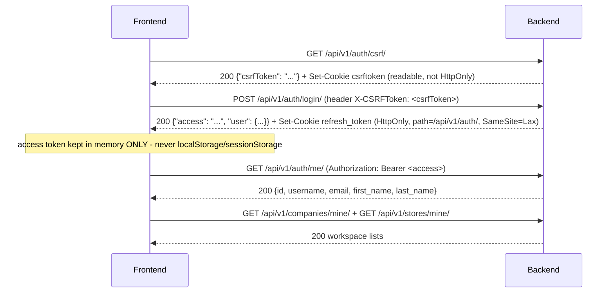

# Frontend Demo Integration Plan

**Companion to `docs/api-inventory-current.md`.** This document maps the four screens named in the task (Login,
Workspace Selection, Dashboard/App Shell, Orders) to real backend operations, documents the exact authentication
contract, and lays out a connected demo. No test, migration, install, server restart, permission grant, policy
configuration, password change, or data seed was performed to produce this document.

## 0. Frontend source: not found in this workspace

The workspace at `D:\CMHP_NEW` contains only `backend/`, `docs/`, and `venv/` - no `frontend/`, no `package.json`, no
`.tsx`/`.jsx` file anywhere. Per the task's own instruction ("inspect it only if its location is explicitly
available... otherwise request its path"), **this document does not recreate the frontend or guess its component
structure from screenshots or naming conventions.** Everything below maps the **backend's own documented screen
contracts** (`docs/erp-screen-catalog.md`, code-verified) to real API operations - this is what any implementation
of these four screens must satisfy, not a description of code that has been read.

**I need the frontend project's path (or repository) to do the field-by-field, component-level reconciliation the
task also asks for** - confirming which exact input names/props exist today, which screen currently calls which URL
(if any already do), and which are placeholders. Until then, the classifications below are based on the backend
contract only: "Ready to integrate" means the backend fully supports the documented screen as specified in
`docs/erp-screen-catalog.md`, not that a specific frontend component has been verified to call it correctly.

## 1. Screen mapping

### 1.1 Login → `AUTH-01`

| Field/action | Backend operation | Classification |
|---|---|---|
| Username input | body field on `POST /api/v1/auth/login/` | Ready to integrate |
| Password input | body field on `POST /api/v1/auth/login/` | Ready to integrate |
| "Log in" submit | `GET /api/v1/auth/csrf/` (must precede) then `POST /api/v1/auth/login/` with `X-CSRFToken` | Ready to integrate |
| Invalid-credentials message | single generic 401 message - wrong username, wrong password, and a correct-password-but-inactive account are **indistinguishable by design** | Ready to integrate (do not attempt to show a more specific message than the API gives) |
| "Remember me" / persistent session beyond the refresh cookie's own 1-day lifetime | no such concept exists - the refresh cookie's `Max-Age` is the only session length | Backend feature absent |
| Password reset / "forgot password" | no endpoint exists anywhere in the inventory | Backend feature absent |
| Rate-limit feedback (too many attempts) | `429` from the login throttle (`5/min` per IP) - the response is DRF's standard throttle body with a `Retry-After`-equivalent wait hint | Needs frontend adjustment (a specific "please wait Ns" UI state, not just a generic error) |

### 1.2 Workspace Selection → `NAV-01`

| Field/action | Backend operation | Classification |
|---|---|---|
| Company list | `GET /api/v1/companies/mine/` → `{"companies": [...]}` | Ready to integrate |
| Store list | `GET /api/v1/stores/mine/` → `{"stores": [...]}` | Ready to integrate |
| Select a company | client-side state only - **never sent to the backend as an authorization claim** (§4 below) | Ready to integrate |
| Select a store | client-side state only, same rule | Ready to integrate |
| "You have no company/store access" empty state | a real, valid, documented state (an empty array from either call) - not an error | Ready to integrate |
| A single combined "workspace" abstraction that is EITHER a company OR a store | there is no backend concept that unifies the two - they are two structurally independent axes (§4) with separate list/permission endpoints | Needs frontend adjustment - the UI's own "workspace" model must keep company and store as two separate selections, not one polymorphic type, or it will misrepresent what the backend actually checks |

### 1.3 Dashboard / App Shell → `NAV-01`/`NAV-02`/`NAV-03` + navigation only

**No `Dashboard` screen ID exists in `docs/erp-screen-catalog.md`, and no backend endpoint returns aggregate
business statistics of any kind** (no order counts, no pending-approval counts, no stock levels - no stock ledger
exists at all in this codebase). Per the task's own instruction, this plan does **not** invent dashboard metrics.

| Field/action | Backend operation | Classification |
|---|---|---|
| Header company/store switcher | same as NAV-01 above | Ready to integrate |
| "My permissions" panel (support/self-diagnosis) | `GET /api/v1/companies/<id>/my-permissions/`, `GET /api/v1/stores/<id>/my-permissions/` | Ready to integrate |
| Store identity confirmation | `GET /api/v1/stores/<id>/overview/` (needs `shared_store.view`, stricter than plain membership) | Ready to integrate |
| Any KPI tile / stat card (order counts, pending approvals, low-stock alerts, revenue, etc.) | no aggregate/reporting endpoint exists anywhere in the 170-operation inventory | Backend feature absent - use static navigation/quick-link tiles (e.g. "Sales Orders", "Purchase Requests", "Batch Plans") instead of any number, exactly as instructed |
| Recent-activity feed | no audit-read API exists (`apps.audit` writes rows; nothing exposes them for reading) | Backend feature absent |
| Notifications | no notification endpoint exists | Backend feature absent |

### 1.4 Orders → assumed to mean Direct Sales Orders (`SO-01`–`SO-06`) - **confirm with the actual frontend**

This project has **three** different "order" concepts (Purchase Orders, Quotations, Direct Sales Orders). Given the
task's own demo sequence ("Login → company → order → approved formula → batch plan..."), **Direct Sales Orders**
(`SO-01`–`SO-06`) is the only one of the three that leads into formula/batch planning, so that is the mapping used
below - **this is an assumption, not a confirmed fact about the real frontend's "Orders" screen, and must be
corrected once its actual scope is known.**

| Field/action | Backend operation | Classification |
|---|---|---|
| Orders list (reference, customer, dates, currency, subtotal, status) | `GET /api/v1/companies/<id>/sales-orders/` (`sales_orders.view`) | Ready to integrate |
| Search / filter by customer / date range | `?search=`, `?customer=`, `?order_date_from=`/`?order_date_to=` (strict `YYYY-MM-DD`, 400 on `from > to`) | Ready to integrate |
| Create order (customer, dates, currency, notes + line items) | `POST /api/v1/companies/<id>/sales-orders/` (`sales_orders.view`+`.create`), needs `customers.view`+`products.view` for the pickers | Ready to integrate |
| Edit a DRAFT order | `PATCH /api/v1/companies/<id>/sales-orders/<id>/` with `expected_version` | Ready to integrate |
| Order detail (read-only + inactive-master badges) | `GET /api/v1/companies/<id>/sales-orders/<id>/` | Ready to integrate |
| Confirm-order review panel (blocking reasons, subtotal, policy state) | `GET .../confirmation-preview/` (`sales_orders.view`) | Ready to integrate - **but see the demo-setup gap in §5**: no company has a confirmation policy configured yet, so every preview today will show `policy.status: NOT_CONFIGURED` and a disabled Confirm button until an administrator answers the policy questions (working rule, not a bug) |
| Confirm action | `POST .../confirm/` `{"expected_version": n}` (`sales_orders.confirm`) | Ready to integrate, same policy-not-configured caveat |
| Any "Reserve stock" / "Manufacture" / "Invoice" / "Dispatch" / "Convert from Quotation" / "Download PDF" action or button on this screen | none of these exist anywhere in the backend - `docs/erp-screen-catalog.md`'s own SO module note says explicitly **"Do not show"** these | Backend feature absent - **do not map any unsupported field to a sales-order field merely to make a save button work**, per the task's own instruction |
| Tax-inclusive total / grand total | only a pre-tax `subtotal` exists; no tax model exists | Backend feature absent |
| Payment terms / credit limit on the order | `Customer` carries no such field (Task 10A scope boundary) | Backend feature absent |

## 2. Authentication contract

The sequence below is read directly from `apps/authentication/views.py`, `apps/authentication/cookies.py`,
`apps/authentication/csrf.py`, and `config/settings/base.py`/`production.py` - already documented in
`docs/frontend-api-handoff.md` §0.2-0.4, restated here with the frontend-implementation specifics the task asked
for.

### 2.1 CSRF bootstrap → login → session restore → refresh → logout



- **`csrftoken`** is a standard, readable (non-HttpOnly) Django cookie - the frontend may read it via
  `document.cookie` or just keep the JSON value from the bootstrap call; either is sent as `X-CSRFToken` on every
  `POST /api/v1/auth/login|refresh|logout/`. **Never sent on any other endpoint** - every other route authenticates
  via `Authorization: Bearer`, not CSRF (they are not `SessionAuthentication`-protected, so DRF never asks for it).
- **The refresh token is NEVER exposed to JavaScript.** It is `HttpOnly`, so `document.cookie` cannot read it, and
  the login/refresh JSON bodies never include it. **Do not** invent a shortcut that copies it into
  `localStorage`/`sessionStorage` - the task explicitly forbids this, and the backend design assumes it never
  happens (the whole point of `HttpOnly` is XSS resistance).
- **Session restoration on page load/reload**: the access token lives only in memory, so a hard reload loses it.
  The frontend's bootstrap-on-load sequence should be: call `POST /api/v1/auth/refresh/` (the browser sends the
  `refresh_token` cookie automatically, scoped to `/api/v1/auth/` - no manual cookie handling needed) to obtain a
  fresh access token silently; on success, proceed as an authenticated session; on failure (401 - no cookie, expired,
  blacklisted, or the user has since been deactivated), treat exactly as a logged-out state and show `AUTH-01`. This
  is the "session restoration" step the task asked for - there is no separate "restore session" endpoint; refresh
  **is** the restore mechanism.
- **`GET /api/v1/auth/me/`** is not strictly required for restoration (the access token alone is enough to call any
  protected endpoint), but is the cheapest way to confirm the token actually works and to repopulate the
  current-user display without waiting for the first real screen's own data call.

### 2.2 Access-token lifetime, proactive vs. reactive refresh

- Access token default lifetime: **5 minutes** (`JWT_ACCESS_TOKEN_MINUTES`, env-configurable - confirm the actual
  deployed value with the backend team before hardcoding a refresh-timer interval).
- Refresh token default lifetime: **1 day** (`JWT_REFRESH_TOKEN_DAYS`), rotated on every use
  (`ROTATE_REFRESH_TOKENS=True`) - the old one is blacklisted the instant a new one is issued, so a leaked-but-unused
  old refresh token stops working the moment the legitimate client refreshes.
- The backend does **not** auto-refresh anything - refresh is entirely client-driven. Recommended: a proactive timer
  just under the access-token lifetime (e.g. refresh at 4 minutes if the lifetime is 5) **plus** the reactive 401
  handler below as a safety net for clock drift or a timer that didn't fire (e.g. the tab was backgrounded).

### 2.3 A single shared refresh operation for concurrent 401s

**Required pattern** (not yet implemented anywhere - this is a frontend design requirement, not a backend fact):
when multiple API calls are in flight and more than one comes back `401` around the same time (e.g. a dashboard
firing several parallel requests right as the access token expires), the frontend must not call
`POST /api/v1/auth/refresh/` once per failing request. Instead:

1. The **first** 401 triggers a single, shared, in-flight refresh promise/operation.
2. Every other 401 that arrives while that refresh is still in flight **awaits the same shared promise** instead of
   starting its own refresh call.
3. On refresh success, every caller that was waiting retries its **original** request once, with the new access
   token.
4. On refresh failure, every waiting caller is told to stop retrying and the app transitions to logged-out
   (`AUTH-01`) - **once**, not once per failed call.
5. **Bounded retries**: each original request gets at most **one** retry-after-refresh. A request that still comes
   back 401 after a successful refresh is a genuine, different problem (e.g. the user was deactivated between the
   refresh and the retry) and must surface as an error, never loop into another refresh attempt.

### 2.4 What is NOT a token-refresh trigger

- **403** ("Forbidden") means the access token is valid but the specific permission is missing - retrying it as a
  token-refresh case will never succeed and will just mask the real problem (show the missing-permission message
  instead, per `docs/frontend-api-handoff.md` §0.7).
- **409** on a write (stale `expected_version`, or a Goods Receipt idempotency-key mismatch) is a business
  concurrency conflict, not an auth problem - refetch the resource and show the conflict to the user; never retry
  the same write body automatically, with or without a token refresh (§17 of the API handoff has the required
  pattern in full).
- **429** (login throttle) is rate-limiting, not an auth failure - show a wait-and-retry message, never attempt a
  refresh (there is no session to refresh - the user isn't logged in yet).

### 2.5 Logout

`POST /api/v1/auth/logout/` (CSRF header required) blacklists the refresh token and clears the cookie; idempotent
(safe to call with a missing/already-invalid cookie); returns `204` with an empty body. **Documented limitation**:
any access token already handed out remains valid in memory until its own short expiry - there is no server-side
access-token revocation. The frontend's own logout handler must still discard its in-memory access token
immediately (do not rely on the backend to invalidate it).

## 3. A gap this plan surfaces: cross-origin requests are not yet supported

**See `docs/api-inventory-current.md`'s own dedicated section for the full technical finding** - no CORS
configuration exists anywhere in this backend. **Practical consequence for these four screens**: if the frontend
dev server (Vite/CRA/Next/etc.) runs on a different origin than the Django server (a different port counts as a
different origin), every one of the calls above will be blocked by the browser before this document's own contract
even applies. This must be resolved - either a dev-server proxy that makes requests same-origin, or adding
`django-cors-headers` with an explicit allowed-origin list plus `CORS_ALLOW_CREDENTIALS=True` (needed because the
refresh cookie must travel with cross-origin requests) - **before any of the "Ready to integrate" rows above can
actually be exercised from a separately-served frontend.** This is a backend/infra decision, not something this
read-only inventory task changes.

## 4. Workspace and permissions - backend-authoritative, always

- **Discovery**: `GET /api/v1/companies/mine/` and `GET /api/v1/stores/mine/` - independent lists; a user may have
  company access, store access, both, or neither (all valid states).
- **Effective permissions**: `GET /api/v1/companies/<id>/my-permissions/` → `{"company_id": id, "permissions": [...]}`;
  `GET /api/v1/stores/<id>/my-permissions/` → the store equivalent. These return the **actual, currently-effective**
  permission code list for that specific company/store - the frontend should drive every "can this user see/do X"
  UI decision from these lists (or, more precisely, from the specific endpoint's own 403 if the frontend gets it
  wrong), never from a cached role name or a guess.
- **`is_superuser`/`is_staff` are never business-access signals for any company/store-scoped operation.** They only
  matter for the small set of genuinely superuser-only administrative endpoints listed in
  `docs/api-inventory-current.md` (Users, Companies, Stores, Catalog, Suppliers, Material Specifications, policy
  configuration endpoints) - `user_has_permission`/`store_user_has_permission` never consult either flag for
  anything else, and the frontend must not either (e.g. do not show a "you're an admin, so you can approve this"
  shortcut anywhere outside that specific list).
- **Selection stores BOTH the workspace type and its ID** - `{type: "company", id: 42}` / `{type: "store", id: 7}`
  (or two independent slots, since a session can have an active company AND an active store at once, on two
  unrelated axes) - never a single bare ID with the type inferred from context, which becomes ambiguous the moment
  both a company and a store share the same numeric ID coincidentally.
- **On switching workspace** (company or store, independently): clear every company-scoped or store-scoped cached
  list/detail belonging to the OLD selection, and clear the "currently selected record" state for anything scoped to
  it (e.g. a currently-open Sales Order detail belonging to the old company should not remain open under the new
  one). **Prevent an older in-flight response from populating the new workspace's state** - tag every in-flight
  request with the workspace id it was issued for (or use an `AbortController`/request-generation counter) and
  discard any response whose tag no longer matches the current selection when it resolves. This matters concretely
  here: `docs/frontend-api-handoff.md` §0.8 confirms the backend **never** trusts a `company_id` selected in the UI
  as a security boundary - it always re-authorizes the actual ID in the request's own URL path - so a stale response
  landing after a switch is a pure frontend race, not something the backend would have blocked.

## 5. Demo plan: Login → company → order → approved formula → batch plan → requirement preview → store preparation

**Existing demo tooling** (`docs/demo-runbook.md`, `apps/common/management/commands/seed_demo_data.py`,
`backend/scripts/demo_http_flow.py`, `backend/scripts/demo_http_commercial_formula.py`) covers Purchase
Request→Order→Receiving→QC-draft (fully) and Quotation/Sales-Order/Formula **drafting** (Task 11B) - but it
**predates** sales-order confirmation (Task 10F), formula approval (Task 11C), batch planning (Task 12A-12B), store
preparation (Task 12C), and batch number allocation (Task 12D). Verified directly against the live dev database
(read-only queries, no writes performed):

| What the connected demo needs | Current state | Gap |
|---|---|---|
| A demo user with `sales_orders.confirm` | `demo_sales` has `sales_orders.view/create/edit` only | **Missing**: needs `sales_orders.confirm` granted |
| A configured `SalesOrderConfirmationPolicy` for `DEMOA` | `None` (unconfigured) - verified: `SalesOrderConfirmationPolicy.objects.filter(company=DEMOA).first()` returns nothing | **Missing**: an active superuser must answer the three policy questions (self-confirmation / zero-price lines / past delivery dates) before any order can be confirmed |
| A demo user with `formulas.approve` | none of the existing `demo_*` users have it | **Missing**: needs a new grant (`demo_formula` is the natural candidate, alongside its existing `formulas.view/create/edit`) |
| A configured `FormulaApprovalPolicy` for `DEMOA` | `None` (unconfigured) - verified the same way | **Missing**: an active superuser must answer the self-approval question |
| A demo user with `batch_plans.view/create/edit` | none exist | **Missing**: a new grant, plus `sales_orders.view`+`formulas.view` for the create-time lookups |
| A demo user with `batch_plans.allocate_number` | none exist (the permission itself is seeded, assigned to nobody, by design - Task 12D) | **Missing** |
| A demo user with `store_preparation.view/create/edit` at `DEMOWH` | none exist | **Missing** |
| A demo Sales Order, Product, and approved Formula wired together end to end | Task 11B's demo products/customers exist (`DEMOPROD1`/`DEMOPROD2`, `DEMOCUST1`/`DEMOCUSTB`); no demo Sales Order, Formula, or Formula Revision has been created yet | **Missing**: the actual transactional chain (order → formula → revision → lines → approval → batch plan) still needs to be created, once the policies/permissions above exist |

**Per the task's own instruction, none of the above was performed** - no permission was granted, no policy was
configured, no password was changed, no record was seeded or mutated. This table is the precise punch-list for
whoever runs that setup next (most naturally: an extension of `seed_demo_data.py` and a new
`scripts/demo_http_batch_planning.py`, mirroring the existing Task 11B script's own structure and safeguards -
DEBUG-only, `--yes`-gated, idempotent, gitignored credentials).

**Once that setup exists, the connected demo's real API sequence is:**

1. `GET /api/v1/auth/csrf/` → `POST /api/v1/auth/login/` (as the sales-order-confirming demo user).
2. `GET /api/v1/companies/mine/`, select `DEMOA`.
3. `POST /api/v1/companies/<DEMOA>/sales-orders/` (create a draft order against a demo customer/product).
4. `GET .../confirmation-preview/` → `POST .../confirm/` (needs the policy configured, per the gap table above).
5. Re-login (or use a second demo user) with `formulas.*` + `formulas.approve`:
   `POST /api/v1/companies/<DEMOA>/formulas/` (with lines added via `PATCH` on the revision) →
   `GET .../approval-preview/` → `POST .../approve/` (needs the formula policy configured).
6. `POST /api/v1/companies/<DEMOA>/batch-plans/` (references the confirmed order's line + the approved revision).
7. `GET /api/v1/companies/<DEMOA>/batch-plans/<id>/requirement-preview/` (read-only, works immediately once the
   plan exists - no extra setup beyond the plan itself).
8. Re-login (or a third demo user) with `store_preparation.*` at `DEMOWH` + `batch_plans.view` at `DEMOA`:
   `POST /api/v1/stores/<DEMOWH>/preparations/` (Packing Type + insert-required against the batch plan).

**Explicitly separated from this implemented chain - PLANNED only, no backend code exists for any of it**: stock
issue/consumption, production/BMR, QC disposition/release, packaging, dispatch, and invoicing. Official batch
**numbering** (Task 12D, `POST .../allocate-number/`) is implemented and could be added as step 6b above once the
new permission is granted, but was left out of the numbered sequence here since it is a separate, optional action on
an already-created plan, not a precondition for the requirement preview or store preparation steps.

## 6. First frontend implementation task

Unchanged from `docs/demo-runbook.md` §8's own recommendation, still accurate: **Login → session bootstrap → logout
(§2 above)**, then **Workspace Selection** (§1.2), then the **App Shell** (§1.3, navigation/quick-links only, no
invented metrics). Only after that foundation exists does building the Orders screen (§1.4) make sense, since every
later screen depends on the same authenticated, workspace-aware HTTP client wrapper.

## 7. Later phase — Recorded Receipts (Task 13C)

**Do not build this yet** - it belongs after the chain in §5, once Order/Formula/Batch Plan/Store Preparation
screens exist. Recorded here so a future implementer has the real contract rather than a guess, and so nobody
mistakes it for a stock-availability feature in the meantime.

**Which receiving action creates the movement.** Nothing on this screen creates data itself. Exactly one existing
receiving action does: `POST /api/v1/stores/<store_id>/goods-receipts/<id>/post/` (the same "Post" button GR-05
already has - see `docs/frontend-api-handoff.md` §7). The moment that call succeeds, one `RECEIPT_IN`
`StockMovement` is created automatically per receipt line, in the same transaction. Nothing on the Recorded
Receipts screen itself is ever a create/edit/delete action - both its endpoints are `GET` only.

**Exact API calls and response examples.**

```
GET /api/v1/stores/4/stock-movements/?material=44
```
```json
{
  "count": 1, "next": null, "previous": null,
  "results": [
    {
      "id": 12, "movement_type": "RECEIPT_IN",
      "source_goods_receipt_id": 12, "source_goods_receipt_reference": "GR-20260210-f6a7b8c9d0",
      "source_receipt_line_id": 60, "store_id": 4,
      "source_company_id": 3, "source_company_code": "CMHP-A",
      "material_id": 44, "material_code_snapshot": "PARA-500", "material_name_snapshot": "Paracetamol 500mg (bulk)",
      "unit_id": 1, "unit_code_snapshot": "KG", "unit_name_snapshot": "Kilogram",
      "quantity": "60.000", "lot_reference": "LOT-A", "release_status": "Not tracked",
      "posted_by_id": 12, "posted_at": "2026-02-10T12:00:00Z", "created_at": "2026-02-10T12:00:00Z"
    }
  ],
  "coverage": {
    "historical_receipts_backfilled": false, "opening_stock_included": false,
    "issues_returns_release_tracked": false, "release_status": "Not tracked",
    "notice": "This total reflects only RECEIPT_IN movements recorded since this feature was installed. Historical receipts posted before this feature existed are not backfilled. Opening stock is not included. Issues, returns, reservations and QC release are not tracked anywhere in this system yet. This is NOT complete physical stock."
  }
}
```

```
GET /api/v1/stores/4/stock-balances/?material=44
```
```json
{
  "count": 1, "next": null, "previous": null,
  "results": [
    {
      "material_id": 44, "material_code": "PARA-500", "material_name": "Paracetamol 500mg (bulk)",
      "unit_id": 1, "unit_code": "KG", "unit_name": "Kilogram",
      "source_company_id": 3, "source_company_code": "CMHP-A",
      "recorded_receipt_quantity": "60.000", "release_status": "Not tracked"
    }
  ],
  "coverage": { "...": "identical shape to the block above" }
}
```

**Permissions - store scope plus the SAME company check `GR-01`/`GR-03` already use.** `stock.view` at the store
(seeded, assigned to nobody - a real grant is needed before any demo user can see this screen), **plus** active
company membership holding `purchase_orders.view` in each movement's own `source_company_id` - not `formulas.view`,
since receipt quantities are not formula data. A caller who holds `stock.view` but lacks `purchase_orders.view` in a
particular company simply never sees that company's rows or totals, in the list or in the aggregate - there is no
separate error for this case, it is just absent.

**Empty state.** A brand-new store (or one whose receipts all predate this feature - see `coverage.
historical_receipts_backfilled: false` above) returns `{"count": 0, "results": []}` from both endpoints, still with
the same `coverage` block. Render this as "No recorded receipts yet" - never as an error, and never as "zero stock."

**`recorded_receipt_quantity` is not available stock - say so on the screen itself, not only in a tooltip.** It is
the sum of `RECEIPT_IN` movements only, grouped by `(material, unit, source_company)` so two different companies'
or units' quantities are never silently added together. It excludes anything not yet in the ledger (historical
receipts, opening stock) and anything the ledger has no concept of yet (issue, consumption, return). Surface the
`coverage.notice` text (or an equivalent short caption) directly on this screen, not buried in documentation only.

**`release_status` remains "Not tracked."** Every row, on both endpoints, always returns the literal string
`"Not tracked"` for this field. Do not render a checkmark, a color, or any status pill that implies a real
release/hold/QC decision exists - none does. Submitting an Incoming QC Inspection (§1 of the main handoff, QC
screens) has no effect on this screen at all.

**No enabled Issue/Reserve/Release buttons.** None of those actions exist anywhere in this API. Do not add
disabled placeholder buttons either, the same "absent, not disabled" rule already applied elsewhere in this plan
(e.g. §5's own note on QC disposition) - a disabled button still implies the feature is coming soon on a specific
timeline, which is not something this document promises.
