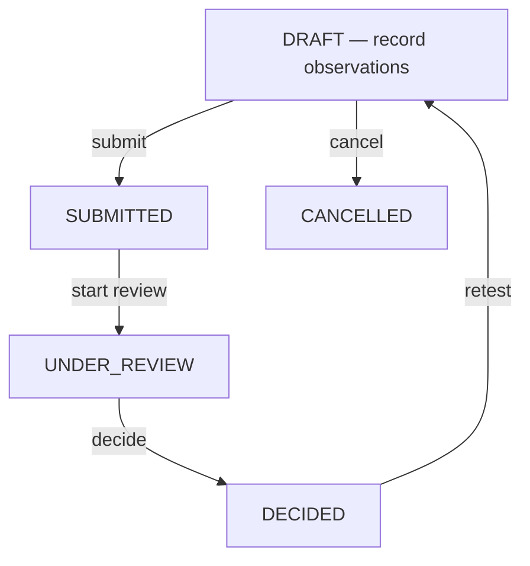

# Incoming QC Review and Disposition — Design Proposal (Task 09B-2)

**This is a design document only.** Most of it describes work that is
not implemented — no model, migration, endpoint, or permission described
below (beyond §5.1's `submit`, implemented Task 09B-3A, and a
*different-shaped* drafting/versioning foundation for §3's specification
models, implemented Task 09B-3B — see each section's own status note)
exists in the codebase. It is written so a future implementation task
can proceed directly from it — the same depth of detail
`docs/receiving-proposal.md` and `docs/incoming-qc-proposal.md` provided
before their own tasks were built — but writing it is not building it,
and nothing here should be read as client-approved.

> **Revision history**: Task 09B-3A corrected a real contradiction in
> this document's original retest/quantity rules (§2.6, §2.7, §4) — a
> retest round was originally checked against the inspection's *full*
> received quantity again, instead of only the specific amount the prior
> round actually held over. Every section below marked **CORRECTED**
> reflects the fix; §4.1 restates the worked example the correction was
> checked against. The original design intent (separating workflow
> status from disposition, deferring QA release/stock usability,
> declining to import purchasing's approval rules) is unchanged - only
> the quantity/retest mechanics were wrong and are now fixed.

## Status legend

- **CONFIRMED requirement** — the client has explicitly agreed to this.
- **EXISTING behavior** — real, shipped code, verified against the
  current repository as of this document.
- **PROPOSED policy** — this document's own recommendation, offered so
  design work can proceed, not a decision anyone has made.
- **OPEN decision** — cannot be answered by this document; the client
  must decide it before implementation of that piece can start.

## Source materials

No client user-story or QC-requirements document exists anywhere in this
repository (confirmed by search — the only match for "requirement" is
`backend/requirements.txt`, an unrelated Python package list). Everything
below is grounded in the actual shipped code
(`apps/quality`, `apps/receiving`, `apps/catalog`, `apps/permissions`,
`apps/audit`) and the existing documentation
(`docs/backend-tasks.md`, `docs/backend-decisions.md`,
`docs/frontend-api-handoff.md`, `docs/erp-screen-catalog.md`,
`docs/erp-handoff-open-decisions.md`, `docs/incoming-qc-proposal.md`).
Since no user-story document exists to potentially conflict with these,
the instruction "do not treat an older user-story document as overriding
newer decisions" has no document to apply to here — noted for
completeness, not because a conflict was found.

---

## 1. What exists today — EXISTING behavior

Verified directly against `backend/apps/quality/models.py`,
`services.py`, `views.py`, `serializers.py` as of this document:

- `IncomingInspection.status` has exactly two values: `DRAFT` and
  `CANCELLED`. There is no `SUBMITTED`, no `UNDER_REVIEW`, no `DECIDED`,
  no `ACCEPTED`/`REJECTED` anywhere.
- `receipt_line` (a `GoodsReceiptLine` FK, `PROTECT`) is the permanent
  identity an inspection is filed against — chosen specifically so two
  receipts sharing a supplier lot reference are never merged (see
  `docs/incoming-qc-proposal.md`).
- `company`/`store`/`material`/`unit` and four `*_snapshot` text fields
  plus `received_quantity_snapshot` are copied once from `receipt_line`
  at creation and never change again.
- At most one **non-cancelled** `IncomingInspection` may exist per
  receipt line (`one_active_incoming_inspection_per_receipt_line`, a
  partial `UniqueConstraint`). A cancelled draft may be replaced by a new
  one — this is the *only* existing "start again" path.
- `InspectionObservation` rows (`parameter_name` required, everything
  else optional free text) belong to one inspection, are fully
  replaceable via `PATCH` while `DRAFT`, and carry no pass/fail field, no
  numeric limit, no specification link of any kind.
- Access: `incoming_qc.view/create/edit/cancel` (STORE scope) plus
  **bare** company membership (no `purchase_orders.view`) in the receipt
  line's own company — deliberately narrower than Goods Receiving's own
  company check, so QC never implies purchasing-price visibility.
- `apps.receiving`'s own domain (`GoodsReceipt`/`GoodsReceiptLine`,
  `delivery_progress_for_purchase_order`) is entirely unaware that
  `apps.quality` exists — no reverse reference, no signal, no field on
  either app changes because of the other today.
- `apps.audit.services.record()` accepts independent, both-nullable
  `company`/`store` context — `apps.quality.services` is documented as
  the second call site (after `apps.receiving.services`) that
  deliberately passes both.

The `PurchaseRequest` approval workflow (`apps.purchasing`) is the
closest existing structural precedent in this codebase for "submit → a
locked round → a durable decision history, preserved across repeats" —
see §2 for exactly what is reused from its *shape* and what is
explicitly **not** carried over from its *business rules*, per this
task's own instruction.

---

## 2. Workflow design

### 2.1 Two separate concerns, two separate places to record them

This proposal deliberately keeps **inspection workflow status** and
**material disposition** in two different places, not one status field —
per this task's explicit instruction. A single `status` enum trying to
mean both "where is this inspection in its own process" and "what did QC
decide about the material" would eventually need values like
`DECIDED_ACCEPTED_BUT_STILL_UNDER_QA_REVIEW`, which is exactly the kind
of overloaded field this project's other workflows (`PurchaseRequest`,
`PurchaseOrder`, `GoodsReceipt`) all avoid.

- **`IncomingInspection.status`** (workflow only — PROPOSED, extends the
  existing enum): `DRAFT → SUBMITTED → UNDER_REVIEW → DECIDED`, plus the
  existing `CANCELLED` (DRAFT-only, unchanged). This says only "where is
  this round in its own process," never what was decided.
- **A new `IncomingInspectionRound` record's `outcome`** (disposition —
  PROPOSED, new model, §2.3): `ACCEPTED` / `PARTIALLY_ACCEPTED` /
  `REJECTED` — real dispositions only (see §2.7's correction: "returned
  for correction" is a separate action, not a fourth outcome value, since
  it allocates no quantity at all). This says what QC decided about the
  material for that round, with explicit quantities (§4) — never where
  the inspection process itself currently stands.
- **Material/stock usability** is **not represented anywhere in this
  proposal**. See §2.5 — this is explicitly OPEN, because it depends on
  a stock ledger that does not exist yet.


*Proposed `IncomingInspection.status` machine. `DECIDED`'s own outcome
(accept/partial/reject/return) is recorded on the round, not here.*

### 2.2 Submission

**PROPOSED**: `POST .../submit/` moves `DRAFT → SUBMITTED`, requiring at
least one observation and `expected_version` — the same shape as every
other `submit`-style transition in this project
(`submit_purchase_request`). At submit time, the current live
`InspectionObservation` rows are copied into an immutable
`IncomingInspectionRoundObservation` snapshot (§2.3), exactly mirroring
`PurchaseRequestLine → PurchaseRequestApprovalRoundLine`. **Who may
submit**: **OPEN**. This document proposes reusing the existing
`incoming_qc.edit` permission (the same permission that already lets
someone finish editing a draft) rather than inventing a new
`incoming_qc.submit` permission, on the reasoning that submission is a
continuation of drafting, not a new kind of authority — but this is a
judgment call, not a confirmed rule, and the client may want a distinct
permission instead.

### 2.3 Review and decision

**PROPOSED, new model**: `IncomingInspectionRound` — one row per
submit-to-decision cycle (mirrors `PurchaseRequestApprovalRound`
structurally, but **not** its business rules — see the explicit
call-outs below).

| Field | Notes |
|---|---|
| `inspection` | FK, `CASCADE` |
| `round_number` | starts at 1, +1 per retest, never reused |
| `submitted_by`/`submitted_at` | |
| `reviewer` | set when review starts (§2.4), nullable until then |
| `review_started_at` | nullable |
| `assessed_quantity` | **the quantity this specific round is deciding on** — see §4.1's correction below; round 1's is always `receipt_line.received_quantity_snapshot`, a later round's is always exactly the immediately preceding round's own `retest_hold_quantity`, never the original total again |
| `outcome` | `PENDING` / `ACCEPTED` / `PARTIALLY_ACCEPTED` / `REJECTED` — **a real disposition only; `RETURNED_FOR_CORRECTION` is deliberately not one of these values, see §2.7** |
| `accepted_quantity`/`rejected_quantity`/`retest_hold_quantity` | this round's own split of `assessed_quantity` — see §4.3 for the corrected invariant |
| `decision_notes` | free text, required for `REJECTED` (mirrors the existing non-blank-reason rule on every rejection/cancellation in this project) |
| `decided_by`/`decided_at` | nullable until `decide` |
| `closed_at` | |

`IncomingInspectionRoundObservation` mirrors
`PurchaseRequestApprovalRoundLine`: an immutable copy of each
observation as submitted, `line_number`, `parameter_name`,
`method_reference`, `result`, `result_unit`, `remarks`, plus — once §3's
specification model exists — a frozen `specification_version` reference.

**Explicitly not carried over from `apps.purchasing`'s approval
workflow** (per this task's own instruction not to import
purchase-approval rules automatically):

- **No self-decision ban.** `PurchaseRequest` permanently forbids a
  requester from approving their own request. Whether the same person
  who logged observations may also decide disposition is **OPEN** — not
  defaulted to "yes" or "no" by this proposal. If the client wants a
  ban, it would be enforced the same way `_reject_if_self_or_repeat_
  decider` does today (an identity check inside the service, evaluated
  after the row lock, before any state change) — but nothing here
  assumes that is wanted.
- **No distinct-reviewer-per-round rule.** `PurchaseRequest`'s
  provisional (itself unconfirmed) "different approver per step" rule is
  a three-step, three-permission-holder design specific to purchasing
  approval. QC review is proposed as a **single decision by one
  reviewer** per round — not three steps — so there is no analogous rule
  to import, and this document does not invent one.
- **No three-step structure at all.** Purchasing has exactly three
  confirmed steps because the client confirmed exactly three. Nothing
  about QC review's step count has been confirmed, and this proposal
  does not assume "three" just because purchasing has three — it
  proposes one review step (§2.4), explicitly labeled as a proposal.

### 2.4 Is a "start review" step needed at all?

**PROPOSED, with a stated alternative**: `POST .../start-review/`
(`SUBMITTED → UNDER_REVIEW`) records who is reviewing before they decide
— useful for a work-queue screen to show "already being reviewed" and to
narrow the lock window for the eventual decide call. **Alternative,
simpler shape**: skip straight from `SUBMITTED` to a decision, with no
separate claim step (matching how `PurchaseRequest` has no "I am about to
approve this" intermediate state). Recommending the claim step is a
genuine judgment call, not a strong recommendation — either shape is
implementable from this document; the client's real reviewer staffing
pattern (one QC reviewer per store, or a shared queue several people pull
from) should decide which is actually useful.

### 2.5 QA release — explicitly OPEN

**Does incoming material require a separate QA release, distinct from
the QC reviewer's own decision?** This document does not answer this.
Many pharmaceutical QC processes have exactly this two-tier structure
(QC decides test results, QA authorizes release based on them) — but
nothing available to this project confirms whether the client's process
does. If a QA release step is wanted, it composes cleanly onto this
proposal without redesigning it: an additional nullable
`qa_released_by`/`qa_released_at` pair on `IncomingInspectionRound`, or a
distinct final status, added later — deferred, not designed here, so
this document does not guess at authority it has not been given.

**When does accepted material become usable?** Also explicitly **OPEN**,
for a more fundamental reason: no stock ledger or stock-balance concept
exists anywhere in this codebase (confirmed repeatedly across every
prior task's documentation). `IncomingInspectionRound.outcome=ACCEPTED`
is a **quality judgment only** — it creates no stock entry, changes no
receipt quantity, and by itself makes nothing "available." A future
stock-ledger task would need to decide whether an `ACCEPTED` (or
`PARTIALLY_ACCEPTED`) QC outcome is what triggers a stock-ledger entry,
and if so, exactly which quantity and at what moment — none of which
this document decides.

### 2.6 Retest — preserving observations and decisions (CORRECTED — see revision note)

> **Revision note.** An earlier version of this document required every
> round's `accepted_quantity + rejected_quantity + retest_hold_quantity`
> to equal the inspection's full `received_quantity_snapshot` — including
> a *retest* round, which only ever has the previous round's held-back
> remainder to work with. That was a genuine contradiction: it would have
> required a retest round to somehow "find" the full original quantity
> again, effectively double-counting whatever the first round already
> finally accepted or rejected. The correction below fixes this by giving
> each round its own `assessed_quantity` (§2.3) instead of always
> reusing the inspection-level total. See §4 for the full corrected
> invariant and a worked numeric example.

**PROPOSED**: `POST .../retest/`, callable only from a `DECIDED`
inspection whose **most recent round's `retest_hold_quantity` is greater
than zero** — that quantity, and only that quantity, is what is retested.
(A round with `retest_hold_quantity == 0` — whatever its `outcome` label
— has nothing left over to retest; a clean `ACCEPTED` or fully-decided
`REJECTED` round already accounted for its entire `assessed_quantity`
between `accepted_quantity` and `rejected_quantity` alone.) This reopens
the **same** `IncomingInspection` (status back to `DRAFT`) for a **new**
round (`round_number + 1`), whose `assessed_quantity` is set to exactly
the prior round's `retest_hold_quantity` — never the inspection's
original `received_quantity_snapshot` again — with fresh, empty
`InspectionObservation` rows to fill in for that new round.
Deliberately **not** a brand-new `IncomingInspection` row. Two reasons,
not just following precedent for its own sake: (1) the existing
one-active-inspection-per-receipt-line constraint exists specifically to
keep one receipt line's inspection history in one place — a second
`IncomingInspection` row for the same line would fight that constraint,
not extend it; (2) every prior round (`IncomingInspectionRound` + its
snapshot observations, **including its now-final `accepted_quantity`/
`rejected_quantity`, which the new round never reopens or re-decides**)
stays attached to the same inspection, permanently visible in its
history — exactly the "preserving previous observations and decisions"
requirement, achieved the same way `PurchaseRequest`'s reject → revise →
resubmit cycle already preserves every earlier round under one request.

### 2.7 Returned for correction — a separate workflow action, not a disposition outcome

**CORRECTED**: `RETURNED_FOR_CORRECTION` is **not** one of
`IncomingInspectionRound.outcome`'s values (§2.3) — it is proposed as its
own, structurally separate action, e.g. `POST .../return-for-
correction/`, distinct from `decide`. The reasoning: a real disposition
(`ACCEPTED`/`PARTIALLY_ACCEPTED`/`REJECTED`) always allocates a quantity
split of `assessed_quantity`; "return for correction" allocates **no
quantity at all** — a reviewer who returns a round for correction is
saying "I have not yet judged the material, the *data* needs fixing
first," not making any accept/reject/hold decision. Treating it as a
fourth `outcome` value alongside three real dispositions (an earlier
version of this document did) blurred that distinction and made the
quantity invariant (§4.3) ambiguous for that case. As a separate action:
it still creates a durable history record (which round, who returned it,
when, why) and still reopens the inspection to `DRAFT` for the *same*
round's `assessed_quantity` to be corrected and resubmitted (not a new,
smaller `assessed_quantity` the way a genuine retest is) — but it is
never confused with, and never counted toward, `accepted_quantity`/
`rejected_quantity`/`retest_hold_quantity` anywhere. **This action is not
implemented in Task 09B-3A** — see §7's implementation slices; it is
specified here only so a later task builds it correctly the first time.

---

## 3. Specifications and observations — minimum proposed design

**No pharmaceutical test limit, sampling rule, or regulatory requirement
is invented anywhere in this section.** Every field below is a container
a client-supplied value would go into — this document does not populate
any of them.

**Structure versus content, kept explicitly separate**: the *shape* of
`MaterialSpecification`/`SpecificationTest` (§3.1) — what fields exist,
how a specification is versioned, how a round observation links to the
version active when it was submitted (§3.2) — can be designed, and even
implemented as empty containers, entirely independently of having any
real client test data yet. What genuinely requires client data is (a)
**validating** that this proposed shape actually captures every field a
real specification sheet needs (a numeric `result_type` with a unit is
not the same shape as a pass/fail `result_type` with none, for example,
and the client's real sheets may reveal a shape this document didn't
anticipate), and (b) **populating** real rows once the shape is
confirmed. Neither of those two needs blocks starting the structural
design or even building the empty tables — see §7's implementation
slices, where slice 5 is sequenced last specifically because of (a) and
(b), not because the schema itself can't be designed sooner.

### 3.1 Proposed models (fields only — no implementation)

> **Status update (Task 09B-3B): a drafting/versioning *foundation* for
> this section is now implemented — with a materially different shape
> than the original sketch below.** The actual shipped models split
> "specification identity" and "specification version content" into two
> separate models (`MaterialSpecification` + `MaterialSpecificationVersion`,
> not one versioned `MaterialSpecification`), `result_type` is `NUMERIC`/
> `TEXT` only (no `PASS_FAIL`), and there is **no** `status` beyond
> `DRAFT`, no `effective_from`, and no `approved_by`/`approved_at` —
> approval/publication/effective-dating remain entirely unimplemented and
> unproposed-in-detail, exactly as this document's §2.5 already left
> them. See `docs/backend-tasks.md`, Task 09B-3B, and
> `docs/frontend-api-handoff.md` §9 for the authoritative, code-verified
> shape; the tables below are the original design sketch, kept for
> continuity, and should not be read as the current contract.

**`MaterialSpecification`** (new, proposed):

| Field | Notes |
|---|---|
| `material` | FK to the existing `catalog.Material` |
| `version_number` | starts at 1, immutable once any inspection round references it |
| `status` | `DRAFT` / `ACTIVE` / `SUPERSEDED` / `RETIRED` — proposed, not confirmed |
| `effective_from` | date, client-supplied |
| `approved_by`/`approved_at` | who approved this specification version — **not** the same authority as a QC inspection decision; see §2.5's authority note |
| `notes` | free text |

**`SpecificationTest`** (child of `MaterialSpecification`, new,
proposed):

| Field | Notes |
|---|---|
| `specification` | FK, `CASCADE` |
| `test_name` | required |
| `method_reference` | optional, free text — same field shape as today's `InspectionObservation.method_reference`, now attached to the *approved* side instead of only the observation side |
| `result_type` | proposed enum: `NUMERIC` / `TEXT` / `PASS_FAIL` — the client's actual test sheets will determine whether more types are needed |
| `unit` | optional text (not necessarily the material's own base unit — a test result unit, e.g. "%", "CFU/g", is a different concept) |
| `acceptance_criteria` | free text or a structured min/max pair — **left as an open shape decision**, not resolved here; see the open question below |
| `sample_requirements` | optional free text (quantity/method needed to draw a sample for this test) — proposed placeholder only |

### 3.2 Linking an inspection round to the exact specification version used

> **Corrected reference target (post Task 09B-3B).** The original text
> below was written before any specification model existed and described
> a single, self-versioning `MaterialSpecification` (matching this
> section's own now-historical §3.1 sketch, where `MaterialSpecification`
> itself carried `version_number`/`status`/`effective_from`). The model
> actually shipped in Task 09B-3B splits that into two: identity
> (`MaterialSpecification`, no version concept of its own) and versioned
> content (`MaterialSpecificationVersion`, which has both `revision_
> number` and its own optimistic-concurrency `version` — see
> `docs/frontend-api-handoff.md` §9.2 for that distinction). A future
> `specification_version` FK on `IncomingInspectionRoundObservation`
> must therefore reference `MaterialSpecificationVersion` - **not**
> `MaterialSpecification`, which has no versioned content of its own to
> freeze a reference to. The reasoning below (freeze at submit time, a
> later revision never retroactively alters a past judgment) is
> unchanged; only the target model name is corrected.

`IncomingInspectionRoundObservation` (§2.3) would carry an optional
`specification_version` FK to the `MaterialSpecificationVersion` row
active at submit time, frozen forever — the same "snapshot the version
that was actually in force" pattern `PurchaseOrderIssueLineSnapshot`
already uses for supplier/material identity. If the specification is
later given a new draft version, every past round's own frozen link is
untouched — exactly so a later specification revision can never
retroactively alter what an already-decided inspection was judged
against.

### 3.3 Sample details

Proposed, minimal, and explicitly incomplete: `sample_reference`
(free text), `sample_quantity` (decimal), `sampled_by`, `sampled_at` —
attached to the round, not the whole inspection, since a retest round
may draw a fresh sample. **What the client's actual sampling procedure
requires (sampling plans, statistical sample sizes, chain-of-custody
requirements) is not designed here** — this is exactly the kind of
regulatory/procedural detail this document was told not to invent.

### 3.4 What client sheets are needed to finalize this section

To move §3.1's placeholder fields into a real, implementable design, the
client needs to supply, for each material category at minimum: the
actual list of tests performed, each test's method/reference, whether
its result is numeric/text/pass-fail, its unit (if any), and its real
acceptance criteria. Without these, `MaterialSpecification`/
`SpecificationTest` can be built as empty containers, but nothing
meaningful can be entered into them.

### 3.5 Existing draft inspections with no specification reference

Every `IncomingInspection` created under Task 09B-1 (and any created
before `MaterialSpecification` exists at all) has no specification
concept to link to. **PROPOSED migration-safety rule**: `specification_
version` on `IncomingInspectionRoundObservation` must be **nullable** —
retrofitting a mandatory link before specifications exist for every
material would make the existing, already-shipped drafting feature
impossible to submit. A further **PROPOSED, not decided** business rule:
require the link only when the material in question actually has an
`ACTIVE` `MaterialSpecification` at submit time; otherwise allow the
round to proceed unlinked, and expose "no approved specification on
file" as a visible flag on the review screen (§6) rather than silently
allowing an unlinked round to look identical to a linked one. Whether
the client wants unlinked submission blocked entirely instead is an
**OPEN decision**.

---

## 4. Quantity rules (CORRECTED — see §2.6/§2.7's revision notes)

### 4.1 The worked example

> PO quantity = 100, Physically received = 60, Accepted = 50, Rejected =
> 10, Still pending delivery = 40.

Reading this against the existing, already-implemented receiving domain
(`docs/backend-tasks.md`, Task 09A): the PO's ordered quantity (100) and
"physically received so far" (60, `PARTIALLY_RECEIVED` per
`delivery_progress_for_purchase_order`) are facts `apps.receiving`
already tracks today, entirely unaffected by anything QC does. The 50
accepted + 10 rejected = 60 is a **complete disposition of everything
physically received so far** — nothing "undecided" is left over from
this round. The 40 still-pending-delivery units are **not QC's concern
at all** — they haven't arrived yet; when they do, receiving records
that (as it already does), and a **separate** inspection would be opened
against that new receipt line when it exists.

**A second worked example, specifically for retest** (per this task's
own correction):

> Received 60 → round 1 accepts 50 and holds 10 → round 2 accepts 8 and
> rejects 2 → final totals: accepted 58, rejected 2, unresolved 0.

Walked through against the corrected model (§2.3, §2.6):

| Round | `assessed_quantity` | `accepted_quantity` | `rejected_quantity` | `retest_hold_quantity` |
|---|---|---|---|---|
| 1 | 60 (= `received_quantity_snapshot`) | 50 | 0 | 10 |
| 2 | 10 (= round 1's own `retest_hold_quantity` — **not** 60 again) | 8 | 2 | 0 |

Round 1's own invariant: `50 + 0 + 10 == 60` ✓. Round 2's own invariant:
`8 + 2 + 0 == 10` ✓ — round 2 is never checked against the original 60,
only against the 10 it actually inherited. Round 2's `retest_hold_
quantity == 0`, so no further retest round is possible — the inspection
is fully resolved. **Cumulative totals** (a computed view across every
round, not a separately stored field): `total_accepted = 50 + 8 = 58`,
`total_rejected = 0 + 2 = 2`, `total_unresolved = 0` (the most recent
round's own hold) — matching the example exactly. Round 1's `50`
accepted and its (implicit) `0` rejected are **permanently final** the
moment round 1 closes; round 2 never re-touches them, it only ever
disposes of the 10 units round 1 explicitly handed forward.

### 4.2 Why QC rejection does not reverse physical receipt or touch the PO's undelivered quantity

**Physical receipt and QC disposition are answers to two different
questions, permanently kept apart by design, not by oversight.**
"Received" answers "did the ordered quantity physically show up" — a
fact about the past, already true the moment it was posted, and
`GoodsReceipt`/`GoodsReceiptLine` are explicitly documented as
immutable once `POSTED` (Task 09A). Rejecting 10 of those 60 units at QC
does not un-happen their physical arrival — the supplier's delivery truck
already came and went. If QC rejection reversed `received_quantity` or
fed back into `delivery_progress_for_purchase_order`'s "remaining"
calculation, it would silently imply the rejected units could be
re-ordered against the *same* PO line up to the original 100 — a real,
separate business decision (does the client want an automatic
"replacement quantity" mechanism, or does rejected material simply
become a supplier dispute to resolve manually?) that this document does
not make. Keeping the two domains untouched by each other means neither
decision is made by accident.

### 4.3 Proposed invariants (CORRECTED)

Per `IncomingInspectionRound`, at `decide` time — **every check below is
against that round's own `assessed_quantity`, never directly against
`receipt_line.received_quantity_snapshot`** (only round 1's `assessed_
quantity` happens to equal that total; the correction in §2.6 is
precisely that later rounds must not be held to the same equality):

- **Per-round**: `accepted_quantity + rejected_quantity + retest_hold_quantity == assessed_quantity`, for a completed disposition (fully accounts for what this round was actually given to decide — no silent remainder within the round itself).
- All three quantities `>= 0`.
- **Round-to-round transfer**: a new round's `assessed_quantity` is set, at creation, to exactly the immediately preceding round's `retest_hold_quantity` — copied once, immutable for that round's own lifetime, never recomputed from anything else and never reset back to the original `received_quantity_snapshot`.
- **Previously finalized quantities cannot be decided again**: once a round is `DECIDED` (`closed_at` set), its own `accepted_quantity`/`rejected_quantity` are permanent. No later round's `decide` call may add to, subtract from, or otherwise re-litigate them — a later round only ever disposes of the specific `retest_hold_quantity` amount handed to it, never the original total.
- **Never sum historical hold snapshots as additional physical stock**: a `retest_hold_quantity` value is superseded the moment it becomes the next round's `assessed_quantity` — it is not additionally counted anywhere else once "spent" this way. The only running totals are the simple sums shown in §4.1's table (`total_accepted`, `total_rejected`, and the *current* unresolved amount, which is just the most recent round's own `retest_hold_quantity` if no further round has opened against it yet).
- **Receipt totals and PO pending quantities remain unchanged**: no field on `GoodsReceipt`/`GoodsReceiptLine`/`PurchaseOrder`/`PurchaseOrderIssueLineSnapshot` is read for comparison here beyond round 1's one-time `assessed_quantity = received_quantity_snapshot` copy, and none of them is ever written to by any of this — restated from §4.2, and the reason round 2 in §4.1's second example never needs to re-check anything against the receipt line at all.
- **Concurrency**: the `decide` transaction locks the `IncomingInspectionRound` being decided before comparing its own three quantities against its own `assessed_quantity` — a strictly local, single-row check (unlike `post_goods_receipt`'s cross-document aggregation), so two concurrent `decide` attempts on the same round can never both succeed with conflicting quantities; the loser simply finds the round already `DECIDED` (or a stale `expected_version`) and must refetch.

### 4.4 What this section explicitly defers, as separate future decisions or workflows — not designed here

- **Sample consumption.** Whether/how much material a sample itself
  consumed (and whether that comes out of the accepted, rejected, or a
  separate "consumed in testing" bucket) is not modeled — §3.3's `sample_
  quantity` is a placeholder field only.
- **Partial decisions left open across time** (e.g., decide 30 of 60 now,
  the rest next week). This proposal's invariant (§4.3) requires a
  round's decision to fully account for the received quantity at decide
  time — a "come back and decide the rest later" flow, if wanted, is a
  separate design question this document does not resolve.
- **Supplier returns and replacement deliveries.** What happens
  operationally to 10 physically-rejected units (returned to the
  supplier? destroyed? held?) and whether a replacement delivery becomes
  a new PO line, a new receipt against the existing PO, or something
  else entirely, are all separate, unscheduled workflow decisions.
- **Stock ledger entries of any kind.** Restated from §2.5: no QC
  decision in this proposal ever creates, reserves, or adjusts a stock
  ledger row, because no stock ledger exists. This is a hard boundary
  this document does not cross, not an oversight to close later inside
  this same task.

---

## 5. API and data contract proposal

All paths below are **PLANNED — none exist yet.** They extend
`/api/v1/stores/<store_id>/incoming-inspections/<id>/...`, following
this project's established conventions exactly (fold-into-404
authorization, `expected_version` optimistic concurrency, `Conflict`
409, `translate_django_validation_error` 400 shape, audit `record()`
call inside the same transaction).

### 5.1 `POST .../incoming-inspections/<id>/submit/` — **IMPLEMENTED (Task 09B-3A)**

> This endpoint is no longer a proposal — it shipped in Task 09B-3A. The
> shape below turned out to match what was actually built, with one
> resolved detail: §2.2's open question is answered **not** "reuse
> `incoming_qc.edit`" but a dedicated `incoming_qc.submit` permission
> (STORE scope, seeded idempotently, granted to nobody automatically) —
> so a role can grant edit access without submit authority, or vice
> versa. See `docs/backend-tasks.md`, Task 09B-3A, and
> `docs/frontend-api-handoff.md` §8.5 for the authoritative, code-verified
> contract; the bullets below are kept for continuity with the rest of
> this design but should not be treated as more current than those.

- **Access**: `incoming_qc.view` + `incoming_qc.submit` (STORE, dedicated
  code — see above) + bare company membership (existing rule, unchanged).
- **Allowed starting state**: `DRAFT`, with ≥1 `InspectionObservation`.
- **Request**: `{"expected_version": 3}`
- **Response (200)**: full inspection detail, `status: "SUBMITTED"`,
  `submitted_by_id`/`submitted_at` populated. **No `current_round` object
  exists yet** — that is still §2.3's unbuilt proposal; submission alone
  does not create any round/review/decision record.
- **Errors**: `400` if zero observations exist, or status is not `DRAFT`;
  `409` on stale `expected_version`; `404`/`403` per the existing access
  rule, unchanged.
- **Audit**: `incoming_inspection.submitted`, `company`+`store` context
  (existing dual-scope pattern, unchanged).

### 5.2 `POST .../incoming-inspections/<id>/start-review/` (proposed, optional — see §2.4)

- **Access**: proposed new permission `incoming_qc.review` (STORE) +
  bare company membership.
- **Allowed starting state**: `SUBMITTED`.
- **Request**: `{"expected_version": 4}`
- **Response (200)**: `status: "UNDER_REVIEW"`, `current_round.reviewer_id` set.
- **Errors**: `400` wrong status; `409` stale version.
- **Audit**: `incoming_inspection.review_started`.

### 5.3 `POST .../incoming-inspections/<id>/decide/` (CORRECTED)

- **Access**: proposed new permission `incoming_qc.decide` (STORE) +
  bare company membership. Whether this must differ from the
  `incoming_qc.review`/`incoming_qc.edit` holder is **OPEN** (§2.3) —
  not enforced either way by this proposal.
- **Allowed starting state**: `UNDER_REVIEW` (or `SUBMITTED`, if §5.2 is
  not built).
- **Request** (round 1 of §4.1's second worked example — accepts 50,
  holds 10 for retest; note there is no `assessed_quantity` field in the
  request body, since it is set once when the round itself was created,
  not chosen by the caller at decide time):
  ```json
  {"expected_version": 5, "outcome": "PARTIALLY_ACCEPTED",
   "accepted_quantity": "50.000", "rejected_quantity": "0.000",
   "retest_hold_quantity": "10.000",
   "decision_notes": "10 units held for retest - ambiguous appearance result, see observation 2"}
  ```
- **Response (200)**: `status: "DECIDED"`, `current_round.outcome:
  "PARTIALLY_ACCEPTED"`, `current_round.assessed_quantity: "60.000"`,
  quantities echoed back.
- **Validation/errors**: `400` if the three quantities don't sum to
  *this round's own* `assessed_quantity` (§4.3 — **not** the inspection's
  full `received_quantity_snapshot` for any round after the first), or if
  `decision_notes` is blank for `REJECTED`, or wrong starting status;
  `409` stale version. There is **no** cross-round/cumulative aggregation
  query here (unlike `post_goods_receipt`'s over-receipt check across
  sibling documents) — each round's check is entirely local to itself,
  because §4.3's correction means a later round is never compared against
  anything a prior round already finalized.
- **Transaction/locking**: locks the single `IncomingInspectionRound`
  being decided before validating and writing its own quantities — no
  other row needs locking, since nothing outside this one round's own
  fields is ever read or written here.
- **Audit**: `incoming_inspection.decided`, `before`/`after` including
  the outcome and quantities.

### 5.4 `POST .../incoming-inspections/<id>/retest/` (CORRECTED)

- **Access**: proposed `incoming_qc.decide` (reopening a decided round is
  itself a disposition-adjacent action) + bare company membership.
- **Allowed starting state**: `DECIDED`, and the most recent round's own
  `retest_hold_quantity > 0` (§2.6's corrected eligibility rule — checked
  on the quantity itself, not the `outcome` label).
- **Behavior**: creates round `N+1` with `assessed_quantity` copied from
  round `N`'s `retest_hold_quantity` (e.g. `10.000` from §4.1's second
  example) — never from `received_quantity_snapshot`.
- **Request**: `{"expected_version": 6, "reason": "Supplier disputes rejection - retesting retained sample"}`
- **Response (200)**: `status: "DRAFT"`, a new empty `current_round`
  (`round_number` incremented), prior rounds still present under
  `rounds` (§5.5).
- **Errors**: `400` wrong status/outcome, or blank reason; `409` stale
  version.
- **Audit**: `incoming_inspection.retest_opened`.

### 5.5 Representative full response shape (PLANNED, CORRECTED)

The example below is §4.1's second worked example in full — round 1
holds 10 for retest, round 2 then resolves that 10 (8 accepted, 2
rejected, 0 left to retest), leaving the inspection fully `DECIDED` with
no further retest possible. Note `assessed_quantity` on each round, and
that round 2's is `10.000` (round 1's own `retest_hold_quantity`), never
`60.000` again; also note `total_accepted`/`total_rejected`/`total_
unresolved` as **computed**, not stored, fields summarizing exactly
§4.1's table.

```json
{
  "id": 5, "reference": "QC-20260211-a1b2c3d4e5", "status": "DECIDED",
  "receipt_line_id": 60, "receipt_id": 12, "receipt_reference": "GR-20260210-f6a7b8c9d0",
  "material_code": "PARA-500", "material_name": "Paracetamol 500mg (bulk)",
  "received_quantity_snapshot": "60.000",
  "version": 7, "current_round_number": 2,
  "total_accepted": "58.000", "total_rejected": "2.000", "total_unresolved": "0.000",
  "rounds": [
    {
      "round_number": 1, "assessed_quantity": "60.000",
      "submitted_by_id": 20, "submitted_at": "2026-02-11T09:00:00Z",
      "reviewer_id": 21, "review_started_at": "2026-02-11T09:05:00Z",
      "outcome": "PARTIALLY_ACCEPTED",
      "accepted_quantity": "50.000", "rejected_quantity": "0.000", "retest_hold_quantity": "10.000",
      "decision_notes": "10 units held for retest - ambiguous appearance result, see observation 2",
      "decided_by_id": 21, "decided_at": "2026-02-11T09:20:00Z", "closed_at": "2026-02-11T09:20:00Z",
      "observations": [
        {"line_number": 1, "parameter_name": "Appearance", "method_reference": "Visual",
         "result": "Off-white powder, minor discoloration in 10 units", "specification_version_id": null}
      ]
    },
    {
      "round_number": 2, "assessed_quantity": "10.000",
      "submitted_by_id": 20, "submitted_at": "2026-02-12T10:00:00Z",
      "reviewer_id": 21, "review_started_at": "2026-02-12T10:05:00Z",
      "outcome": "PARTIALLY_ACCEPTED",
      "accepted_quantity": "8.000", "rejected_quantity": "2.000", "retest_hold_quantity": "0.000",
      "decision_notes": "Retest confirmed 2 units genuinely discolored, remainder acceptable",
      "decided_by_id": 21, "decided_at": "2026-02-12T10:20:00Z", "closed_at": "2026-02-12T10:20:00Z",
      "observations": [
        {"line_number": 1, "parameter_name": "Appearance (retest)", "method_reference": "Visual",
         "result": "8 units acceptable, 2 units confirmed discolored", "specification_version_id": null}
      ]
    }
  ]
}
```

**No `unit_price`/`currency_code`/any commercial field anywhere** — this
proposal changes nothing about that existing, confirmed promise.

### 5.6 Handling 409 on a decision (restated, not a new rule)

Exactly the existing project-wide pattern
(`docs/frontend-api-handoff.md` §9): on a `409` from `decide`, re-fetch
the inspection, show the reviewer what changed (most importantly: did
someone else already decide this round?), and **never** silently
re-submit the same accept/reject numbers against a refreshed version —
a decision is a human judgment, and the fresh state may mean it's no
longer the right one.

---

## 6. Frontend handoff — screens (all PLANNED)

None of the screens below exist. They extend
`docs/erp-screen-catalog.md`'s existing `QC-01`–`QC-05` (Task 09B-1,
implemented) with new, currently-unbuilt screens.

### QC-06 — Incoming QC Work Queue (PLANNED)
- **Displayed fields**: reference, material, receipt reference, status (`SUBMITTED`/`UNDER_REVIEW` filter default), submitted_at, reviewer (if claimed).
- **Actions**: "Start review" (§5.2, if built) — visible only to `incoming_qc.review` holders on a `SUBMITTED` row; row click → QC-07.
- **Permission/state visibility**: identical dual store+company access rule as QC-01 (existing, unchanged).
- **States**: empty (nothing awaiting review — a real, good state); loading; 404/403 per existing rules.
- **API dependency**: `GET .../incoming-inspections/?status=SUBMITTED` (existing filter, reused) or a new `?status=UNDER_REVIEW`.

### QC-07 — Inspection Detail (extends existing QC-02, PLANNED additions)
- **New tabs**: "Review" (QC-08), "History & Retest Rounds" (QC-09), alongside the existing Observations tab.
- **New fields shown**: current round number, outcome (once decided), reviewer identity.
- **Buttons, by status**: `SUBMITTED` — Start Review (if §5.2 built); `UNDER_REVIEW` — Decide (→ QC-08); `DECIDED` — Retest (if outcome allows, §5.4).
- **Explicitly absent**: any implication of stock availability or release authority — no such data exists to show.

### QC-08 — Review and Quantity Decision (PLANNED)
- **Displayed fields**: all of this round's observations (read-only at this point), `received_quantity_snapshot`, running total of accepted+rejected+retest_hold as the reviewer types (client-side mirror of §4.3's invariant — the server's own validation is still authoritative).
- **Actions**: Accept / Partially Accept / Reject / Return for Correction (maps to `outcome` in §5.3's request), each requiring `decision_notes` where the server requires it.
- **Permission visibility**: only shown to `incoming_qc.decide` holders (proposed).
- **States**: validation-error (quantities don't sum correctly — show inline, don't let the click even fire if the client-side check already fails); 409 (someone else decided first — refetch and show, per §5.6); loading.
- **API dependency**: `POST .../decide/`.

### QC-09 — History & Retest Rounds (PLANNED)
- **Displayed fields**: every past round, in order, each showing its own submitted/reviewed/decided actors and timestamps, its outcome, its quantities, and its own frozen observation snapshot — **never** editable, even for a superuser (matches this codebase's consistent read-only-admin-for-audited-models convention).
- **Actions**: "Retest" button on the most recent round only, if its outcome allows (§5.4); visible only to `incoming_qc.decide` holders (proposed).
- **API dependency**: `GET .../incoming-inspections/<id>/` (the `rounds` array, §5.5) for display; `POST .../retest/` for the action.

---

## 7. Deliverables summary

### A. Existing functionality reused

- `IncomingInspection`/`InspectionObservation` (Task 09B-1) as the
  drafting layer this proposal builds review/decision on top of,
  unchanged.
- The existing dual store+company access rule (bare membership, no
  `purchase_orders.view`) — reused as-is, not modified.
- The optimistic-concurrency pattern (`version`/`expected_version`,
  `select_for_update()`, `Conflict` 409) — same shape, new call sites.
- The round/snapshot-history structural pattern from
  `PurchaseRequestApprovalRound`/`...RoundLine` — reused for its
  *shape* (submit → immutable snapshot → durable decision row) only,
  explicitly not its business rules (§2.3).
- The audit `record()` dual company+store context pattern, already
  established by `apps.quality.services` in Task 09B-1.
- `PurchaseOrderIssueLineSnapshot`'s "freeze the version that was
  actually in force" pattern — reused for linking an observation to the
  specification version active when it was submitted (§3.2).

### B. Proposed additions

- `IncomingInspection.status` gains `SUBMITTED`/`UNDER_REVIEW`/`DECIDED`.
- New models: `IncomingInspectionRound`, `IncomingInspectionRound
  Observation`, `MaterialSpecification`, `SpecificationTest`.
- New permissions (STORE scope, proposed names): `incoming_qc.review`,
  `incoming_qc.decide` (and possibly `incoming_qc.submit` — open, §2.2).
- New endpoints: `submit`, `start-review` (optional), `decide`, `retest`.
- New screens: QC-06 through QC-09.

### C. Up to 5 questions the client must answer

1. Must the person who logs observations be a **different** person from
   whoever decides disposition (a self-decision ban, like purchasing
   has) — or may the same person do both?
2. Is a separate **QA release** step required after QC's own decision,
   before material may ever be used — or does QC's decision alone
   suffice?
3. Is the **"start review" claim step** (§2.4) wanted, or should review
   go straight from submitted to decided with no intermediate claim?
4. For **rejected or retest-held material**, what should actually happen
   next — supplier return, destruction, a hold location, a replacement
   order — and is that in scope for a near-term follow-up task?
5. What are the **real test names, methods, result types, units, and
   acceptance criteria** for at least the first few materials that will
   go through this workflow, so `MaterialSpecification`/`SpecificationTest`
   can hold real data instead of empty containers?

### D. Small implementation slices, in dependency order

1. `IncomingInspection.status` extension + `submit` endpoint only (no
   review/decision yet) — lets a queue of "submitted, awaiting review"
   inspections exist and be listed.
2. `IncomingInspectionRound`/`...RoundObservation` + `decide` endpoint,
   skipping `start-review` initially (simplest version of §2.4's
   alternative) — delivers the core accept/partial/reject/return
   capability end to end.
3. `retest` endpoint, reopening the same inspection for a new round.
4. `start-review` endpoint and `UNDER_REVIEW` status, if question C.3 is
   answered "yes."
5. `MaterialSpecification`/`SpecificationTest` + the `specification_
   version` link on round observations — deliberately last, since it
   depends on question C.5's real client data and can be added without
   disturbing anything built in slices 1–4 (the FK is nullable, §3.5).

### E. Acceptance scenarios for the later implementation

- Submitting a draft with zero observations is rejected (`400`).
- A `decide` call whose quantities don't sum to `received_quantity_
  snapshot` is rejected (`400`), and the existing quantities are
  unchanged.
- Two concurrent `decide` calls on the same round: exactly one succeeds,
  the other gets `409`, and the round's final quantities match only the
  winning call — never a partial mix of both attempts.
- A `REJECTED` round with a blank `decision_notes` is rejected (`400`).
- After a `PARTIALLY_ACCEPTED` decision (50 accepted / 10 rejected / 0
  retest-held out of 60), `retest` is rejected (`400`, nothing left to
  retest) unless `retest_hold_quantity` was actually left non-zero on
  that round.
- Retesting preserves the original round's decision and observations
  exactly as they were — fetching the inspection afterward shows both
  the original round and the new round, neither overwriting the other.
- Nothing about `apps.receiving.models.GoodsReceipt`/`GoodsReceiptLine`
  changes state as a side effect of any QC submit/review/decide/retest
  call — `delivery_progress_for_purchase_order`'s output for the source
  PO is identical before and after.
- No `unit_price`/`currency_code`/commercial field appears in any new
  response shape.
- A QC user holding no `purchase_orders.view` in the receipt line's
  company can still submit/review/decide/retest — the existing
  bare-membership access rule is unaffected by any of these additions.

---

## Cross-references

This document adds detail to, but does not replace, the following —
consult them for anything not repeated here:

- `docs/incoming-qc-proposal.md` — the Task 09B-1 drafting-scope proposal this extends.
- `docs/erp-handoff-open-decisions.md` — item B1 now points here for the full detail behind the QC disposition open questions it summarizes.
- `docs/frontend-api-handoff.md` §8 — the existing, implemented Incoming QC Inspection contract this proposal's endpoints would extend.
- `docs/erp-screen-catalog.md` — QC-01–05 (implemented) versus QC-06–09 (planned, this document).
