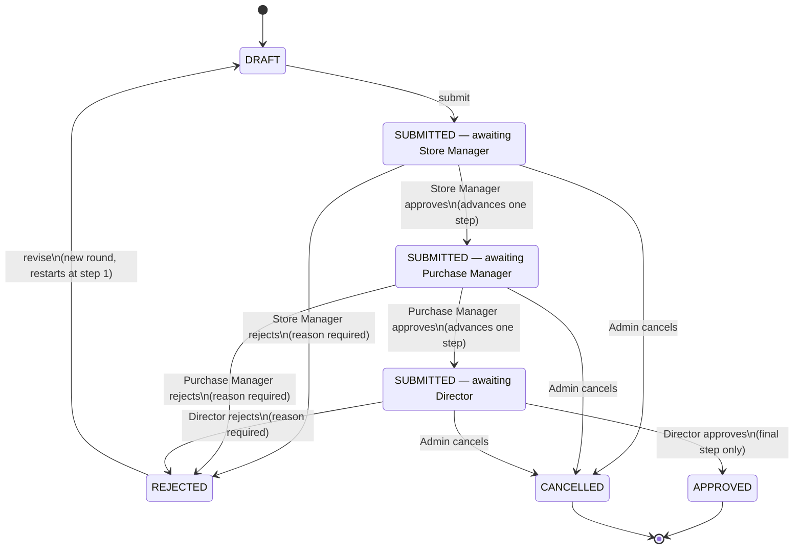

# Purchase Workflow — Design Proposal (Task 08B preparation)

**Status: superseded by implementation for the parts that were built;
still a proposal for everything else.** This document was originally
written before any of it existed, as design-only material for
discussion. Since then, Task 08B-1 (company-scoped Purchase Requests)
and Task 08B-2 (three-step Purchase Request approval) were both
implemented, tested, and are real, working code today - see their
"Implementation status update" sections further down in this same
document, and `docs/backend-tasks.md` for the authoritative technical
write-up of what actually shipped. **This top section and the sections
immediately below it are preserved unedited as a historical record of
the original proposal** - read them as "what was being discussed
before Task 08B-1/08B-2 existed," not as a live description of the
current system. Anything in this document not explicitly marked
"Implementation status update" or "Complete" elsewhere remains an
unimplemented proposal, most notably Purchase Order issue/send-adjacent
questions this document never resolved (see `docs/purchase-order-
proposal.md` for the Purchase Order side of this instead, Tasks
08C-1/08C-2).

This document was prepared while Task 08A's full verification run
(`bvevjqcsd`) was still in progress; no backend code, migration, or
existing data was touched while preparing it. See the end of this
document's companion handoff message for that run's confirmed result.

## 0. What already exists (grounding for this proposal)

Reused, not duplicated, by everything below:

| Existing model | App | Relevant fields |
|---|---|---|
| `Company` | `apps.companies` | `code`, `legal_name`, `display_name`, `is_active` |
| `CompanyMembership` | `apps.companies` | `user`, `company`, `is_active` — company access |
| `SharedStore` | `apps.stores` | `code`, `name`, `is_active` — no owning-company FK, shared by design |
| `StoreMembership` | `apps.stores` | `user`, `store`, `is_active` — store access, independent of company access |
| `StorageLocation` | `apps.stores` | `store`, `code`, `name`, `is_active` |
| `Supplier` | `apps.suppliers` | `code`, `legal_name`, contact/address fields, `is_active` — shared directory, no company/store FK |
| `UnitOfMeasure` | `apps.catalog` | `code`, `name`, `dimension`, `is_active` — no conversion engine |
| `MaterialCategory` | `apps.catalog` | `code`, `name`, `is_active` |
| `Material` | `apps.catalog` | `code`, `name`, `kind` (`RAW_MATERIAL`/`PACKAGING_MATERIAL`), `category`, `base_unit`, `is_active` — shared catalog, no company/store FK, no stock field |
| `PermissionDefinition` | `apps.permissions` | `code`, `module`, `scope` (`COMPANY` or `STORE` only — **no `GLOBAL` scope exists**), `is_active` |
| `CompanyRole` / `StoreRole` | `apps.permissions` | company- and store-scoped role containers, each holding a permission set |
| `AuditLog` | `apps.audit` | `actor`, `action`, `target_type`, `target_id`, `company` (nullable), `store` (nullable), `before`/`after` JSON, `created_at` |

Every proposal in this document builds on these as-is. **No existing
model gains a new field and no existing model is duplicated** —
purchasing entities reference `Supplier`/`Material`/`UnitOfMeasure`/
`Company`/`SharedStore` by FK, exactly as `Material` already references
`UnitOfMeasure`/`MaterialCategory`.

---

## 1. Requirements and open decisions

### 1.1 Confirmed client requirements

These are treated as given, not open for redesign in this document:

1. Two companies use a common physical store.
2. Material shortages may require purchase.
3. Users need to see whether ordered material has arrived or is pending.
4. Both raw materials and packaging materials are involved.
5. Changes must be traceable.
6. Company access and shared-store access are separate (already true of
   the existing codebase — `CompanyMembership` and `StoreMembership` are
   independent, and this document's proposals preserve that separation
   rather than merge it).
7. **Confirmed at Task 08B-1 (supersedes this document's original
   treatment of this as open):** a `PurchaseRequest`'s `company` is the
   company that **needs** the material — the internal requester, not
   necessarily the company that will eventually place the resulting
   Purchase Order, receive the supplier's bill, or legally own the
   stock once it arrives. Example given: Company B requests 100
   bottles; which company actually purchases/bills for those bottles is
   decided separately, later, at PO stage (still open — see item 1 in
   section 1.3 below, which now refers *only* to the PO-stage decision,
   not to what a PurchaseRequest's `company` means).

### 1.2 Proposed design choices (this document's own proposals)

Everything else in this document — the Purchase Request → Purchase Order
→ Receipt split, the specific fields, the specific permission codes, the
specific screens — is a **proposal**, offered because *something*
concrete is needed to have a productive conversation with the client, not
because it has been requested in this exact shape. Each proposal is
labelled `PROPOSED` at first mention below.

### 1.3 Unresolved client decisions (blocking, in priority order)

These cannot be guessed at or defaulted without risking a design that
has to be unwound later. This document does **not** answer them; it
shows, for each, what part of the design is blocked until it is
answered.

| # | Open question | What it blocks |
|---|---|---|
| 1 | **Which company places each Purchase Order, and which company receives the supplier's bill?** (Narrowed at Task 08B-1: this is now specifically the *PO-stage* question — the *PR-stage* question, "whose need does a PurchaseRequest represent," is confirmed as item 7 in section 1.1 above.) | The purchasing/billing-company field on `PurchaseOrder`; whether one PO can serve both companies' needs at once or each company must raise its own; whether a PO's company is always the same as its source PR's company or can legitimately differ (e.g. Company B requests, Company A ends up placing and paying for the order). |
| 2 | **Legal ownership of stock in the shared store.** | Whether received material belongs to the ordering company only, is jointly owned, or is owned by some other construct (e.g. "the store" itself, if that is ever given legal/accounting meaning). Directly affects any future stock-ledger design, not just purchasing. |
| 3 | **Whether/how one company uses another company's material.** | Whether a "transfer" or "cross-charge" concept is needed at all, and if so, whether it is a purchasing concern or a separate future task. |
| 4 | **Who approves purchases, and how many approvals are required.** | The approval state machine in section 2, the approval permission(s) in section 4, and the "Approval inbox" screen in section 5. **The earlier "three signatures" discussion is explicitly not treated as a confirmed approval-level requirement anywhere in this document** — see the note at the end of section 2. |
| 5 | **Supplier qualification requirements.** | Whether a PO can be raised against any active `Supplier` row (today's only gate) or whether a qualification/approval status must exist on `Supplier` first — Task 08A explicitly left this unmodelled. |
| 6 | **Purchase units, currency, taxes, and document numbering.** | Whether `UnitOfMeasure` is sufficient for purchase-line quantities as-is (likely yes, no proposal needed) or whether purchase-specific units are needed; currency/tax fields are explicitly **not** designed in section 3; a human-readable PO/PR number format (vs. the internal numeric PK) is undecided. |

---

## 2. Proposed workflow

```
Material need  →  Purchase Request  →  Review / Approval  →  Purchase Order  →  Receipt tracking  →  (future) QC acceptance
   (informal)         (internal)          (internal)            (external,        (physical arrival)      (separate task)
                                                                 supplier-facing)
```

All boxes after "Material need" are `PROPOSED`. Nothing about the number
of stages, their names, or their order has been confirmed by the client.

### 2.1 Stage meanings

- **Purchase Request (PR)** — records an *internal* need: "we are short
  of X, we should buy some." A PR is never supplier-facing; a supplier
  never sees it and no money is committed by creating one. It exists so
  the need, and who raised it and why, is traceable before anyone
  commits to a specific supplier or price.
- **Review / Approval** — an internal decision on the PR: approve
  (allow it to proceed toward a PO), reject (stop it, with a reason), or
  request changes. **The number of approval steps, and who holds
  approval authority, is entirely unresolved** (open question 4) — this
  document proposes a single approve/reject step only as the *simplest
  possible placeholder* to make the rest of the design concrete, not as
  a recommendation of "one approval is correct." A multi-level chain
  (e.g. two or three sequential approvers) would change the state
  machine below from a single `PENDING_APPROVAL → APPROVED/REJECTED`
  transition into a sequence of such transitions, but would not change
  anything else in this document — the PR/PO/Receipt separation, the
  line-item design, and the audit approach are all independent of how
  many approval steps there turn out to be.
- **Purchase Order (PO)** — records what is actually ordered *from a
  specific supplier*, at a specific price, for specific quantities. A PO
  is the first point where a supplier-facing document exists. **Creating
  or approving a PO does not, by itself, increase any stock figure
  anywhere** — no stock model exists yet (Task 07B explicitly deferred
  it), and even once one exists, a PO is a commitment to receive
  material in the future, not evidence that it has arrived.
- **Receipt tracking** — records what has *physically arrived* against a
  PO, partially or fully, over one or more deliveries. This is where
  "has the ordered material arrived or is it pending" (confirmed
  requirement 3) is answered from.
- **QC acceptance** — a *separate* concern from receipt: a receipt says
  "N units physically arrived at location L"; QC acceptance says "of
  those N units, M are usable and the rest are rejected/quarantined."
  This document does not design QC acceptance (it depends on a future
  lot/QC task that does not exist yet — Task 07B's `StorageLocation`
  docstring already makes the same point: a location's name never
  implies QC status). Section 3 only reserves a link point for it.

### 2.2 Proposed states (PROPOSED — not confirmed)

**PurchaseRequest**: `DRAFT → SUBMITTED → APPROVED | REJECTED`, plus
`CANCELLED` (reachable from `DRAFT` or `SUBMITTED`, never from a decided
state). A `DRAFT` is freely editable by its creator; once `SUBMITTED` it
is read-only pending a decision — mirroring how every existing lifecycle
resource in this codebase treats "draft edits are open, submitted/decided
records are not."

**PurchaseOrder**: `DRAFT → ISSUED → PARTIALLY_RECEIVED → FULLY_RECEIVED`,
plus `CANCELLED` (reachable from `DRAFT` or `ISSUED`, and — see section
3.5 — as a *line-level* remaining-quantity cancellation once some
receipt has already happened, not just a whole-order state). A PO is
only created from an `APPROVED` PurchaseRequest in this proposal, never
standalone — see section 3.1 for why, and section 6 for why this
specific rule is one of the first things to confirm or reject with the
client.

Every transition above is a **proposal**. In particular, whether a PO
even needs its own `DRAFT` state (versus being created already `ISSUED`
straight from an approved PR) is open, and depends on whether the client
wants a review step between "PR approved" and "supplier actually
contacted."

---

## 3. Data design proposal

All model/field names below are proposals (`PROPOSED`), written in the
same style as the existing codebase's models for consistency, not as
final class definitions.

### 3.1 Entities and relationships

```
Company ───────< PurchaseRequest >───────< PurchaseRequestLine >─── Material
   (requesting company -                    (needed qty, unit)         UnitOfMeasure
    CONFIRMED, see 1.1 item 7)
                       │
                       │ approved PR becomes the basis for
                       ▼
Company ───────< PurchaseOrder ─────── Supplier
   (purchasing/billing    │  (delivery_store: SharedStore)
    company - OPEN,        │
    question 1)            ▼
                  PurchaseOrderLine ─── Material, UnitOfMeasure
                       │
                       │ (future task, reserved link point only)
                       ▼
                  ReceiptLine (NOT designed here) ─── StorageLocation
```

- **`PurchaseRequest`** (`PROPOSED`, new app `apps.purchasing`;
  **implemented as Task 08B-1** - see docs/backend-tasks.md, Task
  08B-1, for the actual shipped contract): `company` (FK `Company`,
  `PROTECT`, immutable after creation - **confirmed** to mean the
  company that needs the material, per 1.1 item 7; see the
  "purchasing-company vs. delivery-store" discussion below for why this
  is *not* necessarily the same company that ends up on the resulting
  PO), `created_by`/`submitted_by`/`cancelled_by` (FK user), `status`,
  `notes`, timestamps. No supplier, no price — a PR is purely internal.
- **`PurchaseRequestLine`**: `purchase_request` (FK, `PROTECT` or
  cascade-within-the-same-aggregate — see section 3.7), `material` (FK
  `Material`, `PROTECT`), `requested_quantity` (decimal), `unit` (FK
  `UnitOfMeasure`, `PROTECT` — copied from `material.base_unit` at
  creation time, not re-derived later; see snapshot discussion in 3.6),
  `reason`/`notes`.
- **`PurchaseOrder`**: `company` (FK `Company`, `PROTECT`), `supplier`
  (FK `Supplier`, `PROTECT`), `delivery_store` (FK `SharedStore`,
  `PROTECT` — see below), `source_purchase_request` (FK
  `PurchaseRequest`, `PROTECT`, nullable only if standalone POs are ever
  allowed — open question, see 3.1 note below), `status`, timestamps.
- **`PurchaseOrderLine`**: `purchase_order` (FK), `material` (FK
  `Material`, `PROTECT`), `ordered_quantity`, `unit_price` (decimal, no
  currency field yet — see section 3.3), `unit` (FK `UnitOfMeasure`,
  `PROTECT`), plus the derived-quantity fields in section 3.5.
- **Approval/action history**: `PROPOSED` as a **thin, purpose-built
  table** (`PurchaseRequestDecision` or similar: `purchase_request`,
  `decided_by`, `decision` (`APPROVED`/`REJECTED`), `comment`,
  `decided_at`) rather than trying to generalise `AuditLog` into a
  workflow-history table. `AuditLog` already records *that* a status
  changed (via the existing `record()` pattern, reused unchanged); a
  dedicated decision table is proposed only because "who approved this
  and why" is business data a screen needs to display prominently
  (section 5), not just an audit trail a superuser inspects — the same
  reasoning that would apply to any approval workflow, not something
  specific to purchasing. If the client confirms only ever one approval
  step ever exists, this table may be unnecessary and the audit log
  alone could suffice — worth revisiting once open question 4 is
  answered.
- **Future receipt-line link**: `PurchaseOrderLine` reserves a
  `received_quantity`/`cancelled_quantity` pair (section 3.5) that a
  future `Receipt`/`ReceiptLine` model would update, but **no
  `Receipt`/`ReceiptLine` model is designed in this document** — only
  the fields on `PurchaseOrderLine` that such a future model would need
  to reference and update are reserved, per the brief's explicit scope
  limit ("future receipt-line links" only).

**Why a new app, `apps.purchasing`**: purchasing is a new domain concern
distinct from `apps.catalog` (materials/units), `apps.suppliers`
(supplier identity), `apps.companies`, and `apps.stores` — following the
same "is this a genuinely new concern, or a child of an existing app"
test already applied in Tasks 07A/07B/08A.

**Open note on "PO only from an approved PR"**: this document proposes
that every PO trace back to an approved PR (full traceability of "why
was this ordered," confirmed requirement 5), but a standalone
"emergency PO with no PR" path is a realistic possibility the client may
want — if so, `source_purchase_request` becomes nullable and the
traceability requirement is satisfied by a mandatory `reason` field on
the PO itself instead. This is called out explicitly rather than
decided silently.

### 3.2 Purchasing-company context vs. delivery-store context

These are proposed as **two separate FKs**, never merged into one,
mirroring confirmed requirement 6 (company access and shared-store
access are separate):

- **`company`** (on `PurchaseRequest`, **confirmed** meaning; on
  `PurchaseOrder`, still `PROPOSED` and open) answers "whose need, or
  whose purchasing authority, is behind this document" — gated by a
  **`COMPANY`-scope** permission (section 4), consistent with
  `CompanyRole`/`CompanyMembership` already being the company-access
  mechanism. **A `PurchaseRequest`'s `company` is confirmed to mean the
  requesting company only** — it does not imply that company will place
  the eventual PO, receive the bill, or own the resulting stock (1.1
  item 7). A `PurchaseOrder`'s `company` therefore cannot simply be
  assumed equal to its source PR's `company`; whether it always matches,
  sometimes differs, or is chosen independently at PO stage remains open
  question 1.
- **`delivery_store`** (on `PurchaseOrder` only — a PR does not
  necessarily know yet where material will land) answers "which shared
  physical location should the supplier deliver to, and who is
  responsible for confirming its arrival" — gated by a **`STORE`-scope**
  permission, consistent with `StoreMembership`/`StoreRole`.

This split is exactly why `company` and `delivery_store` cannot be
collapsed into one field: **the company that authorizes the spend and
the store that physically receives the goods are answered by two
different permission systems that must stay independent** (confirmed
requirement 6), and a shared store by definition might receive for
either company's PO. Which specific value goes in `company` for a given
real-world purchase remains open question 1 — this section only fixes
*that* there are two separate fields, not what populates the `company`
one in practice.

### 3.3 Decimal quantities and unit prices

`PROPOSED`: `DecimalField(max_digits=14, decimal_places=3)` for all
quantities (three decimal places accommodates fractional kilograms/
litres without inventing a unit-conversion engine — consistent with
Task 07B's explicit "no conversion engine" boundary, since this is
storage precision, not conversion), and `DecimalField(max_digits=14,
decimal_places=2)` for `unit_price` (no currency field — see open
question 6; a bare decimal is proposed as a placeholder only, not a
design that assumes a single-currency business). `FloatField` is
deliberately avoided everywhere quantities or money are involved, for
the standard reason (binary floating-point rounding is unacceptable for
either).

### 3.4 No currency/tax calculation, no unit conversion (explicitly out of scope here)

Per the brief: this document does not design currency handling, tax
calculation, or any unit-conversion logic. `unit_price` above is a bare
number with no currency attached — deliberately incomplete, flagged as
blocked on open question 6, not an oversight.

### 3.5 Ordered, received, cancelled, and outstanding quantities

`PROPOSED`, on `PurchaseOrderLine`:

- `ordered_quantity` — fixed at PO issue time, never edited afterward
  (mirrors every "immutable after creation" field already established
  in this codebase, e.g. `Material.code`).
- `received_quantity` — cumulative, updated only by a future receipt
  model (never edited directly through the PO API).
- `cancelled_quantity` — the portion of the *remaining* (not yet
  received) ordered quantity explicitly cancelled, e.g. a supplier
  confirms only half of a line can ever be fulfilled.
- `outstanding_quantity` — **computed, never stored**: `ordered_quantity
  - received_quantity - cancelled_quantity`. Storing it directly would
  risk drift between the stored value and its components after
  concurrent updates (see 3.8); computing it on read (in a serializer or
  a property) is the same "don't store what can drift" reasoning already
  applied throughout this codebase (e.g. `Material`'s category-active
  check is service-layer logic, not a cached flag).

**Partial deliveries**: modelled simply as `received_quantity` growing
across multiple receipt events over time, each one (in the future
receipt model) presumably contributing a `ReceiptLine` row that
increments the parent `PurchaseOrderLine.received_quantity` inside the
same transaction it creates the receipt row — not designed further here,
only the increment target is reserved.

**Cancelling remaining quantity**: proposed as a line-level action
(`cancel remaining` on a `PurchaseOrderLine`), not only a whole-PO
cancellation — a PO can be partially received and then have its
remainder cancelled, which is a materially different, and more common,
real-world case than cancelling an untouched order outright. Whole-PO
`CANCELLED` (section 2.2) is proposed as reachable only before any
receipt has happened; once any line has `received_quantity > 0`, only
line-level remaining-quantity cancellation is offered, never a full PO
cancellation that would have to explain away material that already
physically arrived.

**Separating received from QC-approved/rejected quantities**: `received_
quantity` above means "physically counted as arrived," full stop — it
carries no judgement about usability. Any `qc_approved_quantity`/
`qc_rejected_quantity` figures belong on a future QC/lot model tied to a
`ReceiptLine`, never on `PurchaseOrderLine` itself, so that "how much
arrived" and "how much of what arrived is usable" can never be
conflated into one field the way `StorageLocation.name` was explicitly
prevented from implying QC status in Task 07B.

### 3.6 Historical document snapshots

**Proposal**: `PurchaseOrderLine` (and `PurchaseRequestLine`) store a
small set of **snapshot fields** captured at creation time — e.g.
`material_code_snapshot`, `material_name_snapshot`, `unit_code_snapshot`,
and (on the PO side) `supplier_legal_name_snapshot` — *in addition to*
the live FK references. The FK stays for querying/joining ("show me
every PO line for this material"); the snapshot is what a printed or
displayed document actually shows, so that renaming a `Material` or a
`Supplier` after a PO was issued never silently rewrites a document that
was already sent to, or received from, a real supplier. This is a
stronger guarantee than relying on `AuditLog`'s before/after history to
reconstruct a document's original face value on demand — the audit log
is an internal administrative trail (see `docs/backend-decisions.md`'s
existing audit-coverage-boundary notes), not designed to be queried live
every time a document is rendered.

### 3.7 Concurrency, duplicate submissions, audit atomicity

All three follow patterns already established and proven in this
codebase, reused rather than reinvented:

- **Concurrent state changes** (e.g. two people approving the same PR at
  once): `select_for_update()` inside the transitioning service
  function, the same technique `apps.permissions.services.assign_role()`
  already uses to avoid a race between two callers both seeing "not yet
  decided" and both trying to decide it.
- **Duplicate submissions** (e.g. a double-click on "Submit for
  approval"): the transition function re-checks the *current* status
  after acquiring the row lock, before applying the transition — a
  second, redundant call to an already-applied transition (e.g.
  approving an already-`APPROVED` PR) is proposed to behave as an
  idempotent no-op (`200`, unchanged state), exactly like every
  activate/deactivate endpoint in this codebase today; a transition
  attempted from a state that cannot reach the target at all (e.g.
  trying to approve a `REJECTED` PR) is a `400`, not a silent no-op.
- **Audit atomicity**: every state-changing service function wraps its
  business mutation and its `apps.audit.services.record()` call in one
  `@transaction.atomic` block, `record()` called last, so an audit-write
  failure rolls back the mutation — the identical pattern used by every
  service function in `apps.catalog`, `apps.stores`, and `apps.suppliers`
  today, with no new pattern introduced.

### 3.8 What this section deliberately does not do

No currency, no tax, no unit-conversion engine (section 3.4); no
`Receipt`/`ReceiptLine` model (reserved, not designed); no QC/lot model;
no stock-ledger or valuation model; no document-numbering scheme beyond
the database primary key (open question 6).

---

## 4. API and authorization proposal

**Every endpoint below is `NOT IMPLEMENTED`.** This is a proposal for
what a future implementation task would build, not a description of
anything that exists today.

### 4.1 Proposed permission codes (none seeded, none exist yet)

Following the existing `module.action` convention and the existing
`COMPANY`/`STORE`-only scope model (no `GLOBAL` scope, consistent with
every prior task's explicit constraint):

| Code (`PROPOSED`) | Scope | Purpose |
|---|---|---|
| `purchasing.request.create` | `COMPANY` | Create/edit a `DRAFT` PR for one's company. |
| `purchasing.request.view` | `COMPANY` | View PRs belonging to one's company. |
| `purchasing.request.approve` | `COMPANY` | Approve/reject a submitted PR. **Whether this is one permission or several sequential ones is blocked on open question 4.** |
| `purchasing.order.create` | `COMPANY` | Issue a PO from an approved PR. |
| `purchasing.order.view` | `COMPANY` | View POs (and their prices) belonging to one's company. |
| `purchasing.order.cancel` | `COMPANY` | Cancel a PO or a line's remaining quantity. |
| `receiving.delivery.view` | `STORE` | View pending/partial deliveries expected at a specific store — **no purchase price visible**, only material, quantity, and status. |
| `receiving.receipt.create` | `STORE` | Record a physical receipt against a PO line at a specific store (once the future receipt model exists). |

### 4.2 Explicit authorization boundaries (proposed)

- **Ordinary store users never see purchase prices or another company's
  purchase records.** `receiving.delivery.view`/`receiving.receipt.create`
  are `STORE`-scope and are proposed to expose only material/quantity/
  status — never `unit_price`, never any PR/PO belonging to a company the
  viewer has no `COMPANY`-scope purchasing permission for. This is the
  same "shared store, private prices" split confirmed requirement 6
  already implies.
- **Company purchasing permissions never grant store-receiving access,
  and vice versa** — mirrors the existing `shared_catalog.view`
  (any-store) vs. `storage_locations.view` (specific-store) split from
  Task 07B exactly, just applied to a new pair of resources.
- **A superuser administrative-read exception**, if wanted, would follow
  the same narrowly-scoped precedent already used for
  `shared_catalog.view`/`storage_locations.view` (read-only, grants
  nothing else) — proposed as consistent with existing convention, not
  as a new idea.

### 4.3 Proposed endpoints (`NOT IMPLEMENTED`)

| Method | Path (`PROPOSED`) | Purpose | Required access (`PROPOSED`) |
|---|---|---|---|
| `GET` | `/api/v1/purchase-requests/` | List PRs for companies the caller has `purchasing.request.view` in | `purchasing.request.view` |
| `POST` | `/api/v1/purchase-requests/` | Create a `DRAFT` PR | `purchasing.request.create` |
| `GET` | `/api/v1/purchase-requests/<id>/` | PR detail, with lines | `purchasing.request.view` |
| `PATCH` | `/api/v1/purchase-requests/<id>/` | Edit a `DRAFT` PR (rejected once submitted) | `purchasing.request.create` |
| `POST` | `/api/v1/purchase-requests/<id>/submit/` | `DRAFT` → `SUBMITTED` | `purchasing.request.create` |
| `POST` | `/api/v1/purchase-requests/<id>/approve/` | `SUBMITTED` → `APPROVED` — **rule depends on open question 4** | `purchasing.request.approve` |
| `POST` | `/api/v1/purchase-requests/<id>/reject/` | `SUBMITTED` → `REJECTED`, with a reason | `purchasing.request.approve` |
| `POST` | `/api/v1/purchase-requests/<id>/cancel/` | `DRAFT`/`SUBMITTED` → `CANCELLED` | `purchasing.request.create` |
| `GET` | `/api/v1/purchase-orders/` | List POs | `purchasing.order.view` |
| `POST` | `/api/v1/purchase-orders/` | Issue a PO from an `APPROVED` PR — **whether standalone POs are ever allowed depends on the open note in 3.1** | `purchasing.order.create` |
| `GET` | `/api/v1/purchase-orders/<id>/` | PO detail, with lines and cumulative received/cancelled/outstanding quantities | `purchasing.order.view` |
| `POST` | `/api/v1/purchase-orders/<id>/cancel/` | Cancel a PO (only before any receipt) | `purchasing.order.cancel` |
| `POST` | `/api/v1/purchase-orders/<id>/lines/<line_id>/cancel-remaining/` | Cancel a line's outstanding quantity | `purchasing.order.cancel` |
| `GET` | `/api/v1/stores/<store_id>/pending-deliveries/` | Store-scoped list of outstanding PO lines expected at this store, prices excluded | `receiving.delivery.view` |

Every row above is a proposal for a future task, not a commitment to
this exact URL shape, method, or field set.

---

## 5. Screen outline (no frontend implementation)

All `PROPOSED`, listed in plain terms for discussion, not as UI specs.

### 5.1 Purchase Requests — list

- **Fields shown**: PR number/id, requesting company, status, requested
  date, requested-by, line count.
- **Actions**: open detail, create new (if `purchasing.request.create`),
  filter by status/company.
- **Statuses shown**: `DRAFT`/`SUBMITTED`/`APPROVED`/`REJECTED`/
  `CANCELLED`.

### 5.2 Purchase Requests — form (create/edit a `DRAFT`)

- **Fields**: company (fixed to the user's authorized company, not
  freely chosen), one or more lines (material, requested quantity, unit
  — defaulted from the material's base unit), notes.
- **Actions**: save draft, add/remove line, submit for approval, cancel.

### 5.3 Purchase Requests — detail

- **Fields**: everything from the form, read-only once submitted, plus
  the decision history (who approved/rejected, when, and any comment —
  section 3.1's decision table).
- **Actions**: approve/reject (only visible to a holder of
  `purchasing.request.approve`, only while `SUBMITTED`), cancel (only
  while `DRAFT`/`SUBMITTED`).

### 5.4 Purchase Orders — list

- **Fields**: PO number/id, supplier, delivery store, company, status,
  issue date, total value (if prices are visible to this viewer).
- **Actions**: open detail, filter by status/supplier/store.

### 5.5 Purchase Orders — form (create from an approved PR)

- **Fields**: source PR (pre-filled, read-only), supplier, delivery
  store, lines (material/quantity carried over from the PR, unit price
  entered here for the first time — a PR never has a price).
- **Actions**: save, issue.

### 5.6 Purchase Orders — detail

- **Fields**: everything from the form plus, per line: ordered/received/
  cancelled/outstanding quantity (section 3.5) — this is the screen that
  directly answers confirmed requirement 3, "has it arrived or is it
  pending."
- **Actions**: cancel (whole order or per-line remaining quantity, per
  the rules in 3.5), (future) record a receipt.

### 5.7 Approval inbox — **only if the client confirms an approval step exists at all**

- **Fields**: PRs currently `SUBMITTED` and awaiting this viewer's
  decision.
- **Actions**: approve, reject (with a required reason).
- Entirely contingent on open question 4; not designed further than
  "a filtered view of section 5.1's list, scoped to items awaiting a
  decision," since the actual approval-chain shape is unknown.

### 5.8 Pending deliveries — store-scoped

- **Fields**: material, outstanding quantity, expected/ordered date,
  supplier name, delivery store — **no unit price, no company financial
  detail** (section 4.2).
- **Actions**: open the parent PO's non-price detail (if permitted),
  (future) record a receipt.
- Directly answers confirmed requirement 3 from the store side, for a
  viewer who may not hold any purchasing permission at all.

---

## 6. Implementation breakdown

Proposed as small, dependency-ordered slices — not a commitment to build
all of them, and not sized as sprints.

| # | Slice | Depends on | Can start before client clarification? |
|---|---|---|---|
| 1 | `apps.purchasing` app scaffold, `PurchaseRequest`/`PurchaseRequestLine` models + migrations only (no API yet) | Nothing new — reuses `Company`/`Material`/`UnitOfMeasure` as-is | **Partially** — the model *shape* (fields, FKs) can be scaffolded, but the `company` field's real-world meaning is still open question 1, so this would need revisiting if the answer changes who "owns" a PR |
| 2 | PR API: draft CRUD, submit, cancel (no approval yet) | Slice 1 | **Yes** — draft/submit/cancel do not depend on any of the 6 open questions |
| 3 | PR approval: decision model, approve/reject endpoints, permission `purchasing.request.approve` | Slice 2, **open question 4** | **No** — the number of approval steps and who holds authority must be answered first, or this would need rebuilding |
| 4 | `PurchaseOrder`/`PurchaseOrderLine` models + migrations, issued only from an `APPROVED` PR | Slice 3, **open questions 1 and 5** (which company, and whether supplier qualification gates PO creation) | **No** |
| 5 | PO API: create from approved PR, detail, cancel (whole-order and line-remaining) | Slice 4 | **No** (inherits slice 4's blockers) |
| 6 | Receipt tracking: `Receipt`/`ReceiptLine` design and implementation, updating `PurchaseOrderLine.received_quantity` | Slice 5, **open question 2** (ownership — does receiving change who legally owns the stock?) | **No** |
| 7 | Pending-deliveries store-scoped reporting endpoint/screen | Slice 5 (can show ordered/outstanding without receipts existing yet, in a degraded form) | **Partially** — a version showing "ordered, not yet receivable" is possible after slice 5 alone; full "arrived or pending" per confirmed requirement 3 needs slice 6 too |
| 8 | QC/inventory integration (QC acceptance quantities, stock-ledger entries) | Slice 6, a future stock/inventory task that does not exist yet, **open questions 2 and 3** | **No** — blocked on work outside this document's scope entirely |

**What can proceed today, in short**: slices 1–2 (PR creation/submission/
cancellation, without approval or any PO). **Everything from slice 3
onward is blocked on at least one of the six open questions in section
1.3.**

### 6.1 Acceptance scenarios (illustrative only — not executable tests)

- *Given* an active `CompanyRole` holder with `purchasing.request.create`
  for Company A, *when* they create a PR with two lines for materials
  belonging to the shared catalog, *then* the PR is created `DRAFT`,
  editable, with no supplier and no price anywhere on it.
- *Given* a `DRAFT` PR, *when* its creator submits it, *then* it becomes
  `SUBMITTED` and is no longer editable via `PATCH`.
- *Given* a `SUBMITTED` PR, *when* a second, unrelated approval request
  races the first (two concurrent `approve` calls), *then* exactly one
  `AuditLog` "approved" entry and one decision-history row are created,
  never two.
- *Given* an `APPROVED` PR, *when* a PO is issued from it against an
  active `Supplier` and an active `SharedStore`, *then* the PO's lines
  snapshot the material/unit identity at that moment, and the PO's
  status is `ISSUED` with every line's `received_quantity` at zero.
- *Given* an `ISSUED` PO with one line of ordered quantity 100, *when* a
  future receipt records 60 units arrived, *then* that line's
  `received_quantity` is 60, `outstanding_quantity` is 40, and the PO's
  own status becomes `PARTIALLY_RECEIVED`, all inside one transaction
  with its audit entry.
- *Given* a `PARTIALLY_RECEIVED` PO line with 40 outstanding, *when*
  its remaining quantity is cancelled, *then* `cancelled_quantity`
  becomes 40, `outstanding_quantity` becomes 0, and the whole-PO
  `CANCELLED` state is never applied (only the line's remainder is
  affected, since 60 units already physically arrived).
- *Given* a `StoreMembership`-only user (no `CompanyMembership` and no
  purchasing permission at all) with `receiving.delivery.view` for the
  delivery store, *when* they view pending deliveries, *then* they see
  material/quantity/status for every company's outstanding lines at that
  store, but no `unit_price` field appears anywhere in the response.

---

## Implementation status update (added after Task 08B-1)

Slice 1 and part of slice 2 from section 6's breakdown have since been
**implemented**: `PurchaseRequest`/`PurchaseRequestLine` (draft
create/edit, submission, cancellation, list/detail, COMPANY-scoped
permissions, optimistic-concurrency versioning, audit) now exist as real
code, under `apps.purchasing`. This was possible without waiting on any
open question below **except** the one item this section itself
resolved — the confirmed meaning of a `PurchaseRequest`'s `company`
(section 1.1, item 7). See `docs/backend-tasks.md`, Task 08B-1, for the
exact shipped model fields, endpoints, permission codes, and version/
retry rules — this document is not updated to restate that contract in
full, only to record that the confirmed decision above is what unblocked
it. **`SUBMITTED` still does not mean approved**, no approval/rejection
workflow exists, and nothing about Purchase Orders, receipts, or stock
has been implemented — everything from slice 3 onward in section 6
remains exactly as blocked as before.

## Task 08B-2 — Purchase Request Approval (design proposal only, nothing built)

**Status: design only. No approval model, migration, permission, or API
exists yet.** This section proposes a *simple, discussable* shape for
review before any of it is built — it does not answer the business
questions below, and nothing here should be read as a decision.

### Reminder: what `PurchaseRequest.company` still means

Unchanged since Task 08B-1: `company` is the company that **needs** the
material. It does not establish which company will place the resulting
Purchase Order, receive the supplier's invoice, or legally own the
stock. Approval, whatever shape it takes, decides only "is this internal
need endorsed" — it says nothing about who pays or who owns anything,
and this proposal does not smuggle an answer to that in.

### Confirmed business decisions (this update)

1. **A requester must not approve their own request.** This applies no
   matter what - even if the requester happens to also hold the approval
   permission, and even if the requester is a Django superuser.
   Superuser status has never been an implicit business bypass anywhere
   in this codebase (`apps.permissions.services.effective_permission_
   codes()` never consults `is_superuser`, and Task 08B-1 already
   established "no implicit staff/superuser business bypass" for
   Purchase Requests specifically) - self-approval is a further,
   independent restriction on top of that, not something the existing
   permission model resolves by itself. It must be checked explicitly,
   in the service layer, by identity (the request's requester) rather
   than by permission or role membership.
2. **A rejected request may be revised and resubmitted** - rejection is
   not terminal the way cancellation is. See "Proposed workflow" and
   "Preserving decision history" below for how this is proposed to work
   without losing any prior round's record.
3. **Cancelling a request while it is awaiting approval (i.e.
   `SUBMITTED`) is restricted to an Admin.** This is a *business* role,
   not a Django concept - `is_superuser` must **not** be read as
   "Admin" here, and no company-role/permission mapping for "Admin" has
   been chosen (see open question 1 below). Cancelling a `DRAFT`
   request is unaffected by this - that remains a separate, already-
   confirmed policy from Task 08B-1 (any holder of
   `purchase_requests.view` + `purchase_requests.cancel`), scoped
   specifically to drafts, not touched by this new rule.

### Still-open decisions (not answered here)

1. **The exact approving role.** Is "Admin" (from confirmed decision 3
   above, and presumably also the approver for decision-making itself)
   a specific designated company role, or could a different, separately
   named role approve while a different one cancels? Which company
   roles/permissions actually carry that authority is undecided - see
   "A note on 'Admin'" below.
2. **Single-step versus multi-step approval, including the sequence.**
   One decision, or a chain (e.g. two or three sequential approvers,
   escalation by value)? Unknown — the "three signatures" mention from
   an earlier discussion is **not** treated as a confirmed answer here
   or anywhere in this document.

Everything below that depends on either open question says so
explicitly, rather than guessing.

### A note on "Admin" (important - read before implementing anything)

The business term "Admin" used in the confirmed decisions above is
**not** Django's `is_superuser` flag, and must not be implemented as
one. `is_superuser` is an administrative/Django-Admin-access concept in
this codebase (`apps.common.permissions.IsActiveSuperuser`) that has
never granted business/company access on its own - Task 08B-1 was
explicit that Purchase Requests have *zero* superuser business bypass.
"Admin" as a business role - someone with elevated authority *within a
company's* purchasing workflow - has no company-role or permission-code
mapping yet. This is exactly open question 1. Until it is answered,
nothing in this document proposes a concrete permission code for
"Admin," and no code should invent one.

### Concrete illustrative approval sequence (client-reviewable proposal — not a confirmed production policy)

Everything in this subsection is a **proposal**, offered as one concrete,
discussable shape rather than an abstract "single- or multi-step"
description. **"Store Manager," "Purchase Manager," and "Director" are
illustrative role labels only** — their actual company-role/permission
mappings, and whether exactly three steps are required at all (versus
two, one, or a different sequence), are still-open question 2 from
above. Nothing here should be read as the number of steps or the role
names being decided.

**Proposed sequence:**

```
DRAFT → SUBMITTED / awaiting Store Manager
      → awaiting Purchase Manager
      → awaiting Director
      → APPROVED
```



**1. Each step, responsible role, and allowed actions (illustrative):**

| Step | Responsible role (illustrative — mapping unconfirmed) | Allowed actions |
|---|---|---|
| 1 | Store Manager | Approve (advances to step 2) or Reject (reason required, stops the round) |
| 2 | Purchase Manager | Approve (advances to step 3) or Reject (reason required, stops the round) |
| 3 | Director | Approve (**final** — request becomes `APPROVED`) or Reject (reason required, stops the round) |
| any | Business Admin (mapping unconfirmed) | Cancel the request while any step is pending — stops all further decisions for that round |

**Overall request states (illustrative sequence):**

| State | Meaning |
|---|---|
| `DRAFT` | Editable; no decision pending; requester may edit lines/notes and submit |
| `SUBMITTED` — awaiting Store Manager | Round in progress, step 1 of 3 pending |
| `SUBMITTED` — awaiting Purchase Manager | Round in progress, step 2 of 3 pending |
| `SUBMITTED` — awaiting Director | Round in progress, step 3 of 3 (final) pending |
| `APPROVED` | Every required step approved — terminal in this proposal |
| `REJECTED` | A step in this round rejected the request — not terminal; may be revised (`revise` → `DRAFT`) |
| `CANCELLED` | Requester cancelled a `DRAFT`, or an Admin cancelled a pending `SUBMITTED` round — terminal, no reopening |

**2. Approval advances exactly one step; only the final step's approval
sets `APPROVED`.** An approval at step 1 or step 2 never marks the
request `APPROVED` by itself — it only moves the pending step forward
one position. Only an approval at the *last* required step (Director, in
this illustration) transitions the request to `APPROVED`. This is
proposed as a plain step counter (`current_step`, 1-based) on the
request rather than a generic rule engine — see "What this section
deliberately does not do" below.

**3. Rejection at any step requires a reason and stops that approval
round immediately.** A rejection at step 1, 2, or 3 has the identical
effect: `status` becomes `REJECTED`, the round ends, and no further step
is evaluated — a request already rejected at step 1 is never also
"pending" at step 2. The reason requirement is identical to Task
08B-1's `cancellation_reason` (non-blank, bounded).

**4. Proposed revision behaviour — restarting from step one is itself a
proposal, not confirmed:** `REJECTED` → `DRAFT` (the `revise` transition
already described above) → the requester edits and resubmits → the new
round **starts again at step 1** (Store Manager, in this illustration),
regardless of which step the previous round was rejected at. This is
proposed because a revised request has, by definition, changed since the
step that rejected it saw it — re-running the full sequence from the
start is the conservative default that never lets a later step approve
material it never actually reviewed. Whether every revision genuinely
needs to restart from step 1 (versus resuming from the rejecting step)
is not confirmed and is flagged here explicitly as part of the proposal,
not as settled behaviour.

**5. Every round's snapshot and every decision are preserved, never
overwritten.** Task 08B-1's existing submitted-snapshot mechanism
(`material_code_snapshot`/`material_name_snapshot`/`unit_code_snapshot`/
`unit_name_snapshot`, frozen at `submit` time) already protects "what was
submitted" per round if `submit` is called again after a revision — each
resubmission is its own `submit` call and would freeze its own snapshot
the same way. The proposed `PurchaseRequestApproval` history table (see
"Preserving decision history" below) is extended with a `step` field
alongside its existing `cycle` field, so every decision permanently
records **which round, which step, who, when, what outcome, and (for a
rejection) why** — nothing from an earlier round or step is ever
updated or deleted by a later one.

**6. Pending-approval Admin cancellation applies at every step.** The
already-confirmed rule (cancelling a `SUBMITTED` request requires an
Admin) applies identically whether the request is awaiting Store
Manager, Purchase Manager, or Director — there is no step at which an
ordinary `purchase_requests.cancel` holder gains cancellation rights just
because a different step is pending. A successful Admin cancellation
stops all further decisions at whatever step was pending, the same way a
rejection does. The Admin role/permission mapping remains exactly as
unresolved as stated in confirmed decision 3 and the existing
mismatch note below — this sequence does not add a new mapping, only
confirms the rule applies uniformly across all three steps.

**7. If the requester is also the assigned approver for a pending step,
an eligible alternative approver is needed — self-approval is never
bypassed to work around a shortage of approvers.** This is a genuine,
unresolved edge case, not solved here: if, say, the Store Manager for a
company is the same person who raised the request, something else needs
to happen at step 1 - route to a different eligible Store Manager,
require a designated backup, or something else entirely. **No automatic
fallback (e.g. "skip the step," "auto-approve," "escalate silently to
the next step") is proposed** - inventing one would silently choose an
answer to a question nobody has confirmed. The one rule that is firm,
regardless of how this is eventually resolved: the requester can never
be the one who approves their own request, even if they are the only
person holding the relevant role.

**8. Version checks and row locking prevent duplicate and conflicting
decisions at every step, not just at a single decision point.** The same
mechanism already established for `submit`/`cancel`
(`select_for_update()` + `expected_version`, see "Version checks and
locking" below) applies to a decision at any step: two callers racing to
decide the same pending step get exactly one winner and one `409`; a
decision attempted against the wrong step (e.g. a Director trying to
approve while the request is still awaiting the Store Manager) is
rejected the same way a wrong-status transition is rejected today - the
acting user's role/permission must match the **specific step currently
pending**, not merely "holds some approval permission for this company
somewhere." How that per-step role check is expressed (a single
permission plus a step-role lookup, or per-step permission codes) is not
decided, since it depends on still-open question 1.

**9. Approval produces no Purchase Order and no stock movement,
automatically or otherwise, at any step, including the final one.**
Reaching `APPROVED` only means the internal need has cleared every
required review - unchanged from the very first line of this document.
Nothing about creating a Purchase Order from an `APPROVED` request is
designed here.

### Proposed endpoints (`NOT IMPLEMENTED`)

| Method | Path (`PROPOSED`) | Purpose |
|---|---|---|
| `POST` | `/api/v1/companies/<company_id>/purchase-requests/<id>/approve/` | `SUBMITTED` → `APPROVED` |
| `POST` | `/api/v1/companies/<company_id>/purchase-requests/<id>/reject/` | `SUBMITTED` → `REJECTED`, with a required reason |
| `POST` | `/api/v1/companies/<company_id>/purchase-requests/<id>/revise/` | `REJECTED` → `DRAFT` (new confirmed rule - reopens the same request for editing; the following `PATCH`/`submit` reuse Task 08B-1's existing endpoints unchanged) |

All three would sit alongside the existing `submit`/`cancel` endpoints
under the same company-scoped URL, following Task 08B-1's exact shape.
`approve/` and `reject/` are proposed as acting on **whichever step is
currently pending** (read from the request's own `current_step`, not
passed by the caller) - there is no `.../approve/step/2/`-style URL,
since the caller does not choose which step to decide, the request's own
state does.

### Proposed company-scoped permissions

At minimum, two new **COMPANY**-scope permissions (`PROPOSED`, not
seeded):

- `purchase_requests.approve` - required to call `approve/`/`reject/` at
  all. Whether one blanket permission is sufficient once a concrete
  multi-step sequence exists is now genuinely in question: the
  illustrative sequence above needs to tell a Store Manager from a
  Purchase Manager from a Director *for the step currently pending*, not
  just confirm "this user may decide something, somewhere in this
  company's approval flow." Two shapes are possible, neither decided
  here: (a) one `purchase_requests.approve` permission plus a separate
  per-step role/assignment lookup (who is "the" Store Manager for this
  company), or (b) per-step permission codes. Which shape fits depends
  entirely on still-open question 1 (the actual role mapping) and is not
  guessed at. This permission is deliberately **not** the same as
  "Admin" from the confirmed cancellation rule - approving and
  cancelling-while-pending may end up being the same people or different
  people; that mapping is exactly open question 1, and this document
  does not collapse the two into one permission by assumption.
- `purchase_requests.revise` - required to move a `REJECTED` request
  back to `DRAFT`. Proposed as its own permission rather than reusing
  `.edit` or `.create`, since "may reopen a rejected request" is a
  distinct authority from "may edit an already-open draft" - a company
  might reasonably want the original requester to revise their own
  rejected request without also granting them free rein to edit anyone
  else's draft. Whether it should instead simply reuse an existing
  permission is open for discussion, not decided here.

Both continue to require `purchase_requests.view` alongside them, same
"view is always required alongside a mutation permission" rule Task
08B-1 already established.

### Self-approval is enforced by identity, not by permission

Confirmed decision 1 (no self-approval, ever) cannot be expressed as a
permission check at all - `purchase_requests.approve` says "this user
may decide on requests in this company," not "this user may decide on
requests other than their own." The proposed enforcement is a plain
identity comparison in the service layer, evaluated *after* the
permission check and *before* any state change: `actor.id != purchase_
request.created_by_id` (or, if a request has been revised and
resubmitted by someone other than its original creator - not expected
in the normal flow, but not impossible - the identity to compare against
is still proposed as the original `created_by`, since that is who
"the requester" unambiguously means throughout this document). A
superuser or an "Admin"-mapped approver attempting to approve their own
request would still be rejected (`403`, most likely, or a dedicated
error - not decided) - this check has no exception for any role,
permission, or Django flag, by confirmed decision 1's own wording ("must
not... even if").

### Required rejection reason

Mirrors `PurchaseRequest.cancellation_reason` from Task 08B-1 exactly: a
non-blank, bounded `rejection_reason` required in the request body,
including on any retry. Approval needs no reason field, matching how a
plain `activate`-style transition elsewhere in this codebase never
requires one.

### Preserving decision history across revise/resubmit rounds

Confirmed decision 2 (reject → revise → resubmit) changes the actor/
timestamp design from what was proposed before this update. Plain
`decided_by`/`decided_at`/`rejection_reason` fields living directly on
`PurchaseRequest` - the same shape as `submitted_by`/`cancelled_by` -
would work for a *single* decision, but a second round's `reject` would
silently overwrite the first round's reason and actor the moment the
same fields are reused, which directly conflicts with "preserve previous
submissions, rejection reasons, actors and timestamps; do not overwrite
decision history." **Proposed instead**: a small, append-only
`PurchaseRequestApproval` (`PROPOSED`, naming open for discussion) table
- one row per decision, never updated or deleted:

| Field | Notes |
|---|---|
| `purchase_request` | FK, `PROTECT` or `CASCADE` (same composition-child reasoning as `PurchaseRequestLine`) |
| `cycle` | Which submit/decide round this belongs to (1 for the first submission, 2 after the first revise-and-resubmit, and so on) |
| `step` | Which step within that round this decision was for (1 = Store Manager, 2 = Purchase Manager, 3 = Director, in the illustrative sequence above — the actual step count/labels are unconfirmed, so this is a plain integer, not an enum of role names) |
| `decision` | `APPROVED` or `REJECTED` |
| `reason` | Blank for `APPROVED`, required (non-blank, bounded) for `REJECTED` |
| `decided_by` | FK user - who made this specific decision |
| `decided_at` | When |

`PurchaseRequest` itself keeps a `status` field as today, moving through
`DRAFT`/`SUBMITTED`/`APPROVED`/`REJECTED`/`CANCELLED`; the *current*
decision is always the latest row for that `purchase_request`, but every
earlier round's reason/actor/timestamp stays exactly as it was recorded,
readable in full at any time (e.g. for a detail screen showing "this was
rejected once before, here's why, then revised and approved"). This
mirrors the same "thin, purpose-built table, not a repurposed `AuditLog`"
reasoning the original proposal already used for approval history in
section 3.1, now made necessary rather than optional by the confirmed
revise-and-resubmit rule. `apps.audit.services.record()` continues to
record every transition too (`purchase_request.approved`/`.rejected`/
`.revised`), exactly as today - the new table is business data a screen
needs to display, not a replacement for the existing audit trail.

### Version checks and locking

Identical mechanism to `submit`/`cancel` today: `select_for_update()` on
the parent row, `expected_version` compared while holding the lock, a
mismatch returns `409` with nothing applied. Approve/reject would be
valid only from `SUBMITTED`; `revise` valid only from `REJECTED` (a
`DRAFT`, `APPROVED`, or `CANCELLED` request attempting any of these
would be rejected, `400`, the same way `submit` already rejects a
`CANCELLED` request today). Per Task 08B-1's established retry rule, a
call at the *current* version against a request already at the target
outcome would be an idempotent no-op; a conflicting outcome (e.g.
"approve" retried against a request already `REJECTED`) is a `400`, not
silently applied - the same "wrong state for this transition" handling
`submit`/`cancel` already use.

### How cancellation races would be handled

**Confirmed decision 3 above answers the business question**: cancelling
a `SUBMITTED` (pending-approval) request is restricted to an Admin - a
company role/permission mapping not yet chosen (see "A note on 'Admin'")
- and, per illustrative rule 6 above, this applies uniformly at every
step (awaiting Store Manager, Purchase Manager, or Director alike), not
just at one particular point in the sequence. What follows describes
only the *mechanism* two competing actions on the same request would
use, independent of who is allowed to trigger which one. Cancel and
approve/reject/revise would all compete for the same row lock exactly
the way two concurrent `submit` calls already do today
(Task 08B-1's `ConcurrentTransitionTests` regression-tests this exact
pattern for `submit`): whichever call acquires `select_for_update()`
first, checks `expected_version`, and commits first wins; the second
caller's `expected_version` no longer matches once it acquires the lock,
so it receives `409` and must refetch to see which outcome actually
happened (`CANCELLED`, `APPROVED`, or `REJECTED`) before deciding what to
do next. No new locking mechanism would be needed - the existing one
already generalises to any number of competing transitions.

### Existing cancellation behaviour: a confirmed mismatch, not fixed here

Inspecting the Task 08B-1 code as it stands today
(`apps.purchasing.views.PurchaseRequestCancelView`,
`apps.purchasing.services.cancel_purchase_request`): cancelling a
request currently requires only `purchase_requests.view` +
`purchase_requests.cancel`, with **no distinction between `DRAFT` and
`SUBMITTED`** - any holder of `purchase_requests.cancel` can cancel a
`SUBMITTED` request today, exactly the same as a `DRAFT` one. This now
**conflicts with confirmed decision 3**: cancelling a request awaiting
approval is supposed to be Admin-only, not "anyone with the ordinary
cancel permission." **This is a real, identified mismatch, not fixed in
this update** - per this task's own instructions, no permission or code
change is made until "Admin" has an actual company-role/permission
mapping (open question 1); silently repurposing `purchase_requests.
cancel` to mean "Admin," or silently introducing a new permission
without client confirmation, would be choosing an answer rather than
recording the question. **Cancelling a `DRAFT` request is unaffected and
stays exactly as it is today** - `purchase_requests.cancel` alone remains
sufficient for that case; only the `SUBMITTED` case is the identified
gap.

### Expected Postman scenarios (once built)

All `NOT IMPLEMENTED` - listed so the eventual "Purchase Request
Approval" Postman folder has a concrete target:

- Approve at step 1 (Store Manager, illustrative) → `200`, request
  advances to "awaiting Purchase Manager," **not** `APPROVED`.
- Approve at the final step (Director, illustrative) → `200`, status
  `APPROVED`.
- Reject at any step (1, 2, or 3) with a reason → `200`, status
  `REJECTED`, the round stops - no later step is ever evaluated.
- Reject without a reason, at any step → `400`.
- **The requester attempts to approve/reject their own request at any
  step → denied, regardless of holding `purchase_requests.approve` or
  being a superuser** (confirmed decision 1).
- A caller attempts to decide a step that is not currently pending (e.g.
  approve as "Director" while the request is still awaiting the Store
  Manager) → `400`.
- Revise a `REJECTED` request (→ `DRAFT`), edit it, resubmit it → the new
  round starts again at step 1 (illustrative rule 4), and the earlier
  round's decision(s) - reason, actor, timestamp, per step - are still
  visible afterward, unchanged (confirmed decision 2).
- An Admin cancels while the request is awaiting any of the three steps
  → `200`, status `CANCELLED`, no further step is evaluated.
- Approve/reject/revise/cancel with a stale `expected_version` → `409`.
- Approve/reject/revise/cancel attempted from the wrong status → `400`.
- A caller with `purchase_requests.view` only (no `.approve`/`.revise`)
  → `403`.
- A caller from a different company, or with no membership at all → `404`
  (same folding rule Task 08B-1 already uses).
- Two concurrent decisions on the same request (manual "run twice
  quickly" scenario, mirroring the automated `ConcurrentTransitionTests`
  coverage) → exactly one outcome wins, the other gets `409`.
- **A documented, expected gap once this scenario exists to test
  against**: cancelling a `SUBMITTED` request with only
  `purchase_requests.cancel` (no Admin role) currently succeeds - this
  is the confirmed mismatch above, to be closed once "Admin" has a
  permission mapping, not something this Postman folder should assume
  is already fixed.

### What this section deliberately does not do

No approval model, field, migration, permission seed, or endpoint has
been created. **The three-step Store Manager → Purchase Manager →
Director sequence is one concrete, illustrative example for discussion —
it is not a confirmed production policy, the role labels are not
confirmed company roles, and the step count is not confirmed either.**
No generic, configurable N-step workflow engine has been designed - the
illustrative sequence is fixed at three named steps for concreteness,
not built as data-driven configuration. No answer has been chosen for
either still-open question (the approving-role mapping, or single- vs
multi-step). The self-approval-as-sole-approver edge case (illustrative
rule 7) is identified, not resolved - no automatic fallback is proposed.
The identified cancellation mismatch has been reported, not fixed. No
Purchase Order, receiving, QC, or stock-transaction concept has been
added anywhere.

## Implementation status update (added after Task 08B-2)

Task 08B-2 is now **implemented** - see `docs/backend-tasks.md`'s Task
08B-2 section for the full endpoint/model/permission/verification
write-up and `docs/backend-decisions.md` for the reasoning behind each
implementation choice. This section records only how the *shipped*
design differs from the proposal above, so this document stays an
accurate record of what was proposed versus what the client actually
decided, rather than silently rewriting history.

**Both previously-open questions from this section were resolved by the
client's own implementation brief, not guessed at here**:

- **Step count and sequence**: confirmed at exactly three sequential
  steps - the illustrative count this proposal used throughout stood.
- **The approving-role mapping**: resolved to a single company-scoped
  permission, `purchase_requests.approve`, held by whoever a company
  assigns it to through the existing role APIs - not three different
  roles/permissions, one per step. "Business Admin" now means precisely
  "holds this permission." **The illustrative Store Manager / Purchase
  Manager / Director labels this section used were explicitly not
  adopted** - the shipped API and data model use neutral "step 1/2/3"
  numbering only, exactly as this section flagged as one of the two
  open possibilities.

**One new rule was introduced by the implementation brief that this
proposal had not yet raised**: a **provisional** restriction requiring a
*different* eligible approver at each step within one round - the same
person cannot decide two steps of the same round. This is explicitly
unconfirmed client policy, adopted conservatively (never silently
allowing same-admin-multi-step) rather than left undecided in code; see
`docs/backend-tasks.md`, Task 08B-2, for the exact rule and its
documented limitation (no automatic fallback if this leaves a step with
no eligible decider).

**The self-approval ban was implemented as a ban on self-*decision***
(covering rejection as well as approval) - a deliberate extension beyond
the literal "cannot approve their own request" wording, flagged as a
judgment call in `docs/backend-decisions.md` rather than presented as
something the client explicitly said.

The rest of this section's proposal (revise → new round → restart at
step 1; append-only, round-and-step-tagged decision history; per-step
snapshot preservation; Admin-only pending-cancellation as a permission
fix; version+round+step locking) was implemented as designed here,
without further changes.

## Summary of what remains unresolved

Every item in section 1.3's table **except** the now-confirmed PR-company
meaning (moved to section 1.1, item 7, and no longer listed in 1.3) and
the two Task 08B-2 approval questions this section originally listed
(step count/sequence and the approving-role mapping - both now resolved
and implemented; see "Implementation status update" above).

**One question raised by Task 08B-2's own implementation remains open**:
whether the same Admin may decide more than one step of the same
approval round. The shipped code answers this conservatively (no) as a
**provisional** restriction, not a confirmed policy - see
`docs/backend-tasks.md`, Task 08B-2, "Provisional (client-unconfirmed)
restriction adopted for this build."
